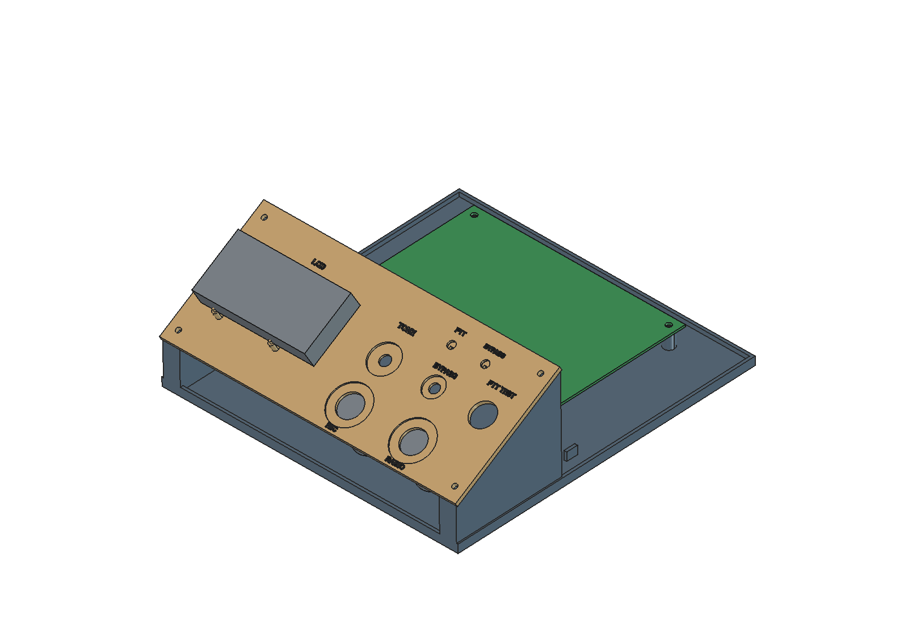
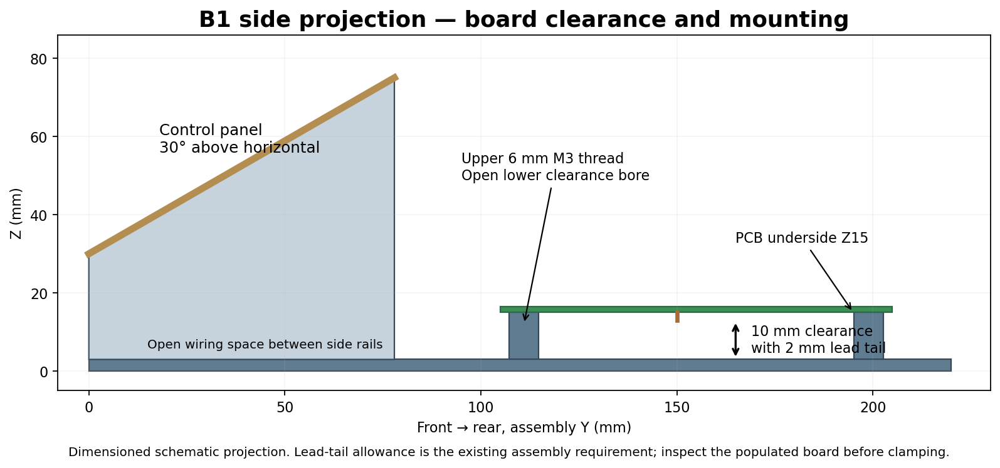
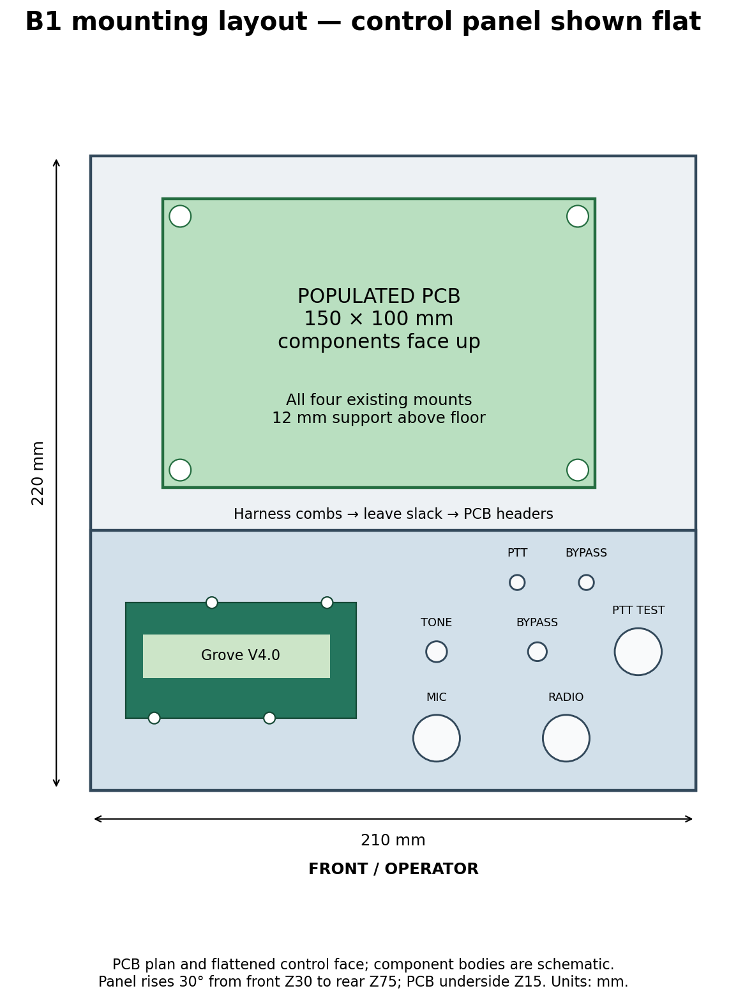
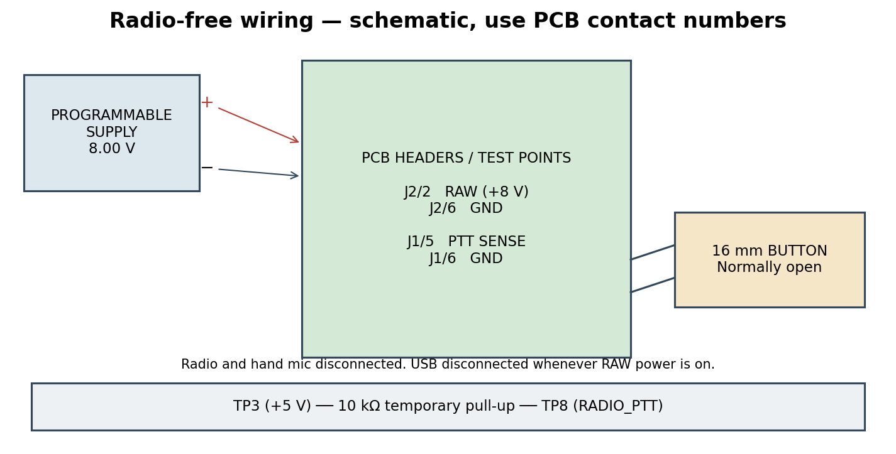

# Assembling and testing on the temporary bench holder

Use **PLA**, the already soldered PCB, the Grove LCD RGB Backlight V4.0, the
encoder, bypass switch, two 5 mm LEDs, two GX16-8 adapters and the inventory
**16 mm momentary push-button**. The radio and hand microphone stay disconnected.
The programmable supply provides **8.00 V**. No soldering takes place on this holder.

The control face rises **30° above horizontal** (selected default). Four nylon
**M3 × 0.5** screws fasten the PCB into the upper 6 mm of each printed support,
with an open 3.4 mm clearance bore below. Four
metal M3 screws fasten the control panel to the user's **M3 × D5 × L4** inserts.
The existing final enclosure remains deferred until the assembled board works.

*Native CAD view. Green is the PCB reference; gray display/connector blocks are
simplified clearance references, not printed parts. The real controls mount in
the labeled tan panel. Board components and cables are omitted for clarity.*

## Sequence at a glance

Open [bench-holder-b1.3mf](../manufacturing/bench-holder/bench-holder-b1.3mf)
**as a project** in Bambu Studio. All print meshes already have their intended
bed face at Z0. Keep that orientation; do not print the control panel at its
installed 30° angle.

| Step | File / plate | How it is held | Next action |
| --- | --- | --- | --- |
| 1 — Qualify interfaces | 3MF **01 - TEST FIT - interfaces** | Broad coupon faces flat on the bed | Accept threads, hardware bores and the angled insert trial before printing the base |
| 2 — Print base | Same project, **02 - FINAL - base** | Insulating floor down, side rails and PCB posts up | Cool, release, remove brim; inspect through threads and flatness |
| 3 — Print controls | Same project, **03 - FINAL - controls** | Panel back face down; keeper/spacers flat | Clean bores, lettering and ledges; inspect all eight labels |
| 4 — Install inserts | Base plus four M3 × D5 × L4 inserts | Base firmly supported, empty, before electronics installation | Let cool and test screws without the PCB installed |
| 5 — Assemble | Four nylon PCB screws; four metal panel screws | Base level on the bench | Seat PCB on all four supports, check clearances, then connect unpowered harnesses |
| 6 — Bring up | Programmable supply, multimeter; optional scope | Completed holder remains level | Follow staged 8 V tests below; record results |

Skip a qualification only when that exact interface has already passed in this
material, orientation and process. The prior Nucleo project establishes the
nylon screw's M3 thread identity, not a physical fit result for this new print.

## Tools and print settings

Have the fully soldered board and its off-board parts, the selected 16 mm button,
PLA, a small driver, one steel M3 cleanup screw, four nylon M3 screws, four metal
**M3 × 8** panel screws, four **M3 × D5 × L4** inserts, a temperature-controlled
insert tip, side cutters/deburring tools, and insulated temporary test leads.
The connector/switch/encoder's existing nuts retain those parts. No separate
purchased PCB standoffs, feet or panel brackets are needed.

The saved process uses **Bambu X1 Carbon, 0.4 mm nozzle, Generic PLA, Textured
PEI Plate, **0.20 mm default layers**, 0.20 mm first layer, 0.45 mm line width, 4 walls,
3 top / 3 bottom layers outside the thread band, 15% gyroid, 5 mm outer brim,
supports off**. The fine thread band uses 5 top / 5 bottom layers, preserving
the selected 0.6 mm skin thickness in both regions.
The resolved filament profile specifies **220 °C nozzle / 55 °C textured bed**.
These are installed-profile/selected print defaults, not physically qualified
settings. Only the base and PCB mount coupon have a **0.12 mm height-range
override from Z8.8 to Z15.2**, enclosing their actual Z9–15 thread region with
transition allowance. The panel, keeper, spacers and other coupons use 0.20 mm.
All plates use the same PLA slot and baseline process. The project carries the inherited
X1C speed/cooling settings rather than a separate hand-built machine profile.

The base is **210 × 220 × 75 mm** in print orientation, within the established
256 mm build volume. Packing reserves brim and avoids the X1C corner exclusion.
Print quantities are one base, one control panel, one LED keeper and four optional
2 mm PCB spacers, plus three independent fit coupons. The spacers are supplied
for longer nylon screws; ordinary short screws do not require them.

## Qualify, then print

1. Print plate 01 and let it cool before removal. Remove its brim without cutting
   mounting faces or rounding the trial-hole edges. The flat interface coupon
   presents, left to right, **16.3 mm PTT, 16.2 mm GX16, 7.2 mm encoder, 6.5 mm
   toggle and 5.2 mm LED** bores. The local grip thicknesses match production:
   PTT 3 mm, GX16 2 mm, encoder/toggle 1.5 mm. Check actual nuts engage and controls
   operate without forcing the plastic. The LED's underside flange seat and
   keeper-pin socket are also represented.
2. The mount coupon has two **PCB posts 88 mm apart, with 6 mm M3 thread at the
   top and an open lower clearance bore**, matching the base. With
   electronics clear, gently run the steel cleanup screw through each thread,
   then remove chips. Start the nylon screw by fingers. It must advance without
   cross-threading or substantial force. Trial the PCB's corresponding short-edge
   mounting pair without bending it. The same coupon includes the LCD's 40 mm
   mounting pair and the LED keeper's trial pin; test those actual parts too.
3. The angled insert coupon has **4.4 / 4.6 / 4.8** pilot sizes embossed beside
   the holes. Each trial has the actual support's **12 mm width, 30° hole axis
   and 5.5 mm pocket depth**. Start with the center **4.6** hole, which is the
   production default. Use a controlled tip at **200 °C as a selected starting
   setting**, aligned with the hole axis; support the coupon and use light pressure.
   Let the plastic flow, stop with the insert flush to the sloping face, withdraw
   straight, then let it cool fully. Establish the needed temperature/dwell on
   this coupon. Stop for cracking, major bulging, tilting or uncontrolled sinking.
4. After cooling, start a metal M3 screw freely and snug it gently against a
   suitable trial mating piece. The insert must remain square and stationary.
   Do not use the screw to pull a warm insert into position. If the center trial
   fails, try the adjacent sizes. **If another size wins, change `INSERT_PILOT_D`
   in the [native generator](../tools/build-bench-holder.py), rebuild and re-slice
   before printing the base.** Do not force the default hole to accept a failed fit.
5. Accept the coupons, then print plates 02 and 03. Let broad skins cool on the bed
   before flexing the plate. Remove brim, strings and loose chips. Check the base
   sits flat, supports are intact, screw holes are open, and lettering is complete.
   Do not drill or tap the PCB holes to correct a printed-fit problem.

Pilot diameter and installation settings are still physical qualification items.
The insert dimensions are established user inputs. General
[insert-hole guidance](https://www.spirol.com/resources/white-papers/how-to-design-the-proper-hole-for-heat-ultrasonic-inserts/)
supports extra depth below the insert and a clearance hole smaller than the insert
face; it is not an exact datasheet for this unbranded insert.

## Assemble and check mechanical clearance

*PCB plan and flattened control face. The native view above shows the installed
angle. Label positions on the printed panel identify every mounted component.*

1. Install the four inserts into the empty base using the accepted coupon recipe.
   Keep the base supported and the tip **30° from vertical**, perpendicular to
   the sloping mounting face. Seat the inserts flush, cool, and remove any raised
   flash without enlarging the holes. Test each M3 × 8 screw before installing
   electronics. With the 3 mm panel, that screw projects 5 mm into a 5.5 mm pocket:
   **0.5 mm nominal tip clearance**. No washer is included in that stack.
2. Mount the encoder, bypass toggle, 16 mm test button and both GX16-8 adapters
   from their labeled face. Use their supplied nuts; do not let the bodies turn
   and twist completed wiring. The **TONE** label must remain above the knob;
   **MIC** and **RADIO** remain below their connector flanges. Keep unused contacts
   insulated. Bypass position markings depend on the actual wired switch throw;
   the panel's BYPASS label identifies its function without assuming that throw.
3. Fit the two LEDs from underneath into their labeled flange seats. Slide their
   insulated leads through the keeper's open slots, and seat its two pins only
   after the coupon fit passes. The keeper captures both flanges with 0.2 mm
   nominal clearance. Do not use LED leads as mechanical retaining springs.
4. Seat the Grove V4 display on its four small supports/locators, rear PCB down,
   glass facing the operator. These use the manufacturer's **80 × 40 mm V4
   outline and staggered 2.3 mm mounting tabs**, not P1's former display pattern.
   Its rear electronics must clear the panel. A relaxed insulated-wire loop through
   a mounting ear and the adjacent slot can retain it during handling; never
   pass a tight loop over the glass. The fixed locator pair must fit without force.
   [Manufacturer V4 drawing, page 23](https://files.seeedstudio.com/wiki/Grove_LCD_RGB_Backlight/res/JHD1313%20FP-RGB-1%201.4.pdf).
5. Clean the PCB mounting surfaces and put the populated board component side up
   on **all four 12 mm-high supports**. Board-local axes rotate with the board:
   assembly X = 175 − board-local Y; assembly Y = 105 + board-local X.
   Mount centers are **(31,111), (169,111), (31,199), (169,199) mm**. Only the
   four enclosure mounts are used; jig registration holes stay unused.
6. Start all four nylon M3 × 0.5 screws loosely, then snug evenly by hand without
   bowing the board. Use screws with at least **4.5 mm engagement** after the
   1.5 mm PCB thickness: **6–16 mm under-head length** fits without a spacer.
   Thread engagement is limited to the upper 6 mm; longer screws extend into
   the clearance bore rather than adding thread engagement. Six millimeters
   of thread is a selected light-duty mounting default, not a tested load rating.
   The included 2 mm printed spacers, placed above the PCB, permit **18 mm** screws.
   Do not stack arbitrary hardware or let a head/spacer extend beyond the existing
   4 mm-radius mounting keepout. Thread identity is from the earlier Nucleo project;
   actual screw length was not recorded there.
7. **Stop and accept the bottom clearance before powering.** The PCB underside is
   Z15, and the floor top is Z3: **12 mm nominal air space**. Trimmed leads within
   the existing 2 mm underside allowance therefore retain **10 mm nominal clearance**.
   Inspect the entire underside from the open sides; no solder joint, lead,
   socket tail or wire may touch the floor. The board must sit flat on the four
   supports, with no rocking or preload caused by a long lead. Check screw tips
   through the underside openings: they must not extend below the base.
   The screw paths are open through the base, so there is **no blind floor for a nylon screw
   to hit before the board is clamped**. Rework a protruding lead or use a suitable
   screw/spacer before tightening further; never pull a bottomed board down by its screws.
8. Leave generous wire slack, lower the control panel onto its two side rails,
   and install four M3 × 8 screws perpendicular to its face. Tighten only enough
   to remove movement; the inserts provide serviceable threads, not permission
   to crush PLA. Rear bodies have an open wiring space below the face; inspect
   every termination for clearance before accepting the panel.
9. Route the harnesses through the open combs toward the PCB. Keep audio away from
   PWM/display bundles where practical. With power off, check driver access, knob
   push/rotation, toggle travel, button return, USB plug insertion and RV1 access.
   Lift/remove the panel only after removing its four screws and freeing wiring
   slack. Carry the completed holder by its base, keeping the display supported.

The open holder follows the existing enclosure's restrained rectangular form and
simple round control openings. The print-versus-buy decisions are specific:
integrated PLA rails/posts replace purchased brackets/standoffs; nylon PCB screws
provide insulating, removable clamping; metal M3 screws/inserts provide repeatable
panel removal as requested. The optional spacers and LED keeper are printed.

## Electrical connections, with power off

These are **PCB header contact numbers**, not an assumed front/rear view of a
GX16 adapter. Identify each header's marked pin 1 and trace the adapter harness
by continuity. Keep both unused external GX16 connections unplugged and cover
exposed energized contacts.

| Bench connection | PCB connection | Purpose |
| --- | --- | --- |
| Supply positive, 8.00 V | **J2 pin 2**, RAW/+8 V | Replaces radio power |
| Supply negative | **J2 pin 6**, GND | Common return |
| Momentary normally-open contact | **J1 pin 5 to J1 pin 6** | Press connects microphone PTT sense to ground |
| Optional 10 kΩ resistor, inventory MRS16000C1002FCT00 | **TP3 (+5 V) to TP8 (RADIO_PTT)** | Gives the open-collector output a defined released voltage without a radio |

The button switches a logic input; it does not switch the 8 V supply. Use its
normally-open pair: open when released, near zero ohms while pressed. Leave any
separate illumination terminals unused. Do not wire the button to J2 pin 5;
that is the transistor's radio output.

The temporary pull-up draws at most **5 V / 10 kΩ = 0.5 mA** when keyed
(calculated). Attach it using insulated temporary connections with the supply off;
no added soldering to the assembled board is required. Without this resistor,
TP8 can float when released, so an unloaded released-voltage reading proves
nothing. Remove the temporary resistor before eventual radio connection.

| Off-board device | Header wiring |
| --- | --- |
| Encoder, J3 | 1 CLK; 2 DT; 3 push switch; 4 +5 V; 5 GND |
| Grove LCD, J4 | 1 GND; 2 +5 V; 3 SDA; 4 SCL |
| Bypass switch, J5 | 1 BYPASS; 2 GND; closed means bypass |
| PTT LED, J6 | 1 anode; 2 cathode/GND |
| Bypass LED, J6 | 3 anode; 4 cathode/GND |

Follow the LCD's signal markings when making its adapter: its native contact
order is not J4's contact order. The board already includes the LED resistors.
Insulate LED leads and unused switch contacts. Keep harness slack between the
panel and PCB; supply leads must rest on the bench rather than pull on a header.

Electrical authority: [board specification](requirements/board-specification.md),
[assembly and bring-up](implementation/assembly-and-bring-up.md) and
[firmware specification](requirements/firmware-specification.md).

## First power without the radio

1. Finish the unpowered inspection and continuity checks in the existing
   [assembly guide](implementation/assembly-and-bring-up.md). Check resistor
   values, module orientation, solder bridges and supply polarity. Verify the
   8 V net is not shorted to ground. This holder does not replace board inspection.
2. Program the accepted firmware if required. **Disconnect bench RAW power before
   connecting USB; disconnect USB before applying RAW power.** Keep this existing
   clone power-path rule throughout testing. Firmware programming can be skipped
   if the intended image is already installed and identified.
3. Leave UI harnesses disconnected for the first board/module power check. Set
   **8.00 V and 50 mA current limit** with output off. This current limit is an
   agent-selected starting value, not a measured consumption or regulator rating.
   Connect J2, enable output, and measure TP2 and TP3 against TP1/GND. Expect about
   8 V at TP2 and **4.75–5.25 V** at TP3 as an initial bench acceptance band.
   Switch off immediately for sustained current limiting, a collapsed rail,
   odor or rapid unexpected heating; inspect before increasing any limit.
4. Power off and add the display, encoder, switches and LEDs one harness at a
   time. Use **100 mA as the initial full-UI current limit** (selected default).
   Record steady current and regulator temperature after each addition. A load
   that needs a higher limit needs a measured power-budget decision first;
   the module's exact RAW regulator capability is not established by this guide.
   At 100 mA through a linear 8-to-5 V regulator, loss would be approximately
   **(8−5) × 0.1 = 0.30 W**, excluding regulator details (calculated screening).
5. Confirm readable LCD operation, encoder selection and short/long presses
   according to the firmware specification. With the temporary pull-up fitted,
   TP7 should read high released and below **0.8 V** pressed. TP8 should read near
   +5 V released and below **0.4 V** while firmware commands PTT. These are
   selected diagnostic thresholds at the small test load, not radio-load acceptance.
   The PTT LED reports commanded PTT, not RF transmission.
6. Release the button and confirm TP8 returns high. Enable bypass: the bypass LED
   should indicate bypass, tone should stop, and button PTT should still forward.
   Check repeated press/release and reset release before considering radio testing.
7. If using an oscilloscope, connect its ground to TP1/GND. Check PWM at TP4 and
   the filtered selected tone at TP5. The fallback tone is 151.4 Hz when settings
   are invalid/uninitialized; a valid saved selection takes precedence. The PWM
   carrier is a separate nominal 10 kHz signal. This does not set radio deviation
   or validate the unloaded microphone-audio output amplitude. Leave RV1 at minimum
   for eventual first radio connection; any bench adjustment must be recorded and
   returned to that starting position.
8. Disable the supply before changing connections or removing the PCB/panel.
   Record actual voltages, current, temperature, firmware identity and observed
   behavior. Radio input loading, actual PTT sink requirements, microphone audio
   and deviation remain outside this radio-free session.

No physical electrical test is performed by preparing these files.
