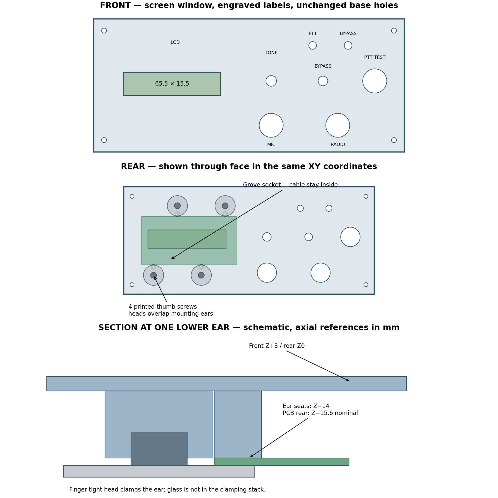
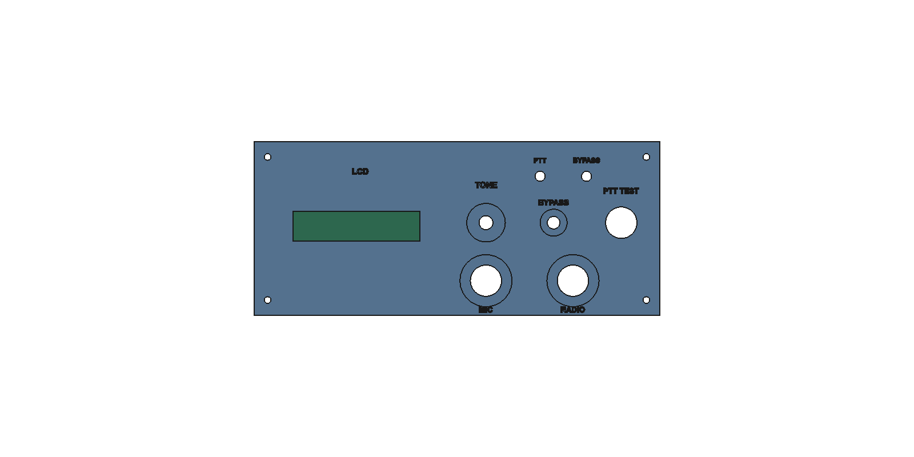
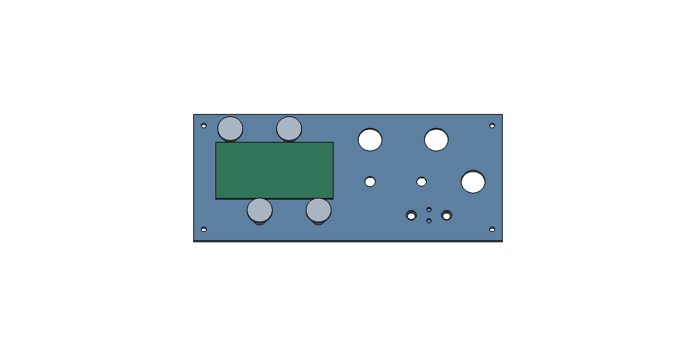

# B2 rear-mounted display panel

Print in the **existing PLA setup**, with the control panel's **front face on the
bed** and its integral rear posts pointing up. B2 replaces only the removable
210 × 90 mm panel. Keep the printed B1 base, its four inserts, panel screws,
LED keeper, controls and PCB supports. Nothing changes at the base interface.

Open [bench-panel-b2.3mf](../manufacturing/bench-panel-b2/bench-panel-b2.3mf)
**as a project**. The custom thumb screws are printed in PLA alongside the panel;
they replace the proposed nylon display screws. They are **5 mm diameter,
1 mm pitch custom threads**, not standard M5 hardware. No purchased display
fasteners or separate washers/spacers are required.

| Step | File / plate | Orientation / holding | Then |
| --- | --- | --- | --- |
| 1 | 3MF **01 - TEST FIT - rear display and threads** | Window coupon front down; four screw heads down; trial sockets flat | Accept thread, ear, screen and plug fit |
| 2 | **02 - FINAL - replacement panel and clamps** | Panel front down, rear posts up; four screws head down | Cool, release and inspect |
| 3 | Printed B2 panel plus existing controls | Support panel on its edges with rear accessible | Transfer controls and mount display |
| 4 | Existing four panel screws and B1 base | Keep base level; lower panel onto original rails | Route harness internally and inspect |

If test screws are already accepted, reuse them and skip the four duplicate
production screws. No base reprint or insert installation is needed. Keep the
existing EC11 [printed flanged nut](ec11-flange-nut-guide.md).

*Dimensioned schematic based on the B2 generator. Rear layout is viewed through
the panel in the same local coordinates as the front; it is deliberately not a
mirrored shop drawing. Native views below show the actual solid geometry.*

*Native CAD views: simplified green display envelope and gray installed printed
thumb screws. The rear view is turned over, so its top edge is the front view's
lower edge. Other controls are omitted.*

## Tools, material and selected settings

Have the Grove LCD RGB Backlight **V4.0**, its Grove cable, the existing populated
holder, PLA, a small driver for the existing panel/control hardware, flush cutters
and a plastic deburring tool. Keep power and USB disconnected during assembly.
Do not use the soldering iron on the populated panel.

The saved project uses **Bambu X1 Carbon / 0.4 mm nozzle / Generic PLA / Textured
PEI**, **0.12 mm layers**, **0.20 mm first layer**, four walls, five top/bottom
layers, 30% gyroid, 3 mm outer brim and supports off. Nominal line width is
0.42 mm; outer/inner walls use 25/40 mm/s. Temperatures come from the installed
Generic PLA profile (220 °C nozzle / 55 °C textured bed). These are selected
profile defaults, not physical acceptance results for this revision.

Face-down printing keeps the 14 mm rear supports continuous and vertical. Labels
are engraved 0.4 mm rather than raised so the front can contact the bed. The
unchanged front hardware recesses contain short annular overhangs: inspect their
roof and edges in the coupon/production slice and after printing. Light cleanup
must not change the control grip thickness or panel mounting surfaces.

The coarse printed threads avoid a fragile FDM M2 screw. Wide integral 17 mm
heads spread a gentle clamping load onto the PCB's mounting ears. Printed PLA
is electrically insulating; tighten with fingers only and release before forcing
a stuck fastener. This is low-load temporary bench retention, not a vibration or
temperature-rated screw joint.

## Qualify the independent coupon

1. Print plate 01 and let it cool fully. Mark the three trial sockets A/B/C
   left to right before lifting them from the plate. Peel away brims; clear strings without
   cutting threads, support tips or locator pins. The 80 × 68.9 mm display coupon
   reproduces the actual window, all four ear seats and rear clamp bosses.
2. Trial one printed screw in the three small sockets: **A = +0.10, B = +0.15,
   C = +0.20 mm radial thread allowance**, left to right on the saved plate. B
   is the production default. It must turn by fingers through at least five
   revolutions, reverse freely and remain secure under a light pull. Do not use
   a metal screw to force this custom thread. If B binds, clean and try C; if B
   is loose, try A. If another size wins, change `socket`'s default `allowance`
   in [the generator](../tools/build-bench-panel.py), rebuild and re-slice.
3. Lay the coupon face down on a soft clean surface with the posts up. Lower
   the display **glass toward the window**, Grove socket toward the lower edge
   shown in the drawing. Its four 2.3 mm ear holes sit over 1.8 mm locator pins.
   All four ear fronts must contact their seats without bending the PCB.
4. Start all four printed thumb screws in the adjacent large bosses, from the
   rear. Their head rims overlap the mounting ears. Turn until just touching;
   snug evenly with fingertips. The screw axis is outside the PCB, so no screw
   passes through a display hole. Keep the PCB flat; the heads must not load the
   black bezel, components, connector or wires.
5. Turn the coupon over and inspect the screen. The 65.5 × 15.5 mm window adds
   0.5 mm per side around the manufacturer's 64.5 × 14.5 mm viewing area. Verify
   the complete character area is visible at your seated viewing angle, the
   bezel does not press the panel, and the module cannot slide or rock.
6. Fit the Grove plug while supporting its socket; route its wires away from the
   lower edge toward the internal harness. Confirm the connector can be unplugged
   with fingers and no wire is trapped under an ear or screw. **Stop and adjust
   the CAD if the screen, ears, depth or cable access fails.** Do not enlarge the
   LCD's PCB holes or use screw torque to draw a bowed board onto the posts.

The [manufacturer drawing, page 23](https://files.seeedstudio.com/wiki/Grove_LCD_RGB_Backlight/res/JHD1313%20FP-RGB-1%201.4.pdf#page=23)
defines the 80 × 40 mm PCB body, staggered ear pattern, 2.3 mm holes and
13.5 mm overall maximum thickness. B2 corrects the earlier supports' ear
positions to include the 2.1 mm projections beyond the PCB edges. It shifts the
display **3 mm right** to clear the unchanged left base rail by 2 mm at the PCB.
No base or control mounting hole moves.

The 14 mm ear-seat depth is a selected clearance default that keeps the module
behind the face even with the 13.5 mm maximum envelope. The reference model's
9.8 mm PCB-front-to-bezel-front split and plug/bend envelope are selected
approximations; the drawing does not dimension that split or the installed cable.
The independent coupon resolves recess depth, seated viewing and plug access.

## Print and assemble the replacement

1. After accepting the coupon, print plate 02. Let the panel cool on the bed;
   release without levering on the posts. Remove brims and loose threads. Inspect
   the window, engraved labels, four base screw bores, keeper sockets, control
   lands and all eight rear supports/bosses. Reject cracks or separated post roots.
2. Disconnect power and photograph/label the existing harness connections. Remove
   the four original panel screws; lift the old panel while supporting its wires.
   Undo control nuts without turning wired bodies. Transfer controls and the LED
   keeper using the [existing assembly guide](bench-holder-guide.md). Keep the
   EC11 printed flanged nut; its hole and recess are unchanged.
3. Mount the display behind B2 exactly as accepted on the coupon. Heads bear on
   the rear of the ears; four integral pads bear on their fronts. The short
   locator pins locate the module and finish inside the nominal 1.6 mm PCB
   thickness; they are not the retaining fasteners. Keep wire loops out of the
   screen window and clear of the encoder and switch bodies.
4. Connect the Grove cable and lay it inside the holder toward the harness combs,
   leaving enough slack to lift the panel for servicing. Lower the panel onto
   the existing rails; keep all four corner seating areas clear. Start all four
   original screws before snugging. Do not pull a pinched harness flat with them.
5. Inspect from front, sides and rear: front window clear; module secure; no wire
   over the face; connector and fasteners accessible; panel seated on both rails;
   no contact with the base, control terminals or the main PCB. Move every control
   through its normal travel. Then use the existing radio-free electrical checks
   in the [bench-holder guide](bench-holder-guide.md).

Record accepted thread trial, material, actual print settings, screen visibility,
clamp retention and cable routing in `docs/`. Digital CAD and slicing checks do
not establish physical print or assembled fit. B2 has not been physically printed
or accepted by this design preparation.

Editable [B2 FreeCAD source](../mechanical/bench-holder/bench-panel-b2.FCStd),
[assembly STEP](../manufacturing/bench-panel-b2/bench-panel-b2-assembly.step) and
[verification evidence](verification/bench-panel-b2/cad-checks.json) accompany the
print project. B1 files remain available for the already printed base.
