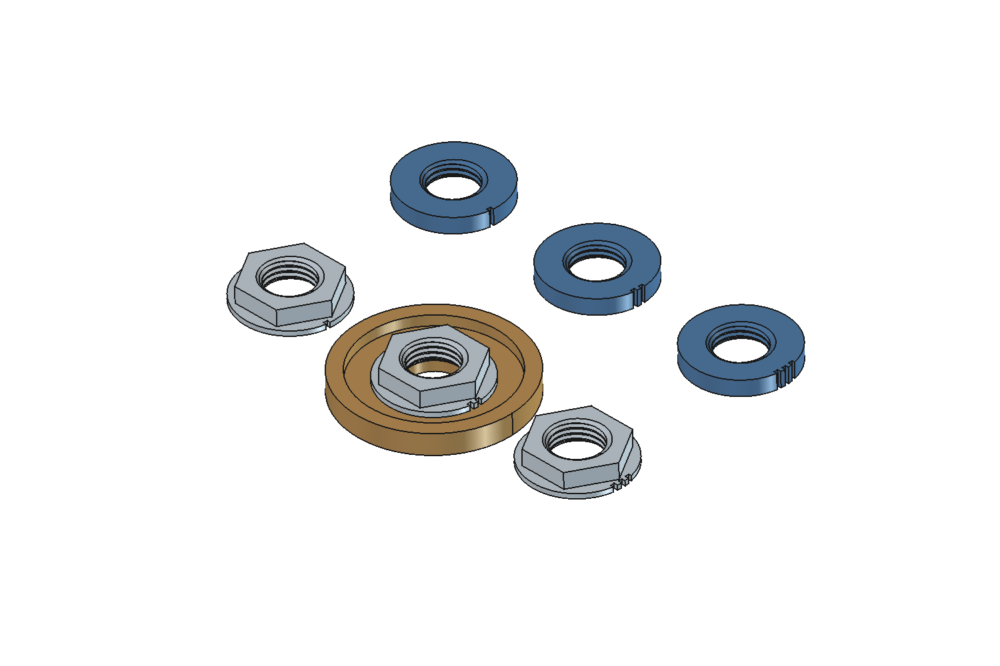
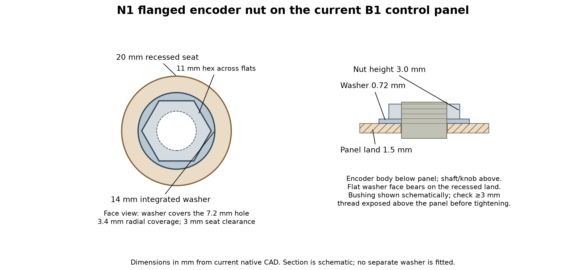

# Print and fit the EC11 flanged nut

Use the selected **PLA and existing Bambu X1 Carbon 0.4 mm setup**, the unpowered
EC11 and the B1 bench holder's control panel. The nut prints **flat integrated-
washer face down**, thread axis upright. The washer and hex are one part.
The encoder's missing nut/washer are replaced by this print; no additional
washer or purchased mounting nut is needed.

## Sequence at a glance

| Step | File / object | Held how | Accept before continuing |
| --- | --- | --- | --- |
| 1. Qualify the thread | [N1 3MF](../manufacturing/ec11-flange-nut/ec11-flange-nut-n1.3mf), plate **01 — TEST FIT** | Three flat rings on the textured plate; thread axes vertical | At least one cleaned ring turns freely on the encoder bushing |
| 2. Print the nut | Same project, plate **02 — FINAL** | Three flanged-nut alternatives, washer faces on the bed | Matching nut turns through its full depth and has a sound flange |
| 3. Install | One accepted nut, chosen by notch count | Encoder body supported behind the panel; washer face on the recessed land | Hand snug, seated evenly, no body rotation, shaft/button/knob move freely |

If these same-material/settings thread trials are already accepted, skip plate
01 and reuse the recorded variant. If an accepted matching nut is already
printed, skip both print steps. You do not need to reprint the bench holder.
Plate 02 contains alternatives; only **one** is fitted to one encoder.

*Native CAD view: three gray flanged nuts, three blue test rings; the brown
panel-seat crop is a reference and is not a printed item.*

## Fit to the existing control panel

The native B1 control panel has a **7.2 mm through-hole**, a **20 mm-diameter
recess**, and **1.5 mm remaining panel thickness** at the encoder. N1's **14 mm
washer** overlaps the hole by **3.4 mm radially** and leaves **3 mm radial
clearance** to the recess edge. Its **0.72 mm washer thickness** is included
in the **3.0 mm total nut height**; the hex above it is 2.28 mm high and 11 mm
across flats. The flange bears on the recessed face, rather than bridging over
the recess edge. The holder's hole, recess and panel angle are unchanged.

The thread is **M7 × 0.75, right-hand**. The user's M7 observation and the
[Bourns PEC11R hardware drawing](https://www.bourns.com/docs/product-datasheets/pec11r.pdf)
support this selected trial pitch; the generic WWZMDiB part's pitch is accepted
by the fit-ring procedure, not inferred from its unmarked body alone. Do not
force a coupon if the bushing has a different pitch.

| Mark | Radial thread allowance | Total/diametral increase | Use |
| --- | --- | --- | --- |
| A — 1 outside notch | +0.05 mm | +0.10 mm | Tightest trial |
| B — 2 outside notches | +0.10 mm | +0.20 mm | Middle trial |
| C — 3 outside notches | +0.15 mm | +0.30 mm | Loosest trial |

Allowances expand both root and crest radii; they are selected FDM fit trials,
not certified 6H tolerances. Test rings are 2.25 mm high; the full nuts are 3 mm,
so test the chosen nut over its complete engagement as well. Count notches
on the outside edge to match a ring and nut. Left-to-right placement is A/B/C.

## Gather supplies and check the print settings

- Selected PLA, textured PEI plate and X1 Carbon with **0.4 mm nozzle**.
- The EC11, control panel and existing knob.
- Fine side cutters/deburring blade, soft brush, magnifier, caliper/ruler and
  a marker for recording the accepted variant.
- Optional 11 mm open-ended wrench **for holding/removal only**. Installation
  is hand snug; do not apply wrench torque to obtain a fit or clamp harder.

The project embeds **0.12 mm layers and first layer, 0.42 mm line widths, four
walls, five top and bottom layers, 30% gyroid, Arachne wall generation, 25 mm/s
outer walls, 40 mm/s inner walls, supports off and a 3 mm outer brim**. The
installed Generic PLA profile supplies **220 °C nozzle and 55 °C textured-bed
temperatures**, cooling and minimum layer-time behavior. These are selected
settings from the existing setup, not a physically qualified nut recipe.

The six objects each fit within 14 × 14 × 3 mm before brim. The slicer keeps
them separated on two plates, well within the established 256 mm build volume
and away from the X1 excluded corner. The washer down orientation supports the
hex directly, retains continuous XY rings around the thread and avoids supports
inside the bore. Thread flanks and lead-ins print in fine layers. Infill cannot
make this a metal-strength nut: excessive clamping torque can strip threads,
split the ring or cause PLA creep.

## 1. Print and accept the thread trial

1. Open [ec11-flange-nut-n1.3mf](../manufacturing/ec11-flange-nut/ec11-flange-nut-n1.3mf)
   **as a project**, select plate 01 and the actual loaded PLA. Confirm the saved
   X1C 0.4 mm / 0.12 mm profile and textured plate. Do not use the bench holder's
   coarse 0.20 mm default for these small threads.
2. Print the three separate test rings. The slicer estimates **9 min 31 s and
   1.10 g** for the complete trial plate. Let the plate cool, flex it to release
   the rings, then trim only the outside brim. Brush away loose strands.
   Do not scrape thread flanks or enlarge the bore to disguise a bad fit.
3. With the encoder loose and disconnected, try B first. Hold the ring square
   to the bushing, turn it gently backwards until the starts align, then turn
   clockwise by hand. It should engage for multiple turns without force,
   cross-threading or visible whitening. Check A if B is loose; C if B binds.
4. **Stop and inspect:** accept the tightest freely turning variant that does
   not rock noticeably. If all three bind after cleaning, stop. Distinguish
   undersized printed threads, first-layer lip and wrong pitch before changing
   the model. Do not chase an unconfirmed thread with an M7 coarse tap.
   If all three are loose, reduce the allowance and regenerate the set rather
   than relying on excessive clamping torque.

Record the accepted letter, filament, printer/profile and observations. No
test ring is required to serve as the assembly nut; keep it as the sizing aid.

## 2. Print and inspect the final nut

1. Select plate 02 with unchanged filament, orientation and settings. It contains
   three matching flanged-nut alternatives; the full plate is only **11 min 3 s /
   1.01 g** estimated. Print the plate and choose the accepted notch count; the
   other two are labelled spare trials. You can disable the two unused objects
   and re-slice if preferred. Never install multiple stacked nuts as the default.
2. Cool, release, trim outside brim and brush away strings. Inspect the integrated
   washer face for flatness, the hex for cracks and the bore for continuous
   flanks. Remove isolated loose strings only. A bed lip that prevents seating
   is a print failure to correct; don't grind away the washer's bearing face.
3. Run the full nut onto the loose bushing by hand and back off. The longer nut
   must turn over its full depth without force. Accept only a sound flange and
   a repeatable thread engagement. If it binds, resolve the cause before mounting.

## 3. Mount the encoder in the bench holder

1. Disconnect all power. Remove the knob if it obstructs the nut. Support the
   encoder body and pass its threaded bushing through the **TONE / 7.2 mm**
   opening from behind the panel. Keep its terminals clear of the holder and
   prevent wires from carrying installation torque.
2. Check that at least **3 mm of usable bushing thread** is exposed above the
   recessed land. This is the selected N1 engagement check, equivalent to at
   least 4.5 mm bushing reach through the 1.5 mm land. If the body rocks on a
   locating tab, or the bushing does not reach, stop and resolve that specific
   obstruction/stack. Do not clamp against a terminal, bend the body to gain
   reach, add washers or change the accepted panel opening.
3. Start the accepted nut with its **broad flat washer face against the panel**,
   hex facing outward. Keep the encoder body fixed while turning the nut by
   hand. Tighten just until the flange seats evenly and the body stops rotating
   under ordinary encoder use. Do not use a power tool or add thread-locking
   chemical to PLA.
4. **Stop and inspect:** the flange must sit entirely inside the 20 mm recess,
   flat on its land. There must be no split, whitening, stripped thread or panel
   distortion. Rotate and press the shaft; the encoder body should remain fixed.
   If it slips, inspect seating and fit rather than simply increasing torque.
5. Refit the knob with clearance above the nut/washer. Check full rotation and
   push-button travel; the knob must not rub the nut or bottom on it before the
   switch clicks. Open/close the supported panel and inspect terminal, wire and
   adjacent-control clearances. Repeat the [radio-free encoder check](bench-holder-guide.md)
   after any rewiring.
6. Record the final fit and recheck clamping after initial use. This PLA fastener
   is for the indoor bench holder; do not treat it as a qualified hot-vehicle
   or permanent enclosure mounting solution without a material/load review.

## Verification and acceptance record

The [native CAD checks](verification/ec11-flange-nut/cad-checks.json) verify six
single valid solids, constrained profiles, native right-hand helices, zero
intersection at the actual B1 seat, closed mesh readbacks and bed orientation.
The [slicer checks](verification/ec11-flange-nut/slicer-checks.json) verify both
named plates, six objects, settings and saved transforms. The project reopened
in Bambu Studio 2.8.2.61 with the intended PLA, two plates, four walls and 0.12 mm
layer/first-layer settings. Actual layer-path inspections show all three bores
and the flange-to-hex transition:
[test rings](verification/ec11-flange-nut/toolpaths-plate-1.png) /
[final nuts](verification/ec11-flange-nut/toolpaths-plate-2.png).

Inventory discovery used the authoritative workshop store. Its
[preflight report](verification/ec11-flange-nut/inventory-preflight.json) does
not pass: it has no Generic PLA record and lacks complete X1C process/envelope
metadata. This does not override the user's explicit selection of PLA and the
existing X1C setup or the established 256 mm envelope. No stock quantity or
inventory preflight pass is claimed; the package uses that user-selected setup.

CAD/slicer checks are complete. **Printing, thread fit, bushing reach, knob
clearance and clamp retention have not been physically accepted.**

| Item | Record after running the procedure |
| --- | --- |
| PLA brand/color, printer/nozzle and profile | ____ |
| Ring A/B/C result and accepted letter | ____ |
| Full-nut thread result; exposed bushing thread | ____ / ____ mm |
| Flat seating, no damage/body rotation, free shaft/button/knob | ☐ |
| Short-use clamping recheck | ____ |

Editable source: [FreeCAD N1](../mechanical/bench-holder/ec11-flange-nut-n1.FCStd).
The [builder](../tools/build-ec11-flange-nut.py) owns the parameter defaults;
individual native sketches and features remain editable. The custom body
dimension properties document generation inputs; they are not live drivers
for every feature. Rebuild after changing the generator's pitch/allowances,
then regenerate/reinspect the 3MF and diagrams. Full package and STL/STEP links
are in the [manufacturing README](../manufacturing/ec11-flange-nut/README.md).
