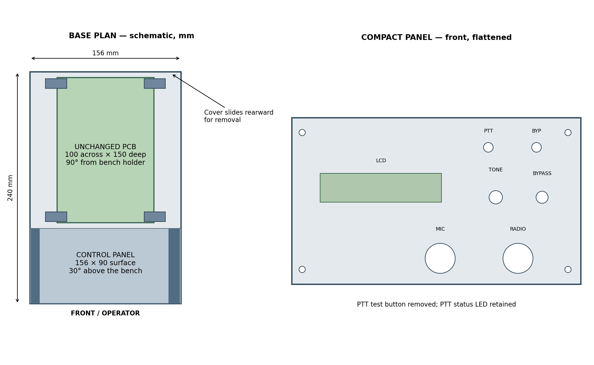
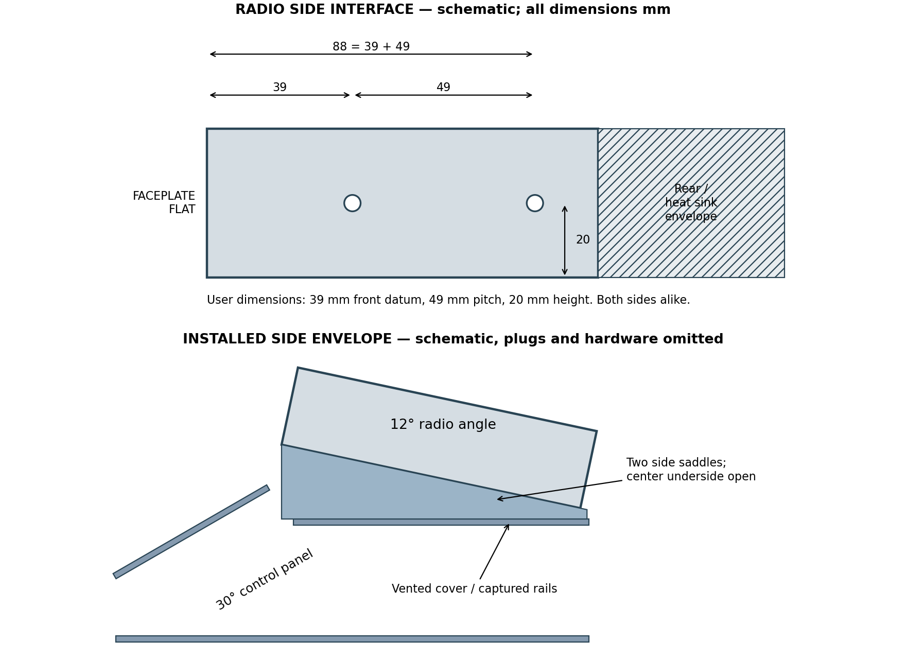
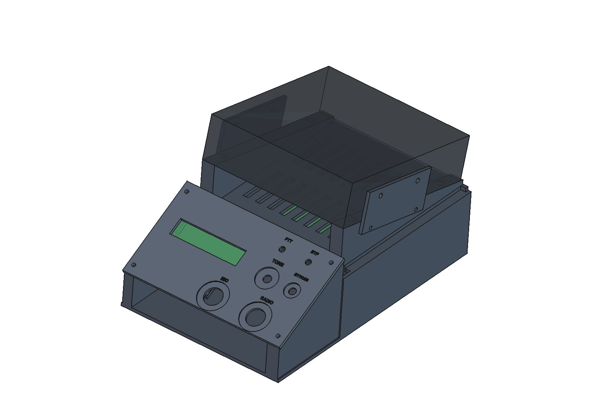

# C1 narrow enclosure and radio stand — PLA prototype

Use **PLA on the Bambu X1 Carbon, 0.4 mm nozzle**, with the orientations already
saved in [ctcss-c1.3mf](../manufacturing/enclosure-c1/ctcss-c1.3mf). The base is
156 × 240 mm; the control face is 156 × 90 mm at 30°. The radio tilts upward
toward the operator by 12°, an agent-selected starting angle. Print the
independent test plate first. This is a fit/load prototype, not a physically
accepted radio installation.

| Sequence | Run / file | Holding and orientation | Next action |
| --- | --- | --- | --- |
| 1 | 3MF **01 - TEST FIT - radio LCD nubs inserts rails** | LCD front down; rail floor down; tongue roof down like the full cover; radio template flat | Accept interfaces before large prints |
| 2 | **02 - FINAL - narrow base** | Base floor down; 3 mm brim; rails/posts up | Cool flat; inspect floor and rail straightness |
| 3 | **03 - FINAL - panel cheeks and retainers** | Panel front down, cheeks on broad sides; strap nub relief up | Clean and fit controls, retainers and radio cheeks |
| 4 | **04 - FINAL - sliding cover and radio saddles** | Cover outside roof down; saddles on broad side faces | Accept cover sliding and saddle alignment |
| 5 | Empty printed components | Support each insert boss directly, electronics absent | Install inserts, cool, trial every screw |
| 6 | Unpowered PCB, LCD and controls | Base level; panel back accessible | Seat boards, route harnesses, fasten panel |
| 7 | Empty radio cradle and cover | Slide cover forward from the rear; retain with its two lock screws | Attach the supported radio only after its pattern/bolts fit |
| 8 | Completed prototype | Flat supported bench, clear rear cables and top speaker | Perform handling and temperature acceptance |

Skip an interface test only when the **same C1 geometry, PLA and process** have
already been accepted. Older B1/B2 thread tests do not establish these new insert
clamps or cover rails. The already populated board, wired controls and EC11 nut
can be reused; no PCB, firmware or wiring pin map is changed. Disconnect/remove
the PTT-test button's temporary harness; retain the PTT status indicator.

*Dimensioned schematic from current C1 parameters. The panel view is flattened;
the base plan shows its horizontal projection. Rear is positive Y.*

*39 mm front offset, 49 mm pitch and 20 mm height are user dimensions. The second
hole is 88 mm from the same faceplate flat. The view is schematic; use the actual
radio for the template fit, not the apparent scale of a photograph.*

*Native FreeCAD view with a simplified translucent radio envelope. Knobs, RF/DC
connectors, screw heads, cables and detailed heat-sink fins are omitted. It does
not establish the complete installed cable envelope.*

## Tools, parts and settings

Have PLA, a 2.5 mm hex driver for the M3 socket heads, the OEM radio bolt driver,
a temperature-controlled insert iron with an M3 tip, flat heat-resistant support,
calipers, flush cutters and a plastic deburring tool. Use a temperature probe
for the later loaded-radio test. Unplug radio power and USB throughout mechanical
assembly; remove the populated board before heat-setting any insert.

| Item | Installed quantity | Why this choice |
| --- | --- | --- |
| Base, panel, cover, LED keeper | One each | Printed insulation, structure and retention |
| PCB corner straps | Four | Broad insulating capture; metal screws remain outside PCB edges |
| Display ear clips | Four | Clamp small LCD ears without screws through the 2.3 mm holes |
| Radio saddles and side cheeks | One left + one right of each | Side support and serviceable retention; center underside, speaker and rear heat sink remain open |
| **M3 × 8 socket-head cap screws** | **24** | Four panel, four PCB straps, four LCD clips, two LED keeper, two cover locks, four saddle-to-cover, four cheek-to-saddle; available stock confirmed by user |
| **M3 × D5 × L4 heat-set inserts** | **24 installed + 8 for all fit trials = 32** | Wear-resistant reusable threads; replace the B1/B2 printed mounting threads |
| OEM radio **M4 × 8** mounting bolts | Four | Radio's existing threaded interface; documented part-number match, separate from M3 enclosure standard |
| Existing controls, Grove V4.0 LCD, populated PCB, harnesses and EC11 nut | Reuse | Preserve working component interfaces and supplied bushing hardware |

The coupon plate includes one test strap and four test LCD clips, in addition
to production copies. Accepted test retainers can become spares. Screws can be
reused from the test plate; 24 is the installed M3 count, not 24 plus a second
complete screw set. No purchased PCB standoffs, loose spacers or printed fastening
threads are required. Existing control bushing nuts and the existing EC11 knob/nut
interface remain part of their controls; standardizing enclosure screws does not
change those component threads.

The saved process uses **0.20 mm layers and first layer, 0.45 mm nominal line
width, five walls, six top/bottom layers, 30% gyroid, supports off and 3 mm outer
brims**. Outer/inner walls are limited to 40/60 mm/s. Generic PLA supplies the
220 °C nozzle / 55 °C textured-PEI bed defaults. These are selected settings,
not physically qualified C1 results. Five walls provide continuous shell around
the rail and bracket loads; infill is not a substitute for layer orientation.

The base's 240 mm direction plus two 3 mm brims occupies 246 mm. Its saved
position stays clear of the X1 excluded corner and bed edges. All parts fit the
established 256 × 256 × 256 mm build volume in their exported orientations.
Do not auto-arrange the base into the excluded corner. Saddles and cheeks print
on broad side faces so their primary load paths lie in continuous XY extrusion
paths, rather than peeling a tall bracket away from the bed-facing floor.
Rails have 45° gussets and sloping retaining lips; the matching tongue is beveled.

Inventory preflight is retained separately in
[inventory-preflight.json](verification/enclosure-c1/inventory-preflight.json).
It does not pass: the store lacks filament/insert quantities and usable printer
capabilities. The user explicitly selected PLA and confirmed ample M3 × 8 stock;
these are current project inputs despite the missing catalog fields. The store
does record the owned D5 × L4 insert dimensions. **32 inserts and four OEM radio
bolts remain a kit-count/procurement check**, without changing those dimensions.
No inventory was reserved, decremented or silently rewritten.

## 1. Accept the independent test plate

1. Print plate 01 in the intended PLA/profile. Let it cool on the plate. Remove
   the brim and strings; do not sand locating diameters or insert pilots until
   their as-printed fit is evaluated.
2. Hold the radio-pattern template against each unpowered radio side. Its edge
   marked FRONT aligns with the **flat of the faceplate**, excluding knobs and
   any curved front lip. Both holes must align freely with the chassis threads.
   The template reproduces 39/88 mm positions and 49 mm spacing. Its holes are
   15 mm from its long edge; **that edge is not the chassis-bottom datum**. The
   actual brackets put hole centers 20 mm above the chassis bottom.
3. Use the three labeled insert pilots, **4.4 / 4.6 / 4.8 mm**. Start at the
   selected **4.6 mm diameter**, not a 4.6 mm radial clearance. Support the empty
   coupon on a flat heat-resistant surface. Start the tip at **190 °C**, a selected
   PLA trial value for these unbranded inserts, not a manufacturer recipe. Apply
   light axial force, seat the D5 × L4 insert flush, remove the tip and let cool
   without a screw pulling on the hot insert. Stop if the boss splits, distorts
   or the insert sinks. Adjust temperature/dwell on the trial, record the actual
   successful recipe and use the pilot that seats squarely and resists turning.
4. After cooling, thread an M3 × 8 screw freely. The 5.5 mm pocket provides 1.5 mm
   beyond the 4 mm insert. A 3 mm mating strap leaves 5 mm screw projection:
   full 4 mm insert engagement plus 1 mm below it, with 0.5 mm pocket clearance.
   A seated screw must clamp the trial rather than bottom. If another pilot wins,
   change `PILOT_D` and all corresponding pilot features, regenerate and re-slice.
   Display/LED pilots presently use the same selected 4.6 mm diameter.
5. Fit an existing main-PCB mounting hole over the nub coupon, without power or
   forcing. The **3.6 mm nub** has **0.4 mm total diametral clearance** in the
   existing 4 mm hole. Its 2.1 mm height projects 0.6 mm above nominal 1.5 mm PCB.
   Install the test strap over the corner with its **1 mm nub-relief pocket toward
   the PCB**. The strap must seat without loading the nub tip or a component.
   Stop if the board rocks, bends or cannot lie on its support seat.
6. Slide the independent tongue into the rail coupon from its open end. In the
   assembled trial, place the tongue bottom 0.3 mm above the bearing shelf and
   its outer edge 0.3 mm inboard of the wall. The chamfer has 0.4 mm vertical
   clearance below the sloping lip. The tongue must slide by hand, stay captured
   under a light upward pull and show no shaved plastic. Remove only strings
   and first-layer flash. A tight trial requires a CAD allowance change, not
   force on the full case.
7. Install four inserts in the LCD coupon from its rear. Place the Grove module
   glass toward the window, resting on its four ear seats. The 1.8 mm locator
   pins enter the module's 2.3 mm holes. Fit four test clips: each overlaps an
   ear, with the M3 screw **outside the LCD PCB**. Tighten only until retained.
   The glass, black bezel and components must remain unloaded; the complete
   character area and Grove plug must be accessible. Do not alter the LCD holes.
8. Record pilot, insert recipe, rail motion, nub/strap fit, radio pattern and
   LCD seating in `docs/`. **Stop and accept these interfaces before plates 02–04.**

## 2. Print, clean and install inserts

1. Print the remaining three plates after coupon acceptance. Keep the base on
   its bed until cool to limit bowing; do not lever against the rails. Clean brims
   from mating edges and remove strings from bores, without changing bearing
   surfaces. Inspect the 3 mm floor and cover skins, vent edges, rail/gusset
   roots, corner seats, bracket hole rims and insert bosses for gaps or cracks.
2. With electronics absent, install ten inserts into the base: four corner
   strap pedestals, four normal to the inclined panel rails, and two vertical
   cover-lock bosses at **X23.5/132.5, Y210**. Support the sloped rails during insertion;
   do not press sideways on a hot boss. The left panel insert centers are X5.5,
   leaving 2 mm of plastic between the D5 insert and both rail edges.
3. Install six inserts from the panel rear: four LCD clip bosses and two LED
   keeper bosses. Install four from the cover top into its saddle attachments,
   and two into the outside face of each radio saddle for its side cheek.
   Use the accepted coupon recipe. Let all inserts cool; check each with an
   M3 screw before adding electronics.
4. Slide the empty cover in **from the rear toward the front**. Its roof stays
   above the electronics; bearing shelves carry downward load, the sloping lips
   capture lift, and the front stop defines insertion. Do not use the two lock
   screws to pull a sticking cover forward. Both screws must enter by fingers
   after the cover is seated. Check the complete travel back out before assembly.

## 3. Assemble the electronics

1. Keep radio power and USB disconnected. Reuse the working control harnesses;
   label plugs before transferring anything. Remove the temporary PTT-test
   button connection. Keep MIC/RADIO identity, bypass orientation and the two LED
   polarities from the [wiring guide](final-product-wiring-guide.md).
2. Mount MIC and RADIO bulkheads, encoder and bypass toggle with their existing
   bushing hardware. Retain the existing EC11 nut. Connectors remain on the front
   panel, as on the bench concept. Use their actual rear plugs, solder sleeves
   and mating cable shells for the clearance check; the CAD cylinders are
   allocations, not exact connector solids. Leave service slack and keep audio
   wiring away from PWM/LCD bundles where practical.
3. Install the LEDs with insulated leads. The printed keeper captures both rear
   flanges through raised pads and leaves 4.5 mm lead passages. Fasten its two
   M3 × 8 screws without crushing the LED bodies. Fit the LCD using the accepted
   coupon procedure and four M3 × 8 clips. The viewing opening remains
   65.5 × 15.5 mm; it is based on the existing Grove V4 drawing.
4. Place the main PCB lengthwise at **X28–128, Y84–234**, component side up,
   underside Z15. The four holes center at **(34,90), (122,90), (34,228),
   (122,228)**. Each locating nub must enter without bending the board. There
   remains 12 mm from floor top to PCB underside, and 10 mm below nominal
   2 mm lead tails. Do not move/drill PCB holes to fix the enclosure.
5. Fit the four relieved corner straps with four M3 × 8 screws in the adjacent
   pedestals. Keep each nub inside its relief. Snug evenly: the PCB should stay
   seated and flat, and no screw touches it. The pedestals stop the straps at
   nominal PCB-top height. A thickness mismatch requires revising the seat/strap
   stack or a printed shim, not bending the PCB with more screw torque.
6. Connect internal harnesses, leaving RV1 and module-removal access available
   with cover/panel removed. Keep wires out of the Y90–240 cover rails, screw
   paths and rear closure. Fasten the panel with four M3 × 8 screws normal to
   its 30° face. Inspect from underneath for trapped wire and connector contact.

## 4. Attach and retain the radio

1. Install both saddle wedges on the cover with four M3 × 8 screws through their
   vertical access bores. Screw seats are 3 mm above the deck, giving the same
   grip as other joints. Fit each side cheek to its saddle with two M3 × 8 screws;
   0.3 mm cheek-to-saddle clearance leaves 4.7 mm projection into each insert.
   The cheek holes and saddle pilots share the 12° radio coordinate system.
2. Place the supported, unpowered radio between the cheeks. Its bottom lies on
   two 12 mm-wide side saddles; the central underside stays open. The front
   faceplate flat is at local Y0 of the radio pattern; both holes on each side
   must align freely. The front bottom is Z100 and the rear bottom about Z67.8.
   The cover roof is Z62.3, leaving about 5.5 mm at the radio's rearmost bottom.
3. Use the original **M4 × 8 mounting bolts, Icom 8820000530**, subject to the
   documented [part-number match](reference/ic229h-mounting.md). These are the
   exception to the M3 enclosure standard. The 3 mm cheek and 0.3 mm side gap
   leave **4.7 mm bolt projection**. Compare exposed length with the original
   mounting bracket when available. Trial by fingers; the bolt must clamp before
   bottoming, without flexing the cheek or reaching into the radio. If necessary,
   print a grip spacer or revise cheek thickness to reproduce that exposed length.
   Do not substitute longer bolts or force an M3 screw into the radio.
4. With the radio still supported, slide the cover/cradle into the base, keeping
   rear RF/DC cables disconnected and harnesses clear. Install the two cover-lock
   screws at X23.5/132.5, Y210. Their heads clear the saddle edges; the radio must be
   lifted off for vertical driver access. The screws prevent sliding; bearing
   rails, gussets and the base carry the radio's weight.
5. Connect rear RF/DC cables with bend space behind the stand; provide slack so
   the cables cannot pull the cover rearward or tip the assembly. Keep the top
   speaker perforations and rear heat sink unobstructed. The front control bay
   and the gap above its low rear stop are deliberately open, following the
   bench-holder concept; this revision is not sealed or RF shielded.

## 5. Accept the installed prototype and service it

1. On a level bench, gently operate the encoder, toggle and both connector
   coupling rings. Confirm the board cannot lift off its seats, the stand does
   not rock or tip, the cover remains captured, and the brackets do not flex
   enough to loosen the radio. Check both display and radio visibility from the
   intended seat. A soft mat may be used on the bench; no unverified printed
   nonslip feet are claimed.
2. Before energizing, inspect insulation, leads, strain relief and microphone/
   radio pin mapping using the existing electrical guide. Keep RAW/radio power
   disconnected during USB service. Firmware and electrical acceptance remain
   separate from this mechanical work.
3. Start with receive operation, then the user's intended transmit duty cycle
   and load. Measure PLA at the saddles, cheek roots and rails. Use **45 °C at
   load-bearing PLA** as a selected conservative first-prototype stop threshold,
   not a radio rating. Stop for temperature above that threshold, softening,
   visible creep, new looseness or loss of rail motion. Record ambient temperature,
   radio power/duty cycle, temperatures and before/after deflection. Sustained
   loaded-radio performance in PLA has not been established by CAD or slicing.
4. After cooling, inspect screw/insert movement and rail wear; repeat opening
   and closing without forcing. For service, disconnect rear cables and power,
   support/remove the radio, undo the two cover locks, and slide the cover
   rearward. A clear rear withdrawal path of about 165 mm is needed. Remove the
   panel as necessary for LCD/controls; remove corner straps to lift the board.
5. Clean debris, retain accepted coupons/spares, and record physical results in
   `docs/`. Replace cracked retainers rather than tightening them harder.

## Revision evidence and regeneration

Editable [C1 source](../mechanical/enclosure/c1/ctcss-c1.FCStd),
[assembly STEP](../manufacturing/enclosure-c1/supporting/step/ctcss-c1-assembly.step),
[CAD checks](verification/enclosure-c1/cad-checks.json),
[mesh/export checks](verification/enclosure-c1/export-checks.json) and
[slicer checks](verification/enclosure-c1/slicer-checks.json) belong to C1.
The PCB/component models include a 30 mm component-height allocation; actual
USB, trimmer, harness and mating-plug access still need installed checks.

The maintained [builder](../tools/build-enclosure-c1.py) and
[exporter](../tools/export-enclosure-c1.py) run through FreeCAD 1.1 Robust MCP.
Close only C1 before regeneration and preserve manual changes; B1, B2 and P1
remain separate. Then run `python tools/prepare-enclosure-c1.py` with Bambu Studio
installed. The generator owns the layout constants; native constrained sketches,
Pad/Pocket features and placements remain editable. No KiCad source is modified.
The current saved source/export hashes are in the linked evidence. CAD, mesh and
slice checks do not constitute a physical print, load or temperature acceptance.
