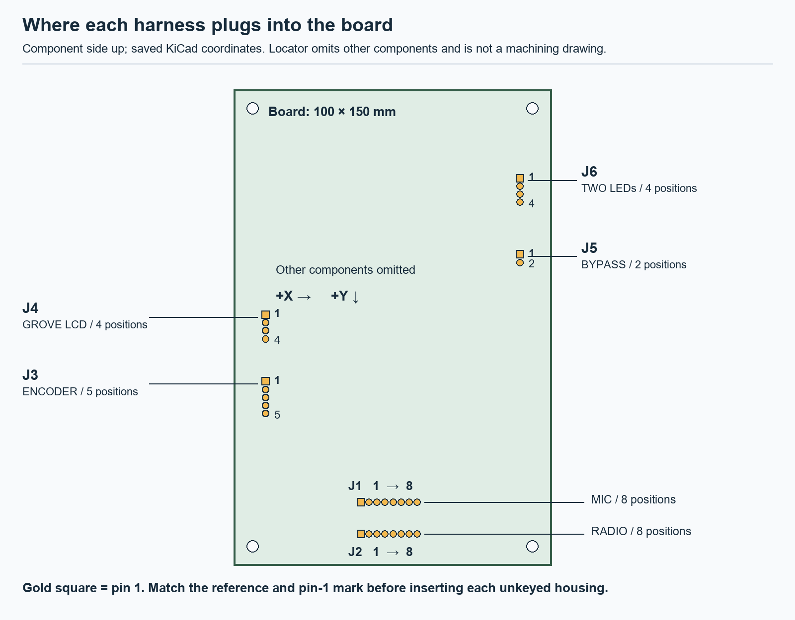
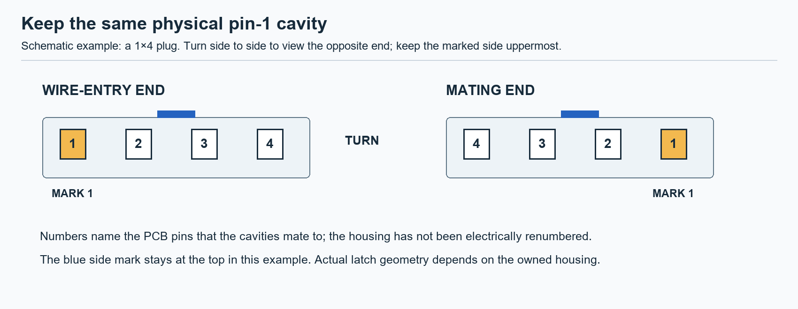
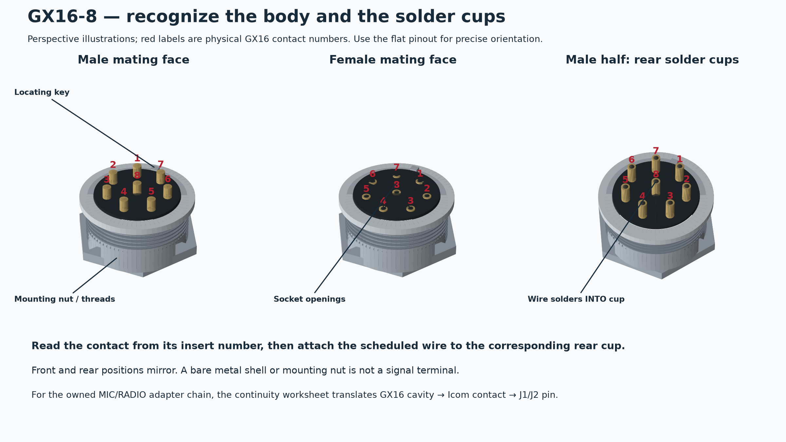
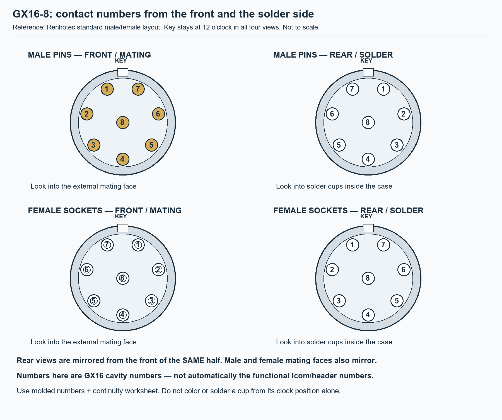
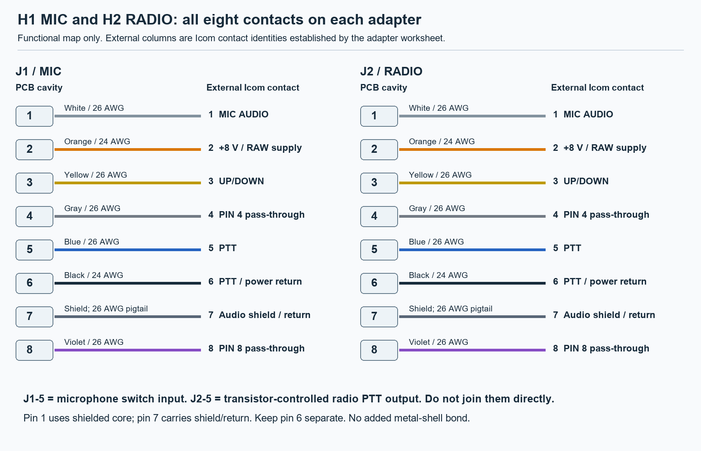
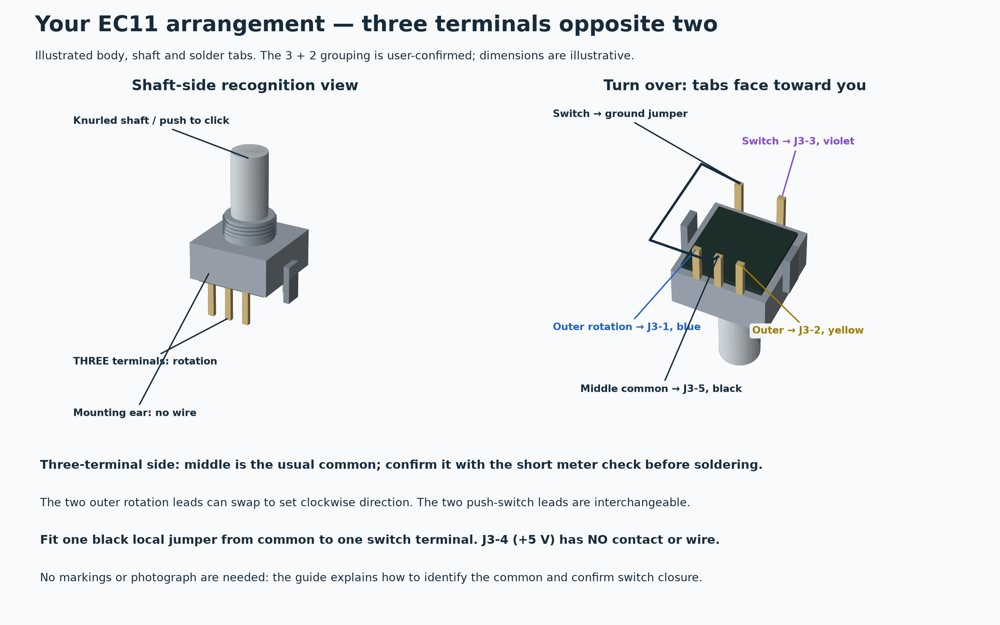
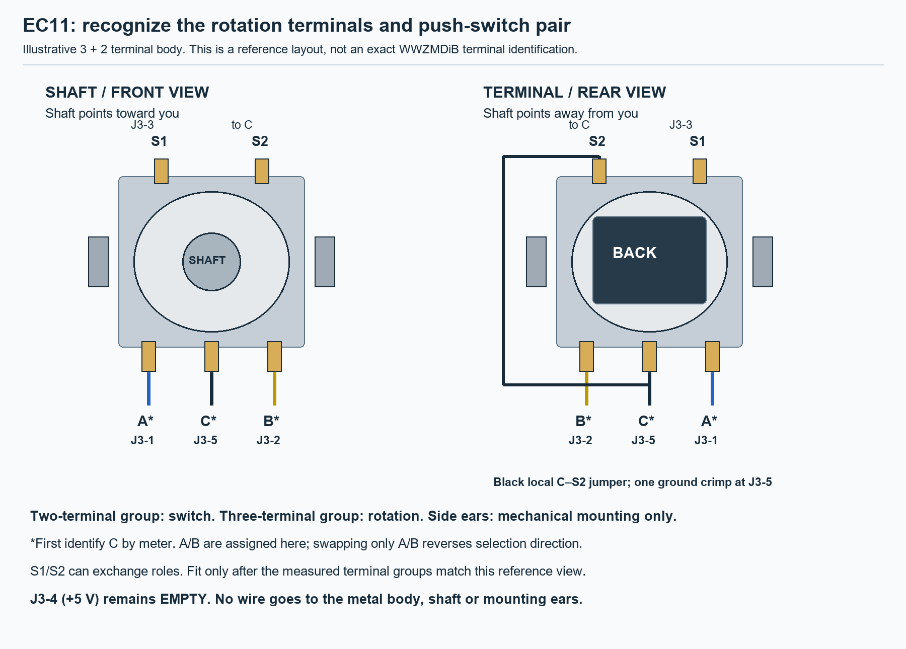
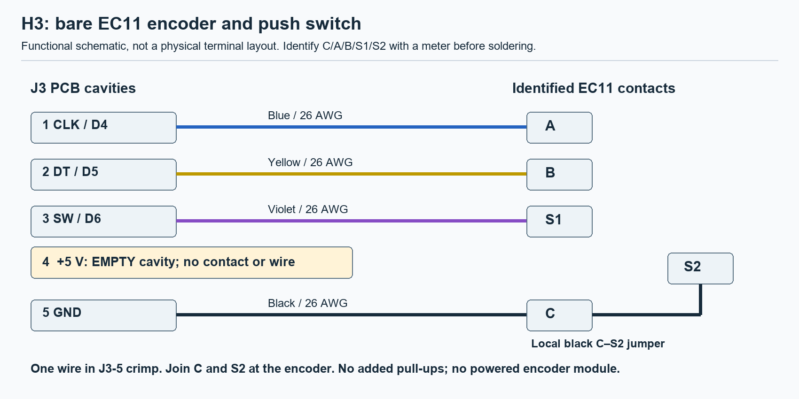
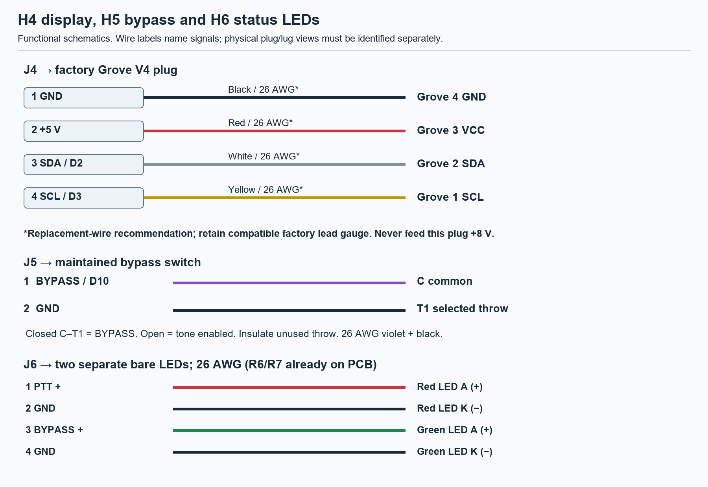

# Wiring the final Icom CTCSS interface

Revision W1.2 · 2026-11-16 · six harnesses, **30 populated PCB contacts**, and one local encoder ground jumper.

Start with the assembled, unpowered carrier PCB, the **already-owned connectors**,
the owned MIC/RADIO GX16-8 adapters and WWZMDiB EC11, the accepted **Grove LCD RGB
Backlight V4.0**, one maintained bypass switch and two bare indicator LEDs.
Use flexible **stranded copper** wire: recommended 24 AWG for the radio +8 V and
PTT/power return, 26 AWG for the other internal wires, and shielded audio cable
for each microphone-audio leg. These gauges and the colors below are selected
workshop recommendations, not claims about the wire currently in stock.

Work with the PCB component side upward. Keep USB, radio and bench power
disconnected while making or changing any connection. The connectors require
no printed replacement. This guide covers final product wiring; it does not
include NUCLEO fixture wiring, scope leads or temporary breadboard resistors.

Quick access: [connector views](#identify-the-board-and-plug-views) ·
[adapter mapping](#identify-the-two-external-adapters) ·
[wire schedules](#wire-by-wire-schedules) ·
[termination procedure](#make-the-terminations) ·
[loose-harness tests](#check-each-loose-harness) ·
[installation](#install-route-and-check-the-complete-product).

## Sequence at a glance

| Step | Work from | Support/holding | Finish before moving on |
| --- | --- | --- | --- |
| 1. Identify contacts | [Board/header views](#identify-the-board-and-plug-views), [adapter worksheet](#identify-the-two-external-adapters) | PCB on insulating support; adapters unplugged at both ends | Pin 1 marked on all six housings; adapter end-to-end maps recorded |
| 2. Identify controls | [Encoder](#j3--bare-ec11-encoder-and-push-switch), [switch/LEDs](#j5-and-j6--bypass-switch-and-indicators) | Loose devices in padded vise; meter only | Encoder C/A/B/S1/S2, switch C/T1, LED A/K labelled |
| 3. Measure and prepare | [Wire schedule](reference/final-product-wire-list.csv), [cut lengths](#measure-before-cutting) | Devices held in their intended positions | Route/service allowance recorded; first crimp accepted |
| 4. Build harnesses | [Termination procedure](#make-the-terminations), tables below | Solder cups/lugs in vise; PCB remains disconnected | Six labelled harnesses; one encoder jumper; insulated joints |
| 5. Check loose harnesses | [Unpowered checks](#check-each-loose-harness) | Harness disconnected from PCB and power | Every endpoint proved; no unintended cross-connections |
| 6. Install and energize | [Installation and acceptance](#install-route-and-check-the-complete-product) | PCB fixed on insulated mounts; controls secured | Unpowered checks, staged power checks, then radio acceptance |

Skip re-termination of factory-terminated ends that already pass the mapping,
retention and insulation checks. An accepted harness can skip rebuilding, but
still receives the final installation check. Reuse the Grove plug and the
owned adapter tails where practical.

## What is authoritative

The [board specification](requirements/board-specification.md), a fresh read of
all six PCB headers in [header-readback.json](verification/wiring-guide/header-readback.json),
and an exported schematic netlist underpin these tables. The
[Grove decision](requirements/enclosure-decision-register.md#display-and-enclosure-sequencing--user-decision-2026-11-13)
supersedes the old DFR0063 display selection. The
[production-image record](verification/firmware-phase1/2026-11-13/grove-ui/production/README.md)
describes the tested Grove firmware. Connector ownership is established; no new
connector purchase is prescribed. The older Harwin selections in the
[sourcing review](implementation/component-sourcing-review.md) are references,
not an identification of the connectors you found.

Two physical details still require identification during assembly: the cavity-to-
Icom mapping of the owned adapters and the terminal roles of the generic EC11.
The meter procedures below resolve them before soldering; no guessed circular
pin layout or generic encoder terminal drawing is used as an exact part map.
Final cut lengths wait for the populated board/control positions; enclosure
revision remains deferred until the working assembly's as-built record.

## Gather tools, wire and consumables

| Item | Use / selection |
| --- | --- |
| Six owned female header housings and compatible female contacts | J1/J2: 1×8 each; J3: 1×5; J4/J6: 1×4 each; J5: 1×2; all PCB interfaces at 2.54 mm pitch |
| Owned MIC and RADIO GX16-8 adapters | Preserve their identity, key orientation, conductor mapping and shielding |
| Grove V4.0 display and factory Grove lead | Retain the keyed display plug; adapt only the PCB end as needed |
| WWZMDiB EC11, bypass toggle, red PTT and green bypass LEDs | Existing accepted interface; selected legacy toggle E-Switch 100SP1T1B1M1REH and LED references Kingbright WP7113ID / WP7113GD if these are the fitted parts |
| 24 AWG (about 0.205 mm²), 26 AWG (about 0.129 mm²) flexible stranded copper | Correct insulation outside diameter and conductor size for the actual contacts; do not substitute rigid bus wire or copper-clad aluminum |
| Shielded flexible audio cable | One insulated audio core plus shield/drain per J1/J2 leg; about 26 AWG core preferred if compatible with the contacts |
| Contact-compatible open-barrel crimper and stripper | Small female contacts need their own suitable dies; a general insulated-terminal crimper is not evidence of compatibility |
| Temperature-controlled soldering iron, electronics solder/flux | For solder cups, switch, encoder, LED legs and any required tail splices |
| Flush cutters, fine pliers, magnifier, multimeter with diode mode | Preparation, inspection and endpoint checks |
| Heat-shrink in several sizes; wire-ID sleeves; heat gun; padded vise | Individually cover exposed joints and drains; label both ends; restrain components during soldering |
| Current-limited bench supply and USB programming cable | Staged testing, one power source at a time |

The workshop inventory contains the EC11 collection and a Klein 80024 general
stripper/crimper; it does not establish a matching small-contact die or the
recommended flexible wire/color stock. Use the wire/terminal labels to establish
compatibility before terminating. The owned-connector confirmation supersedes
any missing connector inventory entry. No inventory was reserved or decremented.

### Gauge, color and preparation settings

- **24 AWG orange:** nominal +8 V, J1-2 and J2-2. **24 AWG black:** J1-6 and J2-6.
  **26 AWG:** UI, controls, other pass-through signals and shield pigtails.
  For these short internal leads, flexibility and sound crimps matter more than
  increasing copper size. Wire size does not establish the radio's available
  port current or the module regulator's thermal capacity.
- **Red means regulated +5 V**, except the red wire explicitly labelled PTT LED
  anode. **Orange means +8 V**. Black is return. White/yellow match the Grove
  data/clock colors. Repeat colors between harnesses are intentional: permanent
  endpoint IDs, such as `J4-3 SDA`, identify the circuit.
- Preserve suitable factory Grove/adaptor wire rather than replacing it merely
  to change color or gauge. Record its actual color beside the schedule and use
  ID sleeves at both ends. Gauge compatibility includes insulation diameter;
  thick silicone jackets can be too large even when the conductor AWG fits.
- **Crimp strip length and die:** use the actual contact's drawing/instructions.
  For confirmed Harwin M20-116/M20-118 contacts only, [Harwin IS-15 issue 8](https://www.harwin.com/api/download/?document=https://content.harwin.com/m/7d24feda1954c6ac/original/IS-15-IS-15-Z20-320-Hand-Crimp-Tool-Instruction-Sheet.pdf)
  gives 4.0 mm maximum strip and 1.7 mm maximum insulation diameter; its conductor
  crimp heights are 0.86 ±0.03 mm for 22–24 AWG and 0.72 ±0.03 mm for 26–30 AWG.
  These numbers do not apply automatically to generic DuPont contacts. Harwin's
  [M20-1160042 page](https://www.harwin.com/products/M20-1160042)
  specifies 22–30 AWG and matching M20-106/M20-107 housings.
- **Soldering selected starting setting:** 330 °C tip with Sn63/Pb37 electronics
  solder, or 350 °C with SAC305, suitable chisel tip, flux and good thermal contact.
  Follow a known part's lower heat/time limit; these are bench starting settings,
  not manufacturer-qualified dwell times. Heat only until solder wets the lug
  and conductor, then let the joint cool without movement. If wetting is slow,
  stop and correct cleanliness/tip contact rather than heating the plastic body.
  Follow normal ventilation/handwashing practice for the chosen solder.
- **Insulation:** heat-shrink each bare termination separately, with approximately
  5 mm overlap onto wire insulation where space permits (selected default).
  Keep it out of connector mating/latch areas. No loose drain strands, exposed
  adjacent lugs or solder spikes are acceptable.

## Identify the board and plug views

The locator is derived from the current placed-pad coordinates. KiCad X increases
rightward, Y downward. J1/J2 run **1→8 left to right** in this view; J3/J4/J5/J6
run **1→last top to bottom**. Use the rectangular pin-1 land and the top legend
as references. Cross-check against the full [assembly drawing](reference/assembly-top.svg).
The PCB can be rotated inside the case; the reference and pin-1 mark remain
authoritative, not the viewer's left/right after rotation.

The female housing has a **wire-entry end** and a **mating end**. Numbers in this
guide name the PCB pins the cavities mate to, not left-to-right positions in an
arbitrary photograph. In the illustration, turn the housing side to side to
look through its opposite end while keeping the marked side uppermost; the
apparent left-to-right order reverses. Mark the physical pin-1 cavity
on two sides, mate the empty housing to the unpowered header to establish its
orientation, then unplug before installing contacts. Never insert a loose bare
female contact onto a powered pin as an orientation test.

## Identify the two external adapters

Call the microphone-side bulkhead adapter **MIC** (to J1), and the radio-side
adapter **RADIO** (to J2). Label these before separating their parts. Their
GX16 cavity numbers are not presumed to equal the Icom microphone connector
numbers. For an adapter with intermediate connectors, include the complete
adapter chain in this check.

The perspective view shows where the wires physically attach: **inside the rear
solder cups**, not on the threaded barrel or mounting nut. The front male pins
and female socket openings are the external mating surfaces. The third view
shows the male half from behind; use the corresponding male/female rear view
below for the exact circular contact order. Standard GX16-8 geometry is enough
for these illustrations; no photograph is required. Adapter continuity testing
establishes which electrical function reaches each numbered contact.

**Use the rear/solder view while attaching wires inside the case.** Keep the
locating key at the top, identify whether the external mating face has male
pins or female sockets, then choose that row in the drawing. The same contact
moves to the opposite left/right position when viewed from the other end;
center contact 8 remains at the center. The numbers are physical **GX16 cavity
numbers**. Translate them to J1/J2 wire IDs using the worksheet below.

The circular layout is redrawn from Renhotec's
[male and female GX16 diagrams](https://renhotecpro.com/gx16-connector-data-sheet/)
([male reference](https://renhotecpro.com/wp-content/uploads/2023/10/gx16-wiring-diagram-male-socket-1030x462.jpg),
[female reference](https://renhotecpro.com/wp-content/uploads/2023/10/gx16-wiring-diagram-famale-plug-1030x462.jpg)).
It shows the seven-around-one-center arrangement, key and mirrored numbering;
it does not identify the manufacturer or internal wiring of the owned adapters.
Use their molded numbers as the final cavity reference. If the key or numbering
differs, annotate a photograph of that connector instead of rotating this drawing
until an assumed function appears to match.

1. Disconnect the adapter from the radio, microphone, PCB and all supplies.
2. Find the Icom-end contact numbers using its molded marks or the exact mating
   connector's documented view. Record whether you are looking at the mating
   face or solder/tail side; include the locating key in a sketch/photo.
3. With a multimeter, trace each Icom contact to its GX16 cavity, solder cup or
   existing tail. Mark the **functional Icom number** on that tail. Test both
   adapters independently; mating and solder-side views can be mirror images.
4. Fill the worksheet. Check every conductor against every other conductor for
   shorts, with the adapter alone. Record any pre-existing ground/shield/shell
   bonds rather than adding new ones. A pre-existing bond is distinct from a
   short introduced by a new solder bridge.
5. Stop if a required conductor is missing, two non-ground functions are joined,
   or the numbered Icom reference cannot be identified. Correct the map/adapter
   before terminating the harness; a generic GX16 clock-face diagram will not
   resolve an unknown adapter chain.

| Functional Icom contact | Function in this board | MIC GX16 cavity / tail color | RADIO GX16 cavity / tail color | Continuity checked |
| --- | --- | --- | --- | --- |
| 1 | Microphone audio | ____ / ____ | ____ / ____ | ☐ / ☐ |
| 2 | Nominal +8 V | ____ / ____ | ____ / ____ | ☐ / ☐ |
| 3 | Up/down pass-through | ____ / ____ | ____ / ____ | ☐ / ☐ |
| 4 | Pin 4 pass-through; function still unspecified | ____ / ____ | ____ / ____ | ☐ / ☐ |
| 5 | PTT: MIC sense vs RADIO transistor output | ____ / ____ | ____ / ____ | ☐ / ☐ |
| 6 | PTT/power return | ____ / ____ | ____ / ____ | ☐ / ☐ |
| 7 | Audio shield/return | ____ / ____ | ____ / ____ | ☐ / ☐ |
| 8 | Pin 8 pass-through; function still unspecified | ____ / ____ | ____ / ____ | ☐ / ☐ |
| Shell, separately | Existing bond, if any; no new chassis bond | ____ | ____ | ☐ / ☐ |

Pins 4 and 8 still pass through even though their service functions are not
established. Do not omit them or repurpose them. The finished PCB intentionally
joins pins 6 and 7 to GND; adapter-only tests occur before that common connection
can hide which return wire goes to which terminal.

## Measure before cutting

Dry-fit the populated PCB and controls in their actual supported positions.
Use string along the intended cable route, including bends and a removable-panel
service loop. Existing P1 planning figures are **260 mm MIC, 200 mm RADIO and
200 mm UI**, with **75 mm service allowance where a panel disconnects**. They
are planning references; P1's display mounts do not establish Grove fit.

Record a final length for each branch before cutting. If the measured route
already includes the 75 mm loop, do not add it twice. If it does not, add it,
plus the terminal engagement/trim allowance needed at each end. LED and encoder
branches can have different lengths. Leave the loop able to open the panel
without pulling on contacts; excess wire must not cover the PCB, adjustment
trimmer, USB or ventilation path.

| Harness | Measured route including loop, mm | Final cut length(s), mm | Actual wire / colors |
| --- | --- | --- | --- |
| H1 MIC → J1 | ____ | ____ | ____ |
| H2 RADIO → J2 | ____ | ____ | ____ |
| H3 Encoder → J3 | ____ | ____; local ground jumper ____ | ____ |
| H4 Grove → J4 | ____ | ____ | ____ |
| H5 Bypass → J5 | ____ | ____ | ____ |
| H6 Two LEDs → J6 | ____ | PTT ____; bypass ____ | ____ |

## Wire-by-wire schedules

The downloadable [wire list CSV](reference/final-product-wire-list.csv) contains
every PCB position, including the unused J3-4 position, and the local encoder
jumper. A row ID is also the suggested wire label. `26 pigtail` means an insulated
26 AWG stranded lead joining a shield/drain to a single crimp; it does not specify
the braid's AWG. Use one conductor per female crimp throughout.

<!-- WIRE_TABLES_START -->

#### J1 connection schedule

| Wire ID / PCB pin | Function | Off-board termination | Recommended color | AWG |
| --- | --- | --- | --- | --- |
| `J1-1` | `/MIC_AUDIO` | MIC adapter: contact mapped to Icom pin 1 (microphone audio) | White | 26 |
| `J1-2` | `+8V` | MIC adapter: contact mapped to Icom pin 2 (nominal +8 V) | Orange | 24 |
| `J1-3` | `/UP_DOWN` | MIC adapter: contact mapped to Icom pin 3 (up/down pass-through) | Yellow | 26 |
| `J1-4` | `/PIN4_SPARE` | MIC adapter: contact mapped to Icom pin 4 (pin 4 pass-through) | Gray | 26 |
| `J1-5` | `/MIC_PTT_SWITCH` | MIC adapter: contact mapped to Icom pin 5 (PTT) | Blue | 26 |
| `J1-6` | `GND` | MIC adapter: contact mapped to Icom pin 6 (PTT/power return) | Black | 24 |
| `J1-7` | `GND` | MIC adapter: contact mapped to Icom pin 7 (audio shield/return) | Shield + black sleeve | 26 pigtail |
| `J1-8` | `/PIN8_PASS` | MIC adapter: contact mapped to Icom pin 8 (pin 8 pass-through) | Violet | 26 |

#### J2 connection schedule

| Wire ID / PCB pin | Function | Off-board termination | Recommended color | AWG |
| --- | --- | --- | --- | --- |
| `J2-1` | `/MIC_AUDIO` | RADIO adapter: contact mapped to Icom pin 1 (microphone audio) | White | 26 |
| `J2-2` | `+8V` | RADIO adapter: contact mapped to Icom pin 2 (nominal +8 V) | Orange | 24 |
| `J2-3` | `/UP_DOWN` | RADIO adapter: contact mapped to Icom pin 3 (up/down pass-through) | Yellow | 26 |
| `J2-4` | `/PIN4_SPARE` | RADIO adapter: contact mapped to Icom pin 4 (pin 4 pass-through) | Gray | 26 |
| `J2-5` | `/RADIO_PTT` | RADIO adapter: contact mapped to Icom pin 5 (PTT) | Blue | 26 |
| `J2-6` | `GND` | RADIO adapter: contact mapped to Icom pin 6 (PTT/power return) | Black | 24 |
| `J2-7` | `GND` | RADIO adapter: contact mapped to Icom pin 7 (audio shield/return) | Shield + black sleeve | 26 pigtail |
| `J2-8` | `/PIN8_PASS` | RADIO adapter: contact mapped to Icom pin 8 (pin 8 pass-through) | Violet | 26 |

#### J3 connection schedule

| Wire ID / PCB pin | Function | Off-board termination | Recommended color | AWG |
| --- | --- | --- | --- | --- |
| `J3-1` | `/ENC_CLK_D4` | EC11 identified A contact | Blue | 26 |
| `J3-2` | `/ENC_DT_D5` | EC11 identified B contact | Yellow | 26 |
| `J3-3` | `/ENC_SW_D6` | EC11 identified push-switch S1 contact | Violet | 26 |
| `J3-4` | `+5V` | EMPTY: no contact and no wire | None | N/A |
| `J3-5` | `GND` | EC11 identified rotation common C | Black | 26 |

#### J4 connection schedule

| Wire ID / PCB pin | Function | Off-board termination | Recommended color | AWG |
| --- | --- | --- | --- | --- |
| `J4-1` | `GND` | Grove pin 4 GND | Black | 26 |
| `J4-2` | `+5V` | Grove pin 3 VCC | Red | 26 |
| `J4-3` | `/LCD_SDA_D2` | Grove pin 2 SDA | White | 26 |
| `J4-4` | `/LCD_SCL_D3` | Grove pin 1 SCL | Yellow | 26 |

#### J5 connection schedule

| Wire ID / PCB pin | Function | Off-board termination | Recommended color | AWG |
| --- | --- | --- | --- | --- |
| `J5-1` | `/BYPASS_D10` | Bypass switch common C | Violet | 26 |
| `J5-2` | `GND` | Bypass switch selected throw T1 | Black | 26 |

#### J6 connection schedule

| Wire ID / PCB pin | Function | Off-board termination | Recommended color | AWG |
| --- | --- | --- | --- | --- |
| `J6-1` | `/LED_PTT_ANODE` | Red PTT LED anode A (+) | Red | 26 |
| `J6-2` | `GND` | Red PTT LED cathode K (-) | Black | 26 |
| `J6-3` | `/LED_BYPASS_ANODE` | Green bypass LED anode A (+) | Green | 26 |
| `J6-4` | `GND` | Green bypass LED cathode K (-) | Black | 26 |

#### Local connection schedule

| Wire ID / PCB pin | Function | Off-board termination | Recommended color | AWG |
| --- | --- | --- | --- | --- |
| `ENC-GND-LINK` | `GND` | EC11 C to identified push-switch S2 | Black | 26 |

<!-- WIRE_TABLES_END -->

### J1 and J2 — microphone and radio harnesses

Each header goes only to its named external adapter. The board supplies the
pass-through paths for 1/2/3/4/8. **Do not wire a separate J1-to-J2 jumper.**
J1-5 is the microphone switch input; J2-5 is the radio PTT output. They must not
be joined directly, or the firmware PTT control is bypassed. J2-5 is not an
Arduino pin to drive externally.

Use the shielded cable core for pin 1, and its shield/drain for the pin-7 return
at each end of that internal leg. This preserves the connector's designated
audio-ground path. Do not leave pin 7 open under a blanket 'ground one end only'
rule. Keep pin 6 as its own return conductor even though 6/7 meet on the PCB.
At the header, terminate the shield through a **short insulated stranded
pigtail**, one wire in the crimp. Sleeve the exposed shield breakout and keep
it short. At a solder cup, join the shield/pigtail to the identified signal-ground
contact. If the owned adapter already has a sound shielded tail, retain it.
Do not add a connection to the GX16 metal shell or an enclosure fastener.

Keep the two audio legs short, alongside their shields and away from LCD,
encoder and PWM wiring. The case is not a substitute for the shield. The
eight-contact schematic strips in the illustration are functional maps,
**not circular mating-face geometry**; apply the completed adapter worksheet.

### J3 — bare EC11 encoder and push switch

The EC11s have no mounting nuts or washers. Use the
[printed nut with integrated washer](ec11-flange-nut-guide.md) for the bench
holder, accepting its thread test before mounting and making the final harness.

Your encoder has **three unmarked terminals on one side and two on the opposing
side**. The perspective illustration carries that arrangement directly: three
rotation terminals, two push-switch terminals, a shaft/bushing and separate
mechanical mounting ears. Turn it over so the solder tabs face you, as in the
right-hand view. The callouts show where to attach the blue, yellow, violet and
black leads and the short black ground jumper. No photo or factory markings are
needed for the identification procedure below.

On the usual EC11 arrangement, the middle terminal of the three is common C.
Confirm that one role before soldering: with the meter between the middle and
each outer terminal in turn, rotate slowly and observe both paths opening and
closing. If the readings do not establish the common, check all three pairs
through intermediate shaft positions using the procedure below. Assign the two
outer channels A/B as shown; they can swap if clockwise selection is reversed.
The two terminals on the opposite side are the push switch: pressing the shaft
closes their connection, releasing opens it. Either switch terminal may take the
violet wire; the other takes the jumper to C. Do not confuse the mounting ears
with these five electrical terminals.

**For soldering, use the terminal/rear view with the shaft pointing away from
you.** Orient the two switch terminals at the top and the three rotation
terminals at the bottom. Side ears are mounting features. The starred rotation
labels are a reference assignment: confirm common C with the meter procedure
below, then assign the two outside rotation contacts A/B and check direction.
S1/S2 are interchangeable names for the normally-open push-switch contacts.
This makes the black C-to-S2 jumper visible at the actual device end.

The body view illustrates a common 3+2-terminal arrangement, using the documented
[Bourns PEC11R-4 rear-facing example](https://www.bourns.com/docs/product-datasheets/pec11r.pdf)
(product dimensions, page 2) as a geometric reference. It is not a Bourns pinout
attributed to the generic WWZMDiB EC11. Apply it after the measured terminal
groups match: if the physical common is elsewhere, retain the electrical
C/A/B/S1/S2 connections below and annotate your device's measured view.

This is the owned passive five-terminal EC11, not a powered CLK/DT/SW/VCC/GND
breakout board. Its five terminals do **not** map straight across to J3's five
positions. The [accepted substitution](implementation/component-sourcing-review.md#already-owned-ec11-encoder-substitution)
requires four PCB contacts plus the local common-to-switch ground jumper.

1. With the encoder loose/unpowered, find the pair that is open released and
   closed only while the shaft is pressed. Label those **S1/S2**; their choice
   of which is S1 is arbitrary. Mounting tabs are not electrical terminals.
2. In the remaining rotation group, identify common **C** and the two contacts
   that open/close to C as the shaft turns. Use slow rotation through intermediate
   positions, not just detents. If a continuity beeper misses transitions, use
   resistance mode. Label outputs A and B provisionally; a maker's trustworthy
   exact drawing can supply these identities instead.
3. Connect J3-1 to A, J3-2 to B, J3-3 to S1 and J3-5 to C. Add the **black local
   C-to-S2 jumper at the encoder**, preferably directly between its terminals.
   Insulate both junctions. The C terminal receives the ground lead and jumper;
   keep two wires out of the J3-5 crimp. If the lug cannot accept both safely,
   use an insulated soldered ground branch adjacent to the encoder instead.
4. **Leave J3-4 empty**: no female contact and no loose +5 V lead. Keep the full
   five-position housing so pins 1/2/3/5 retain their positions. The PCB already
   has 10 kΩ input pull-ups; no additional pull-up/series fixture resistors go
   in this final harness.
5. Check pressed switch continuity from J3-3 to J3-5, and rotation closures
   from J3-1/J3-2 to J3-5. During powered UI testing, clockwise should increase
   selection. If reversed, power down and exchange only A/B at J3-1/J3-2,
   updating the labels, or deliberately change firmware direction. Do not swap
   ground or move any wire into pin 4. Confirm one intended UI step per detent;
   current firmware expects four transitions per detent and direction +1.

The first drawing is a physical reference view; the second is a functional
contact diagram. Neither is a measured WWZMDiB terminal map.
Record a simple terminal sketch with your C/A/B/S1/S2 labels before sleeving it;
a photograph is optional.

### J4 — Grove LCD RGB Backlight V4.0

Retain the keyed Grove display plug. At the PCB end the **J4 order is black,
red, white, yellow from pin 1 through pin 4**. Grove's own contact numbering
runs SCL/SDA/VCC/GND (1/2/3/4), so the functional mapping is J4 **1→4, 2→3,
3→2, 4→1**. Follow the signal names and the display's markings; do not copy a
wire-entry view from a different connector. See Seeed's
[Grove interface convention](https://wiki.seeedstudio.com/Grove_System/#interface-of-grove-modules)
and [LCD wiring table](https://wiki.seeedstudio.com/Grove-LCD_RGB_Backlight/).

Rehouse the PCB end if its contacts fit the owned housing, or terminate that
end with compatible female contacts. A Grove display plug is not the same as
the 2.54 mm PCB header housing. Do not try to force the wrong pitch into place.
Avoid adding an unnecessary extra four-way connector/splice midway along the lead.
If a splice is required, stagger and individually sleeve all four joints and
support the cable jacket so the joints do not flex.

Power comes from **J4-2 regulated +5 V**, never J1/J2-2 +8 V or RAW. SDA is D2;
SCL is D3. There are no duplicated pull-ups on the carrier. Retain the Grove
module's interface circuitry; check idle SDA/SCL high and reliable display
operation during bring-up before adding components. Build production firmware
with `./tools/build-firmware.ps1 -Target ProMicro -GroveV4` when rebuilding.
V4 uses LCD address 0x3E and backlight address 0x62. The older PCF8574 build is
not interchangeable with this display, and a V5 module has a different backlight
interface/address; this guide retains the accepted V4 hardware.

### J5 and J6 — bypass switch and indicators

**Bypass:** wire J5-1 (violet) to identified common C and J5-2 (black) to the
throw T1 that closes in the panel's labelled BYPASS position. Identify C/T1 with
the meter, not assumed lug order. Sleeve the unused SPDT throw separately.
An SPST switch simply uses its two terminals. The carrier pull-up makes
**open = tone enabled; closed to GND = bypass**. Bypass leaves firmware PTT
forwarding active; there is no OFF, OFFSET or mechanical/unpowered PTT bypass.
No +5 V wire goes to this switch.

**LEDs:** the red PTT LED gets J6-1 red to anode A and J6-2 black to cathode K.
The green bypass LED gets J6-3 green to A and J6-4 black to K. Keep these two
return wires separate in the harness; their common point is on the PCB.
R6/R7 already supply 330 Ω series resistance. Do not substitute a three-lead
two-color LED or a powered indicator module for these two bare LEDs.

Before trimming, mark each LED's cathode. A fresh lead is usually longer at
the anode and the case flat usually identifies cathode, but once trimmed use
diode mode: red meter probe to A and black to K should give a forward drop
(and often a faint light); reverse should not conduct. Record A/K and sleeve
each solder joint. No direct battery or unresisted +5 V polarity test.

## Make the terminations

1. **Prepare one sample first.** Use the same contact, gauge, insulation and
   tool as the harness. Strip without nicking/removing strands. For a crimp,
   keep copper strands untinned: solder-wicking makes a stiff fatigue point
   and changes the intended barrel fill.
2. **Crimp with the proper die.** Conductor wings capture bare strands;
   insulation wings grip insulation. Keep stray strands and the conductor end
   out of the mating spring. Complete the tool's full cycle and inspect with
   magnification. Accept only a centered sound crimp with insulation support,
   an undamaged locking lance and an uncrushed female receptacle. Qualify the
   sample to the actual manufacturer's pull requirement; the routine gentle
   tug on a finished lead is a retention check, not a measured pull test.
3. **Reject and replace bad contacts.** Do not squeeze a malformed receptacle
   with pliers or fill a poor crimp with solder. Cut back to undamaged wire,
   strip again and use a fresh contact. If conductor/jacket size does not fit,
   change the compatible contact/wire selection rather than force it.
4. **Solder far-end joints with the device restrained.** Slide on sleeves first.
   Strip only enough for the cup/lug, lightly tin the soldered end and terminal,
   support the lead, heat the joint and feed only enough solder for wetting.
   Do not flood a cup so solder reaches its neighbor or wick solder far under
   the jacket. Work on loose devices away from the PCB and display plastic.
   Observe the part's heat limit; let each joint cool before touching or shrinking.
5. **Sleeve and strain-relieve.** Inspect first, then shrink insulation without
   scorching wire/connector bodies. Cover shield breakouts and LED/switch/EC11
   terminals separately. Route the encoder ground jumper without bare exposed
   crossings. Clean flux as its manufacturer directs; dry fully before testing.
6. **Insert contacts into housings.** Start at the marked pin-1 cavity and follow
   the schedule, with the latch facing its retaining feature. Push until seated;
   gently pull each wire individually to prove capture. Check the mating end
   for equal depth. J3-4 remains empty. If a contact is in the wrong cavity,
   use the appropriate extraction method with power disconnected; replace a
   damaged lance. Do not force the housing onto the PCB to seat a loose contact.
7. **Label both ends.** Mark H1 MIC/J1, H2 RADIO/J2, H3 ENC/J3, H4 LCD/J4,
   H5 BYPASS/J5 and H6 LEDs/J6; mark PTT/BYPASS at the split LED end. Add pin-1
   marks and wire IDs. Photograph the unsleeved endpoint identities and the
   finished housings for the as-built record.

## Check each loose harness

Perform these tests with **all harnesses disconnected from the PCB** and all
power absent. Zero/record meter lead resistance first. For a simple wire path,
use ≤1 Ω after lead compensation as a selected workshop acceptance limit;
values should be close to the shorted-lead reading and stable during gentle
flexing. Use >1 MΩ as the selected isolation criterion for unintended paths in
the passive, disconnected harness, with switches open and LEDs accounted for.
These limits do not apply indiscriminately to the populated PCB or powered devices.

| Harness | Required tests before plugging it in |
| --- | --- |
| H1, H2 | Each of eight header cavities reaches only its mapped functional Icom contact. Prove pin 2 power, 5 PTT, 6 return and 7 shield individually. Include shell/bond checks from adapter worksheet. Shield is continuous and no strand reaches audio core or another lug. |
| H3 | J3-4 has no terminal. J3-5 reaches C and S2. S1 reaches J3-3; pressing closes J3-3 to J3-5, release opens. A and B reach J3-1 and J3-2. Turn slowly and observe their closures to common. |
| H4 | Unplug the display for cable-only testing. J4-1→Grove GND/4, J4-2→VCC/3, J4-3→SDA/2 and J4-4→SCL/1. Check all other pairs isolated, then reconnect display with power still off. |
| H5 | Bypass position: J5-1 to J5-2 near-zero; normal/tone position: open. No connection to unused throw or switch mounting hardware unless the exact device intentionally bonds it. |
| H6 | Diode mode from J6-1 (+) to J6-2 (−) lights/forward-biases only PTT LED; J6-3 (+) to J6-4 (−) only bypass LED. Reverse blocks. No bare lead or solder bridge between the two pairs. |

Check electrical continuity by probing the metal contact carefully without
spreading the female spring. Do not force a large meter probe into the socket;
use a correctly sized test pin or fine probe. Rework a failed path and repeat
the **entire affected harness** check, including adjacent cavities.

## Install, route and check the complete product

1. **Mount before plugging.** Secure PCB on its insulated mounts and secure
   the GX16 bulkheads, encoder, switch, LEDs and display in their supported
   positions. Connector nuts/coupling torque must be reacted by the panel,
   not by soldered wires. The old P1 LCD mounting allocation is not a Grove
   mounting instruction; capture the working assembly before enclosure revision.
2. **Plug by pin-1 marks.** Verify the complete row is engaged, with no one-pin
   offset, overhang or reversal. J1 MIC and J2 RADIO are separately labelled.
   Route audio/shield together away from PWM/LCD/control bundles; give cables
   broad bends (15 mm minimum planned radius unless the cable requires more).
   Retain about 5 mm clearance from seams, screw paths and sharp edges.
   Use the existing harness retention features where applicable; do not clamp
   individual wires hard enough to crush insulation. The service loop must
   permit panel opening, USB access and connector extraction.
3. **Check board-level paths with power off.** J1-1↔J2-1, 2↔2, 3↔3, 4↔4,
   and 8↔8 are direct paths. Both headers' 6/7 reach TP1 GND. **J1-5↔J2-5
   must not be a direct short**; semiconductor/resistor paths on a populated
   board can affect a meter reading, so do not demand an arbitrary open-circuit
   resistance. J1/J2-2 reaches TP2/RAW, while J4-2 reaches TP3/VCC, not RAW.
   Check for a hard power-to-ground short and accidental +8-to-+5 short, allowing
   capacitors to charge; compare unexpected readings with the schematic.
4. **Start without radio.** Follow [assembly bring-up](implementation/assembly-and-bring-up.md#first-power-and-functional-tests)
   using a current-limited supply on the accepted nominal 8 V RAW input, at
   the identified supply/return points. Keep USB disconnected. Start with the
   module-only load, then power off before adding display/control harnesses.
   Measure TP2 and TP3 relative to TP1; record current and regulator temperature
   as each load is added. Stop for current limiting, heating, unstable +5 V,
   resets or an unexpected PTT assertion. Set the limit for the measured load
   and verified port budget; this guide does not invent a radio current rating.
5. **Verify controls radio-free.** Use the Grove production image. Confirm the
   display/home screen, clockwise increase, one intended step per detent,
   short press and 750 ms long press. Check open/closed bypass states, green
   bypass LED, and red PTT indication using the project's
   [radio-free verification procedure](implementation/firmware-phase1-guide.md).
   The physical EC11's direction/detent behavior is not established by the
   NUCLEO-simulated encoder tests. Do not tie MCU output pins to +5 V or ground.
6. **Verify power margin.** The prior Grove bench reading was approximately
   4.5 V with backlight on; record the assembled product's actual rail and
   transients under its full load. The 5 V/16 MHz ATmega32U4 requires adequate
   supply margin; a lit display alone does not close the power/thermal check.
   Preserve the accepted nominal 8 V-to-RAW architecture while resolving any
   demonstrated rail droop. No simultaneous USB and RAW/radio power until the
   exact clone's isolation path has been established.
7. **Accept before radio connection.** Verify real cable pin mapping/polarity,
   radio microphone-port current capacity, PTT open-circuit voltage/sink current,
   and reset/default release using the existing
   [radio acceptance plan](implementation/assembly-and-bring-up.md#first-power-and-functional-tests).
   Begin with RV1 at minimum tone injection. Use appropriate radio test equipment
   for tone deviation, microphone audio, residual PWM and transmit behavior.
   Bypass must remove tone while preserving firmware PTT forwarding.
8. **Finish mechanically.** Power off, inspect for pinched wires and displaced
   contacts after opening/closing the assembly. Gently flex each supported cable;
   no terminal should move. Clean solder/flux debris, secure insulated joints,
   and record the checks below. Clear holes/USB/calibration/tool access and
   service loops before closing the enclosure. Re-test any harness disturbed
   during final assembly.

## Record the as-built and acceptance

Save completed measurements, worksheet and annotated photos under
`docs/verification/wiring-guide/as-built/` when the harnesses are made. The
directory is a future recording destination, not evidence that assembly ran.

| Check / value | Record |
| --- | --- |
| Date, assembler, populated PCB revision/photo | ____ |
| Owned housing/contact identification; die; wire conductor/jacket sizes | ____ |
| Sample crimp result; actual strip length; any measured pull test | ____ |
| Completed MIC/RADIO adapter map, key/view and shell bonds | ____ |
| EC11 C/A/B/S1/S2 terminal sketch; final direction and steps/detent | ____ |
| Actual cut lengths, color substitutions and shielding details | ____ |
| Thirty PCB contacts seated; J3-4 empty; local C-S2 jumper fitted | ☐ |
| All six loose-harness checks; installation pin-1/offset check | ☐ |
| Supply source/limit; TP2/TP3 idle/full-load volts; current; temperature | ____ |
| Display, encoder, switch, both LEDs, PTT/reset and tone/bypass checks | ____ |
| Radio current/PTT/deviation/audio acceptance | ____ |
| Panel-open/closed clearance, retention and final visual inspection | ☐ |

**Verification boundary:** the [W1 document checks](verification/wiring-guide/README.md)
verify this schedule against current saved PCB/schematic connectivity and review
the illustrations. They do not establish that a harness has been built, that an
unknown adapter map has been measured, or that the complete product has passed
powered-radio or mechanical acceptance.
