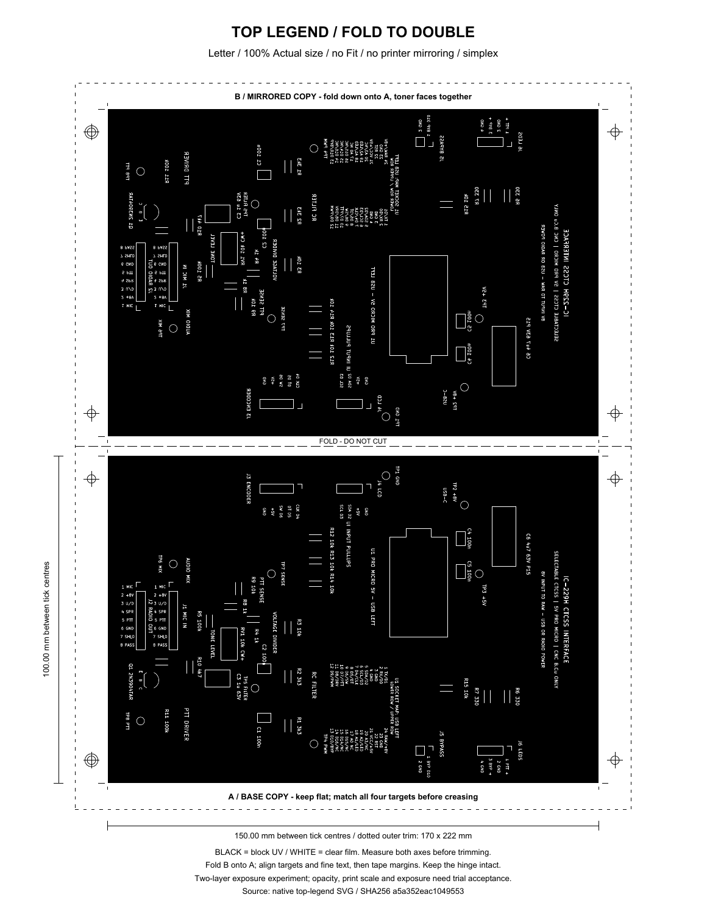

# Print and fold the double-layer legend mask

Start with one **Letter-size laser-printer-compatible transparency**, printed
on its designated printable face. Each board image is 150 mm across the page
and 100 mm high. B is above A, reflected across their shared fold. The user
found that one toner layer did not sufficiently block UV; this is the next
experiment with two overlapping toner layers.

| Step | File / material and holding | Action and next check |
| --- | --- | --- |
| Print | [Mask PDF](../manufacturing/pcb/carvera-air/print-masks/top-legend-negative-100x150mm.pdf), full Letter sheet | Print once, simplex, Actual size / 100%; cool flat |
| Measure | Cooled sheet flat on bench | Check 150 mm horizontal and 100 mm vertical tick-centre spans |
| Trim | Sheet on cutting mat | Cut the dotted outer 170 x 222 mm rectangle; retain fold and targets |
| Fold | A flat, toner up; B folds down onto A | Match targets and fine artwork; then crease and tape margins |
| Expose trial | Folded film held flat over top coating | A's unprinted face toward coating; inspect processed legend |

If a printed, cooled sheet already passes scale and print-quality checks, skip
printing it again. A prepared packet can skip folding after checking that its
layers have not shifted or been damaged.

## Gather and print

Use the linked PDF, a laser printer and compatible film; ruler or calipers;
straightedge, cutting mat and knife or scissors; tape for clear margins;
magnification and a visible-light backlight. For exposure, use the existing UV
coating setup, flat hold-down and coating-specific cleaning/development supplies.
Record the coating, lamp distance, exposure time and processing for this trial.
No new exposure settings are established by this layout.

Select **Letter, simplex, Actual size / 100%**, with Fit, duplex, toner-saving
and printer mirroring disabled. Use the printer's mode for the actual film.
These are selected print defaults; accuracy and UV blocking are physical checks.
The PDF also requests no viewer print scaling.

*Layout preview only: print the linked vector PDF, not this image or guide.*

1. Print the full sheet once and cool it flat. Do not feed folded film through
   the printer or pre-cut it for an unsupported feed size.
2. Measure between tick centres: **150.00 mm horizontal**, **100.00 mm vertical**.
   Record both measurements before trimming; check both copies against the board
   outline. If scale is wrong, correct the print setup and repeat. A uniform
   correction multiplier is intended / measured length only if both axes agree.
3. Inspect toner for pinholes, missing areas and smearing. Reject damaged artwork.
4. Cut the dotted **outer** rectangle, retaining its 10 mm side margins and all
   targets. Small ticks on the black field's edge extensions identify the board
   boundary; **do not cut out the masks separately**. The dashed horizontal line
   is a hinge, not a cut. Save usable clean offcuts for other work.

## Fold and accept alignment

1. Keep A flat, toner upward, with B extending above it. Bring B down onto A
   **with toner faces together**. Make a loose bend on the dashed line first;
   do not set a hard crease until aligned. The 6 mm gap places the crease 3 mm
   from either field.
2. Look through the packet against visible light. Match all four crosshair
   centres and rings; the double-ring target identifies the corresponding
   corner. Hold A fixed and adjust B and the loose hinge until targets agree.
3. Inspect fine text and connector outlines across the entire board under
   magnification. Each must have one outline, without doubled edges or narrowed
   clear strokes. If all corners cannot match, check unequal print distortion
   rather than forcing the film or accepting only local alignment.
4. Hold flat, gently crease outside the artwork and tape clear side/free-edge
   margins without stretching. Keep tape, bubbles and debris outside the field.
   Recheck after taping. Reopen and realign if shifted; reprint damaged toner.

The folded packet is **170 x 111 mm**. From lamp toward board, the exposure
stack is **B clear film / B toner / A toner / A clear film / coating**. Facing
toner layers keep the images close together; A's film still separates toner
from coating. Keep the packet flat to limit edge blur.

## Expose, inspect and hand off

1. Keep B uppermost, A's unprinted face toward the coating. From the lamp side,
   the legend matches A and reads normally after an in-plane rotation. Check an
   asymmetric feature, such as the USB opening and J1 labels, against the board.
   Do not turn the packet over or add another mirror.
2. Align the artwork boundary and asymmetric features to the board and apply
   the existing flat hold-down without shifting the layers. Film crosshairs
   register the two prints; they are **not jig-hole marks**. Preserve the existing
   PCB registration and zero strategy for any machining.
3. Black is intended to block UV and leave coating uncured; clear lettering is
   intended to transmit UV and cure. Follow the selected coating's exposure
   and processing procedure. This layout change specifies no new dose.
4. Remove the packet without smearing coating; process and clean as specified
   for that coating. Inspect the smallest text and broad blocked areas. Accept
   only if intended lettering survives and blocked areas clear as intended.
   Record settings and observations separately from PDF checks. Adjust and
   repeat the experiment if needed.
5. Inspect holes and clear coating obstruction before assembly using the
   [PCB fabrication guide](pcb-fabrication-guide.md). The existing laser-marking
   CAM route remains a separate process; this trial does not require laser
   marking over the exposed legend.

Two layers are the proposed remedy for observed UV leakage, not a measured
opacity result. Fine-line registration and exposure through this folded stack
remain the specific physical acceptance checks.

## Geometry and verification

The [generator](../tools/create-legend-print-test.py) retains all 1,141 white
vector paths from the [native SVG](../manufacturing/pcb/carvera-air/native-exports/icom-ctcss-board-top-legend.svg)
in each copy. Coordinates are millimetres from the PDF lower-left, not machine
coordinates:

- A: X=32.95..182.95, Y=40..140; original field rotated clockwise 90 degrees.
- B: X=32.95..182.95, Y=146..246; reflection about Y=143.
- Artwork, edge ticks and targets reflect by **(x, y) -> (x, 286 - y)**.
- Outer trim: X=22.95..192.95, Y=32..254; the fold bisects it.

The [current verification record](verification/folded-mask.json) identifies
input/output hashes, scale and reflected-vector checks. The final PDF was
rendered with Poppler and visually inspected for clipping, marker placement,
legibility and orientation. These checks validate the delivered layout, not
printer performance or UV exposure.
