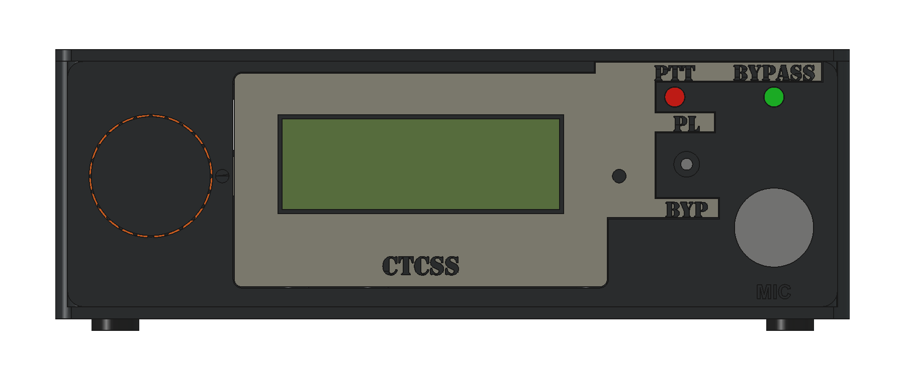

# P1 IC-229H companion enclosure

Built through FreeCAD MCP using FreeCAD 1.1.1. P1 brings the UI onto a front fascia: a large left ribbed knob, recessed LCD surround, small aligned indicators, front MIC and rear RADIO. A plain top and underside/rear fasteners keep the visible surfaces uncluttered. The body is 200 × 195 × 68 mm.

The direction takes the IC-229H's dark rectangular fascia, horizontal display and left knob as visual cues; see the [reference radio photo](https://medan-radio.blogspot.com/2015/03/icom-ic-229h.html). The taller 1602 display and existing 150 × 100 mm board determine this enclosure's proportions. Grey surround and amber band are separate printed parts. Color is optional; the print project uses one common filament slot and makes no multicolor hardware assumption.

## Construction and editing

Open the [native FreeCAD assembly](../../mechanical/enclosure/icom-ctcss-enclosure.FCStd). `EnclosureAssembly` contains nine named Part Design bodies and linked repeated washers/harness bridges. `FitCoupons` contains four independent native bodies. `InstalledHardware` contains clearly named reference envelopes and visible electronics/feet; these are excluded from print exports. `Dimensions` holds millimeter values. Expand a body to edit its constrained sketches, named Pads, Pockets and root fillet. Lettering uses editable Draft ShapeStrings as Pocket profiles. No custom workbench or feature proxy is required.

The [builder](../../tools/build-enclosure.py) reproduces the geometry. Case dimensions, component positions and corresponding mounts form a coordinated layout: changing a layout dimension requires reviewing its matching supports, openings, coupons and installed envelopes. Native sketches retain dimensions directly; spreadsheet expressions drive selected common dimensions and clearances. The saved source retains assembly coordinates; supporting STLs have separate print coordinates.

PCB local-to-case transform is X=175−boardY, Y=55+boardX, Z=9.35+boardZ. The four existing mounting holes are unchanged. The front bay keeps controls forward of Y30.2 and the carrier starts at Y55. The rear radio allocation ends 8.08 mm from the carrier allocation. Top removal exposes calibration and module extraction without disturbing the front UI.

Integrated PCB supports, printed washers, harness bridges, knob, band, LCD supports, connector nut cradles and LED keeper implement the printing bias. The [decision register](../requirements/enclosure-decision-register.md) records each retained purchase and its functional reason. The [manufacturing README](../../manufacturing/enclosure/README.md) gives quantities and assembly order.

## Print orientation and loads

The base prints floor-down. Upright walls carry cable torque in their continuous wall paths, with the rear connector cradle supported by a gusset. The cover prints exterior-down; its long columns grow axially from the broad panel and carry screw preload in compression. Fascia and surround print front-down, putting their XY face loads in continuous paths; connector axial pull acts across layers, so the captive nut land and broad reinforcement distribute it. Keep fasteners snug. PCB-post root fillets spread preload into the floor.

The knob prints front-down: its collar hoop and tangential clamp lie in the extrusion plane. The separate C-band is cosmetic and lightly loaded. The LED bridge prints rear-face-down, so the bridge sits on the bed and its retaining stems grow upward. Washers, harness bridges and coupons print flat. Short nut-seat roofs bridge 5.2–5.7 mm; the surround's mounting-ear ramps start with a full extrusion-width root and grow at approximately 45°. No support material is included.

## Current verification

- [CAD checks](../verification/enclosure-p1/cad-checks.json): valid single solids, fully constrained sketches, zero printed-part intersection volume and zero PCB/base intersection.
- [Mesh readbacks](../verification/enclosure-p1/mesh-checks.json): thirteen closed meshes, no detected non-manifold edges or self-intersections, Z=0 bed faces and oriented build-volume checks. The lettered surround uses Netgen; other parts use OCC tessellation.
- [Multi-plate checks](../verification/enclosure-p1/multi-plate-checks.json): embedded settings, nineteen instances, three plate assignments, saved geometry/transforms, brim/exclusion margins and sliced toolpaths.
- Layer inspection: [fascia/fit pieces](../verification/enclosure-p1/slice-01-fascia-and-fit-coupons.png), [base/retainers](../verification/enclosure-p1/slice-02-base-and-retainers.png), [cover](../verification/enclosure-p1/slice-03-cover.png).
- [Dimensioned layout](../verification/enclosure-p1/layout.svg), [base interior](../verification/enclosure-p1/base-interior.png) and [fascia rear](../verification/enclosure-p1/fascia-rear.png).

Acceptance and revision-specific prototype findings are maintained solely in the register. [P0.1](enclosure-p0.md) is historical evidence; its native baseline is preserved under `mechanical/enclosure/revisions/`.
