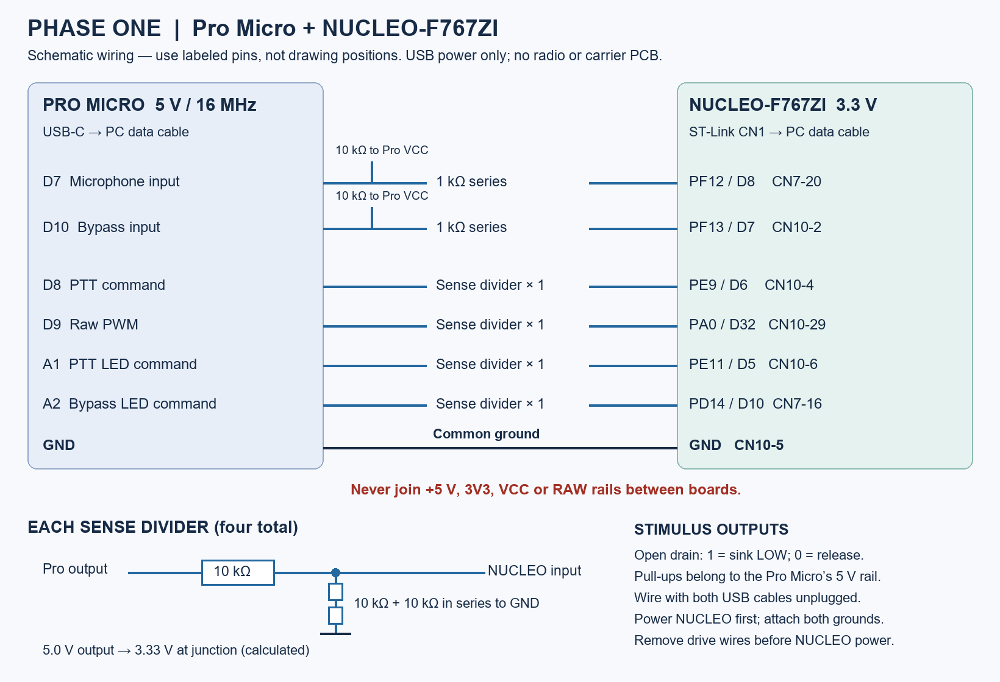

# Phase one: Pro Micro on a breadboard

Start with the **5 V / 16 MHz Teyleten Pro Micro on an unpowered solderless
breadboard**, USB connector accessible, and the **NUCLEO-F767ZI** beside it on
an insulating surface. Keep the carrier PCB, radio, microphone, RAW supply,
LCD and encoder disconnected for the basic tests. Both boards use their own
USB cables; connect their grounds, **not their power rails**.

This phase tests the firmware's digital interfaces. D9 is raw 10 kHz PWM;
its pulse widths encode the sine. The NUCLEO measures that encoding, not the
PCB's filtered audio or RF deviation. See the [firmware README](../../firmware/README.md)
for builds and the [implementation note](firmware-architecture.md) for resource ownership.

## Sequence at a glance

| Step | Run / use | How it is held and powered | Check before continuing |
| --- | --- | --- | --- |
| 1. Build and program | [build-firmware.ps1](../../tools/build-firmware.ps1), Arduino CLI, ST programmer | USB only, no inter-board signal wires | Correct identities; both firmwares respond |
| 2. USB checks | [phase1-test.py](../../tools/phase1-test.py) `--mode usb` | Same arrangement | Durable saves and watchdog USB recovery pass |
| 3. Build fixture | Wiring below | Both USB cables unplugged; Pro Micro straddles breadboard trench | Meter continuity and divider resistance |
| 4. Qualify wiring | `STOP`, `STATUS`, meter | NUCLEO powered first, then Pro Micro | Grounds common, D8 LOW, divided levels correct |
| 5. Automatic digital tests | `phase1-test.py --mode wired` | Keep both USB connections and all fixture wiring fixed | PWM frequency, bypass/latch, PTT latency, reset interlock |
| 6. Instrument / fault tests | Scope or sigrok; procedures below | Same fixture; optional controls added with power off | Record observations and explicit acceptance |
| 7. Handoff | `STOP`, disconnect | Remove drive wires before powering down NUCLEO | Keep reports; move to PCB tests only after acceptance |

If the exact current bench builds are already programmed and the USB checks
have passed, skip steps 1–2. An earlier firmware revision's report does not
qualify a changed build. Building never programs either device automatically.

## Tools and materials

- Pro Micro 5 V / 16 MHz, NUCLEO-F767ZI, solderless breadboard, jumper wires.
- Two USB data cables. Use the NUCLEO's ST-Link USB connector **CN1**, not its
  target USB connector. This particular Pro Micro enumerated after changing its cable.
- **Twelve 10 kΩ resistors** for four independent sense dividers: one upper
  resistor and two series lower resistors per divider. 1% preferred, 1/4 W is ample.
- **Two 1 kΩ series resistors** and **two 10 kΩ pull-ups** for PTT/bypass drive.
- Meter; optional oscilloscope, frequency counter or sigrok-supported logic analyzer.
  Use a probe/input rated for the voltage being measured. Probe divided nodes
  for 3.3 V-only analyzers. Logic thresholds must recognize the divided HIGH.
- Optional UI extension: three more 1 kΩ series resistors and three 10 kΩ pull-ups.
  The actual LCD and encoder are later additions, not prerequisites for the basic fixture.
- Python 3.12 with `pyserial==3.5`, Arduino CLI 1.3.1, the pinned board packages,
  Arm GNU 13.2.Rel1, CMake ≥3.22, Ninja, STM32CubeProgrammer. Full commands are
  in the [firmware README](../../firmware/README.md).

## 1. Program and confirm USB

1. Disconnect all signal wires. Build the Pro Micro **bench** configuration;
   it enables USB `SAVE` and `HANG`, but has no command to override the physical
   microphone input. Production builds omit these two commands.
2. Upload the sketch using the Pro Micro's detected port, and program the
   NUCLEO ELF using its identified ST-Link. Do not erase or replace bootloaders.
3. List ports with `python -m serial.tools.list_ports -v`. Pro Micro port numbers
   can change after upload; the first upload here changed COM7 to COM10.
4. On the Pro Micro, send `STATUS` plus newline at 115200. Expect `CTCSS1`,
   `bench=1`, `saved=1514` on first use, `tx=0`, `fault=0`, `lcd=0` and eventually
   `armed=1` with the input released. A previously saved valid tone is retained.
5. On the NUCLEO ST-Link COM port, send `ID`, then `STOP`. Expect `STANDIN1`
   and `OK stopped`. `STATUS` must show `armed=0 drive=0`. Unconnected sense
   pins float; ignore `sense` until the dividers are fitted.
6. Run the USB test, substituting the current ports:

   ```powershell
   python tools/phase1-test.py --pro COM10 --standin COM5 --mode usb --output .agent-scratch/firmware/usb-test.json
   ```

   It temporarily changes settings, checks durable-save completion, intentionally
   hangs the bench firmware and restores the original saved tone. USB reconnect
   time is **not** a measurement of D8 release time. Keep the radio disconnected.

## 2. Wire with both USB cables unplugged



The drawing is **schematic, not a breadboard hole map**. Arduino names refer
to each respective board; NUCLEO D8 is not the same wire as Pro Micro D8.
Use the NUCLEO connector/pin numbers below to disambiguate. Do not use the
Pro Micro socket-pad numbers as Arduino pin names.

### Common ground and stimulus outputs

| NUCLEO connection | Series resistor | Pro Micro connection | Pull-up at Pro Micro end |
| --- | --- | --- | --- |
| GND, CN10 pin 5 | None | GND | None |
| PF12 / D8, CN7 pin 20 | 1 kΩ | D7 microphone PTT sense | 10 kΩ to Pro Micro VCC (+5 V) |
| PF13 / D7, CN10 pin 2 | 1 kΩ | D10 bypass | 10 kΩ to Pro Micro VCC (+5 V) |

These NUCLEO pins are 5 V-tolerant digital pins configured **open drain with
no internal pull-up**. A command of `1` sinks LOW (pressed/closed); `0` releases
the line and the Pro Micro's 5 V pull-up supplies HIGH. Never substitute a
push-pull 3.3 V HIGH: it does not meet the ATmega32U4's guaranteed 5 V input
HIGH threshold. The 1 kΩ resistor limits accidental contention; it is not a
voltage converter. Both boards must remain powered while these wires are attached.

### Four separate sense dividers

Build this circuit **four times**. Each signal has its own divider:

```text
Pro Micro output --- 10 kΩ ---+--- NUCLEO input
                             |
                            10 kΩ
                             |
                            10 kΩ
                             |
                            GND
```

| Pro Micro output | NUCLEO input at divider junction | Purpose |
| --- | --- | --- |
| D8 | PE9 / D6, CN10 pin 4 | Radio PTT command; HIGH means commanded TX |
| D9 | PA0 / D32, CN10 pin 29 | Timer input capture of raw PWM |
| A1 | PE11 / D5, CN10 pin 6 | PTT LED command |
| A2 | PD14 / D10, CN7 pin 16 | Bypass LED command |

At a 5.0 V output, the selected 10 kΩ/20 kΩ divider gives **3.33 V** and draws
**0.167 mA** (calculated). At 5.25 V it gives 3.50 V before tolerance. These are
selected fixture values, not measured values. Divider lower legs also hold
the sense lines LOW while the Pro Micro is resetting. The dividers protect
the capture pin, which must not be treated as an arbitrary 5 V-tolerant input.

### Stop and inspect

1. With power off, verify NUCLEO GND to Pro Micro GND continuity.
2. Check each divider separately: approximately 20 kΩ from junction to GND,
   10 kΩ from output wire to junction. Check no direct +5 V-to-NUCLEO rail wire exists.
3. Verify D7 and D10 go to the two stimulus lines, while **D8 is a sensed output**.
4. Check no wire enters RAW, A0, TX/RX, MOSI/MISO/SCK or RST. Leave A0 untouched.
5. Remove loose resistor offcuts; keep exposed leads from bridging neighboring rows.

## 3. Power and qualify the fixture

1. Power the NUCLEO through CN1. Send `STOP`; outputs default released at boot.
2. Power the Pro Micro via USB. Keep the radio and external RAW power disconnected.
3. Measure Pro Micro VCC-to-GND, and record it. Meter D8 and A1: both should
   be near zero. D9 averages about half VCC while idle; a scope shows 10 kHz,
   50% duty, not a static DC output.
4. Query NUCLEO `STATUS`: with all lines released, `sense=0` is required.
   Bits are 1=D8, 2=A1, 4=A2. Stop and fix wiring if idle reads nonzero.
5. Send `ARM`, then `BYPASS 1`. Within 25 ms the A2 command should go HIGH;
   inspect the divided A2 junction (about 3.33 V for a 5 V source). Query
   `STATUS`: expect `sense=4`. Send `BYPASS 0` and confirm `sense=0`.
6. Send `PTT 1`, then `STATUS`: expect `sense=3`. Meter divided D8/A1 HIGH;
   send `PTT 0` and require both LOW. **Stop if a divided HIGH exceeds 3.6 V.**

The fixture expires its arm lease after five seconds without a command and
releases all driven inputs. `STATUS` refreshes the lease. If typing slowly,
send `ARM` again before proceeding; `ARM` first releases every input. `STOP`
always releases outputs. A host disconnect does not leave a test key held
indefinitely while the fixture's main loop is running. An independent watchdog
also resets a stalled fixture into released outputs (nominal two seconds,
LSI-clock dependent).

## 4. Run automatic wired tests

Close serial terminals so the runner can own both ports:

```powershell
python tools/phase1-test.py --pro COM10 --standin COM5 --mode wired --output .agent-scratch/firmware/phase1-wired.json
```

The runner requires all four sense dividers. It checks idle midpoint PWM,
low/middle/high tones, PTT press/release within 25 ms, bypass while keyed,
saving a pending tone, resuming the original latched tone and held-PTT
watchdog recovery. It sends `STOP` on exit and restores the original setting.
A failure is a stop/inspect point; retain its report, fix the cause and rerun
the affected test. Do not relax the ±0.1 Hz limit just to make a report pass.

Measurement windows are three seconds. `tone_mHz=151400` means 151.400 Hz.
The NUCLEO estimates sine frequency from hysteretic crossings of PWM pulse
width; this does not measure analog distortion. `errors` must be zero and
approximately 30,000 carrier periods must be present. The timer clock derives
from ST-Link's 8 MHz MCO. Absolute ±0.1 Hz acceptance also requires an adequate
reference clock; compare to a calibrated counter/scope if the margin is small.

## 5. Instrument and fault checks

### sigrok / oscilloscope

Use at least **1 MS/s** for 25 ms latency and gross PWM checks; use **10 MS/s
or faster** for pulse-width analysis. These are selected acquisition defaults.
Connect analyzer ground to the common ground. Channels: microphone stimulus
(D7, requires 5 V-capable input or an additional divider), divided D8,
divided D9, divided A1 and divided A2; include bypass stimulus when channels
permit. Label every channel in PulseView. Save the original `.sr` capture
with sample rate, thresholds, firmware hashes and probe points in the report.
Discover supported hardware with `sigrok-cli --scan`; no driver/device ID is
assumed. Configure the discovered device and channels in PulseView, or use
its documented sigrok CLI driver options.

1. Trigger on D7 falling. Require D8/A1 rising within 25 ms; then repeat on
   D7 rising for release. Repeat while issuing `STATUS` repeatedly and during
   `SAVE` activity. Check the waveform continues without missing PWM periods.
2. Toggle bypass while D8 stays HIGH. D9 must settle to fixed 50% duty and
   resume modulation within 25 ms; D8 must remain HIGH throughout. The selected
   modulation ramp is 5 ms. Measure filter decay separately in a later phase.
3. Hold PTT and send `HANG` to the bench Pro Micro. Capture D8 falling before
   one second and remaining LOW through boot while D7 stays LOW. Release D7,
   wait at least 10 ms, and press again: only this fresh press may key it.
   Repeat with bypass already enabled. Use the runner/regular `STATUS` to
   refresh the NUCLEO lease while holding inputs.
4. Power up/reset with PTT held; observe bootloader behavior too. Do not use
   USB enumeration or firmware status as substitutes for the pin capture.
5. Send `BOUNCE 1` and `BOUNCE 0` with the fixture armed. Each runs eight
   1 ms toggles then leaves the requested final state. Capture the stimulus
   and D8: brief intermediate closures must not key/release PTT, and the final
   stable transition must be acted on within 25 ms. Require `bounce_late_us`
   below 100 µs; inspect captures if it exceeds that selected scheduler bound.
   The runner checks final state/latency; analyzer captures check for unwanted
   intermediate pulses. Software debounce tests alone do not prove the pins.

### Optional controls and LCD failure

The basic build has `CTCSS_LCD_ADDRESS=0`, intentionally disabling unidentified
display hardware. UI state/gesture logic is host-tested. Once the actual
backpack is identified, set its 7-bit address and confirm the PCF8574 mapping
in [display.cpp](../../firmware/icom_ctcss/display.cpp), or adapt that module
for its identified controller. Do not infer compatibility from “1602.”

With power off, connect the identified LCD to D2/SDA, D3/SCL, VCC and GND,
including its required pull-ups. Add the real encoder or these fixture lines:

| NUCLEO pin | 1 kΩ series to Pro Micro | Pull-up |
| --- | --- | --- |
| PF14 / D4, CN10 pin 8 | D6 push button | 10 kΩ to Pro Micro VCC |
| PF15 / D2, CN10 pin 12 | D4 encoder A/CLK | 10 kΩ to Pro Micro VCC |
| PE13 / D3, CN10 pin 10 | D5 encoder B/DT | 10 kΩ to Pro Micro VCC |

`BUTTON 1/0` presses/releases; `ENCA` and `ENCB` follow the same active-low
convention. A positive detent is electrical AB **11→01→00→10→11**; configure
direction/transitions for the actual encoder. Short presses select/cycle;
hold 750 ms for long press. Check all four manual digits, Cancel, invalid range
feedback, all 50 presets, TX indication and pending save behavior.

During PTT, disconnect the LCD or hold SCL LOW through 1 kΩ. Require D8 and
the tone to remain correct, bypass to work, and all invisible menu gestures
to be discarded. Release the fault: the driver retries initialization each
second and returns home. Re-check normal display refresh within 200 ms.
The bus timeout is 1.5 ms per transaction. A display's missing ACK cannot
detect every visual failure (e.g. a failed LCD glass with a responding backpack).

## Finish and handoff

Send `STOP`, confirm `drive=0`, remove stimulus wires, then unplug the Pro
Micro and NUCLEO. Label and retain the fixture or photograph your wiring for
repeatability. Check breadboard contacts and re-seat loose leads before a repeat.
Promote accepted reports/captures to `docs/verification/firmware-phase1/` with
the source/build hashes; temporary runs belong in `.agent-scratch/firmware/`.

Phase two adds the assembled carrier's power, Q1 PTT load and reconstruction
filter; phase three adds the LCD/encoder if not tested earlier, and the radio
only after the [assembly prerequisites](assembly-and-bring-up.md) pass. The
fixture command protocol is designed to grow with these phases. No analog
radio emulator, RF load, or calibrated audio acquisition is implemented in
phase one. Amplitude, distortion, carrier leakage, clicks, microphone loading
and radio deviation remain later physical acceptance items.

Pin/electrical references: [ST UM1974, MB1137](https://www.st.com/resource/en/user_manual/dm00244518-stm32-nucleo-144-boards-mb1137-stmicroelectronics.pdf),
[ST DS11532](https://www.st.com/resource/en/datasheet/stm32f767zi.pdf),
[ATmega32U4 datasheet](https://cdn.sparkfun.com/datasheets/Dev/Arduino/Boards/ATMega32U4.pdf).
The fixture values are agent-selected; the target board/clock/pin allocation
and NUCLEO identity are established project inputs.
