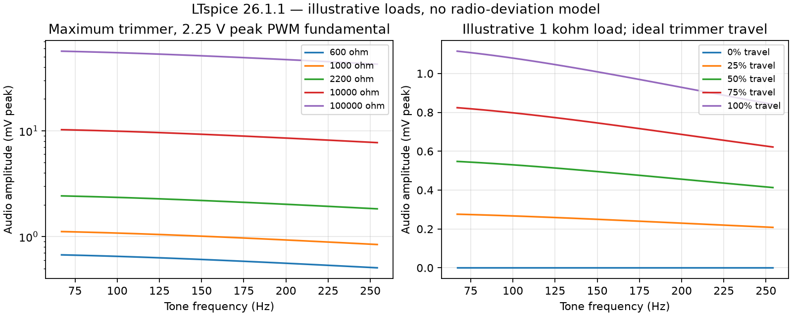
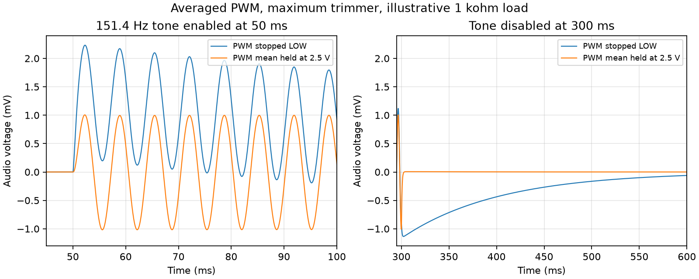

# LTspice validation before prototype manufacture

Checked **25 October 2026**, using LTspice **26.1.1 for Windows** and KiCad **10.0.0**. This is a targeted electrical review, not a new complete manufacturing audit. The schematic, board and project hashes exactly match the 22 October sourcing revision. No design files or manufacturing outputs were changed. [Source hashes, dependencies and tool identity](../verification/ltspice/manifest.json) identify the saved inputs, including project libraries and BOM.

**Verdict: NEEDS ATTENTION.** The simulated filter agrees with the earlier independent calculation; the documented radio PTT circuit is comfortably within the driver's capability in the modeled cases. Simulation identified a firmware tone-disable transient to address. Available tone/deviation headroom, the actual firmware spectrum, power budget and physical/CAM acceptance remain open. There is no simulation-backed reason here to change the PCB resistor values before resolving those requirements.

## Current-design checks

| Check | Result and scope |
| --- | --- |
| Fresh schematic export | All 61 maintained connectivity assertions pass; all 38 component values match the BOM |
| Schematic short detector | Zero detected shorts |
| ERC | Zero errors, zero warnings |
| Saved-board DRC | Zero errors, zero unconnected items; 115 warnings retained |
| Warning breakdown | 38 library footprint comparisons, 35 silk overlaps, 38 symbol/footprint field differences, four extra mounting-hole footprints |
| Schematic appearance | Fresh Konnect monochrome render inspected: readable functional groups, correct filter/trimmer/PTT topology; some annotations still describe 151.4 Hz as the example tone |

The fresh [ERC](../verification/ltspice/erc.json), [DRC](../verification/ltspice/drc.json), [export](../verification/ltspice/schematic.net), and [tone pin mapping](../verification/ltspice/connectivity.json) are retained separately from historical checks. DRC used saved files, without live-board synchronization or zone refill; this board has no copper zones. Its 73 physical warnings and 42 schematic-parity warnings are separate arrays in the report. The unchanged design hashes establish applicability of the prior layout review and warning dispositions; this run does not newly approve those warnings or machining.

## Tone amplitude and tolerances

The simulation includes R1-R5, C1-C3 and both sections of RV1, extracted from the fresh netlist. It uses ideal sources, linear passive parts, and illustrative resistive equivalents of the combined radio/microphone load. These resistances are test scenarios, not measurements of the radio. No model claims that a microphone's nominal impedance is the radio input impedance at subaudible frequencies.

Nominal AC analysis covers all 50 presets plus 10 kHz, five loads and five trimmer positions: **25 stepped cases, 1,275 frequency points**. At positive trimmer settings, the maximum relative difference from `tools/tone-response.py` is **2.6e-10**, below the selected 0.1% cross-check criterion. Output increases monotonically over the five modeled trimmer settings; ideal minimum output is effectively zero (the model uses a 1 milliohm numerical endpoint). Actual end resistance/contact variation can leave residual tone at minimum.

At maximum trimmer, with a **2.25 V peak tone fundamental** at D9 (90% sine modulation of a 0-5 V PWM duty range):

| Illustrative combined load | 151.4 Hz audio, mV peak |
| --- | ---: |
| 600 ohms | 0.606 |
| 1 kohm | 1.007 |
| 2.2 kohms | 2.189 |
| 10 kohms | 9.249 |
| 100 kohms | 51.046 |

At 1 kohm, the endpoints are **1.115 mV peak at 67 Hz** and **0.841 mV peak at 254.1 Hz**. The range falls about **2.44 dB** from low to high tone. The circuit is broadband across the specified tone range; its maximum level remains strongly load-dependent. Required injection voltage/deviation has no numerical acceptance target yet, so these results cannot establish sufficient headroom. Do not reduce R5 solely to improve an illustrative result: that also changes microphone loading and interaction.

The tolerance study exhausts **512 endpoint combinations** across R1-R5 (each +/-1%), C1/C2 (+/-10%), C3 (+/-5%) and RV1 total resistance (+/-10%), at each of five loads: **2,560 cases**, four frequencies each. The fixed-part tolerances come from the selected BOM; RV1's tolerance comes from the [Bourns 3296 datasheet](https://www.bourns.com/data/global/pdfs/3296.pdf). At 1 kohm/151.4 Hz, gain ranges **0.0004198-0.0004751 V/V**, approximately -6.2%/+6.2% about nominal. These are endpoint samples, not proven bounds over continuous tolerances, temperature, DC bias or aging. X7R capacitance changes with operating conditions are not modeled.

## PWM reconstruction

The switched model compares a continuous sine duty command with a 10 kHz ramp, generating ideal 0/5 V pulses. It runs for 1.2 seconds to allow the coupling network to settle, retaining the last 0.2 seconds. It is an illustrative source, not a simulation of the ATmega timer, firmware, quantization or update jitter.

| Tone | Simulated fundamental, mV peak | Central 10 kHz component, microvolts peak |
| --- | ---: | ---: |
| 67 Hz | 1.114 | 2.413 |
| 151.4 Hz | 1.006 | 2.417 |
| 254.1 Hz | 0.842 | 2.413 |

These results use the 1 kohm load and maximum trimmer. Fundamental amplitude agrees with the AC prediction within 0.1%. The central carrier is about **-53.3 to -50.9 dBc** in this source model; this excludes sidebands and is not total out-of-band noise. The independent small-signal 10 kHz/151.4 Hz transfer ratio is **-47.50 dB**; differing source amplitudes explain why that is not the same number.

The central-carrier values use trapezoidally weighted sine/cosine fitting over the final five tone periods. The MCP waveform export resets the delayed-start time axis to zero; the fit uses the exported endpoint and does not mistake it for absolute simulation time.

A 151.4 Hz rerun with maximum timestep halved from 0.5 to 0.25 microseconds retains the logged **1.006 mV** fundamental. Small harmonic estimates are timestep-sensitive: partial distortion changes from 0.0465% to 0.0208%, while LTspice's total distortion readout changes from 0.432% to 0.408%. **No hardware THD acceptance claim is made from these numbers.** Final firmware must be checked for harmonics, sidebands, carrier residue and radio deviation against agreed numerical limits.

## Tone enable/disable transient: firmware action

Changing between stopped-LOW PWM and sine-modulated PWM changes the filter's average input between 0 and 2.5 V. C3 blocks the final DC level, but passes the transition. The averaged-source model enables tone at 50 ms and disables at 300 ms, at the three representative frequencies, comparing LOW idle with a maintained 2.5 V average.

At the illustrative 1 kohm load and maximum trimmer, LOW idle leaves **0.913-0.923 mV** at the audio node **25 ms after disabling**, and about **0.100-0.101 mV after 250 ms**. This is a decaying baseline transient, not a continuing CTCSS sine. Its approximately **102 ms** time constant follows C3 and the roughly 100 kohm series mixing path. It can cause a click/low-frequency disturbance during bypass, where PTT remains asserted.

Holding the mean constant reduces the 25 ms residual to **1.3-6.0 microvolts** in these cases. The initial few milliseconds still depend on phase and stored filter energy.

**Recommendation for firmware implementation:** retain 50% PWM duty during idle/bypass and ramp the sine modulation about that center, rather than stopping D9 LOW for ordinary tone disable. Establish the center at startup before arming PTT. Keep the agreed PTT/bypass command timing; define and test a short amplitude envelope separately. A 50% duty idle still produces switching carrier, so idle carrier/noise and reset/power transitions require bench checks. This is a recommendation supported by the model, not a claim that firmware has been implemented or physical clicks eliminated.

## Radio PTT: service-manual load replaces the initial assumption

The manufacturer-authored [IC-229A/E/H service manual scan](https://www.radiomanual.info/schemi/ICOM_VU/IC-229A_E_H_serv.pdf), **section 9, LOGIC UNIT schematic, PDF page 36**, provides the expected load. Its document hash and exact trace are recorded in the manifest. View that scanned page rotated clockwise.

Radio J1 microphone **pin 5** connects to **D12 (1SS193) cathode** and **C15 (0.001 microfarad)**. D12's anode is pulled toward the 5 V logic rail through **R56=22 kohms**. From that anode, **R57=220 kohms** feeds **Q5 (2SC2712)** base, with **R58=100 kohms** from base to ground. Q5's collector has **R53=100 kohms** to the logic rail. These radio reference numbers are distinct from the carrier-board references.

When our transistor grounds PTT, the expected current is approximately:

`I_PTT = (5 V - V_D12 - V_CE)/22k - (V_D12 + V_CE)/(220k + 100k)`

For a roughly 0.6 V diode drop and small collector voltage, this is **about 0.20 mA**, not 5 mA. Even neglecting the diode drop gives a simple nominal upper bound of **5/22k = 0.227 mA**. An exploratory 5.25 V rail and 5% low pull-up resistor would raise that conservative bound to 0.251 mA; those variations are selected sensitivity assumptions, not stated radio tolerances.

`ptt-radio.cir` transcribes that network with generic diode/NPN models, then connects the board's R10=4.7 kohms, R11=100 kohms and Q1. Six cases use GPIO source levels 4.2/5 V and logic rails 4.75/5/5.25 V, a selected 25 ohm GPIO switch resistance and 1 microampere leakage into the floating output. Results:

- PTT sink **0.189-0.211 mA**; nominal 5 V rail approximately **0.200 mA**.
- Asserted PTT **20.6-21.5 mV**; below the selected 0.2 V check criterion.
- Reset/floating GPIO releases PTT to **4.21-4.67 V**; above the selected 4 V criterion.
- The modeled radio detector output goes HIGH when keyed (4.75-5.25 V) and LOW when released (47-48 mV).

The retained **5 mA** test is now explicitly a **margin test**, modeled as 8 V through 1.6 kohms. Across generic transistor gains 40/100/300 and GPIO drive 4.2/5 V, collector voltage is **52.8-61.1 mV**, base current **0.733-0.902 mA**, and the floating output releases to approximately 8 V. These models demonstrate topology and margin; they are not onsemi process-corner models.

The exact transistor's [onsemi datasheet](https://www.onsemi.com/download/data-sheet/pdf/2n3904-d.pdf), October 2024 revision 3, gives a 0.2 V maximum saturation voltage at 10 mA collector/1 mA base under its stated test conditions. Do not extrapolate that limit as a guaranteed result at arbitrary current/temperature. Here the documented radio load requires much less current than the retained margin test. The schematic now supplies an adequate design basis; a prototype PTT check is confirmation of implementation and cable wiring, rather than the only basis for choosing the load.

## Remaining prototype acceptance

1. Establish the required injected tone voltage/deviation and the combined radio/microphone impedance across 67-254.1 Hz; compare those with maximum available amplitude before accepting calibration range. The service manual can help model the radio audio stage, but microphone interaction and required deviation still need an explicit target.
2. Implement centered PWM and the tone envelope; check actual D9 waveform, idle carrier, bypass transients and tone spectrum. Reset/high-impedance release is supported; a software hang with D8 HIGH remains a firmware watchdog concern.
3. Complete the existing full-load power/thermal budget and checks for the Pro Micro, LCD/backlight, encoder and LEDs. The accepted nominal 8 V RAW architecture remains the project input; no regulator model was invented for the unidentified module internals. The service schematic also shows a 10 ohm series feed (radio R71) to microphone power, which belongs in the eventual load/drop budget.
4. Follow the existing [assembly/bring-up procedure](assembly-and-bring-up.md) for cable mapping, current-limited power, unpowered continuity, machining coupons and hardware fit. Confirm PTT voltage/current and behavior against the documented expectation before normal radio operation.

This run does not recheck procurement inventory, USB backfeed, regulator stability/thermal limits, ESD/RF pickup, PCB parasitics, CNC tolerances, assembly workmanship or actual radio deviation. No newly selected purchased parts are required by this review.

## Reproduction and retained evidence

The [simulation package](../verification/ltspice/README.md) contains editable `.cir` inputs, relative `.include` dependencies, pin mapping, CSV results, exact solver logs, numerical summary and source hashes. All seven runs completed without logged solver warnings or convergence failures. Final evidence is independent of `.agent-scratch/`; intermediate raw waveforms, databases, inspection downloads and one-off processing scripts are disposable.
