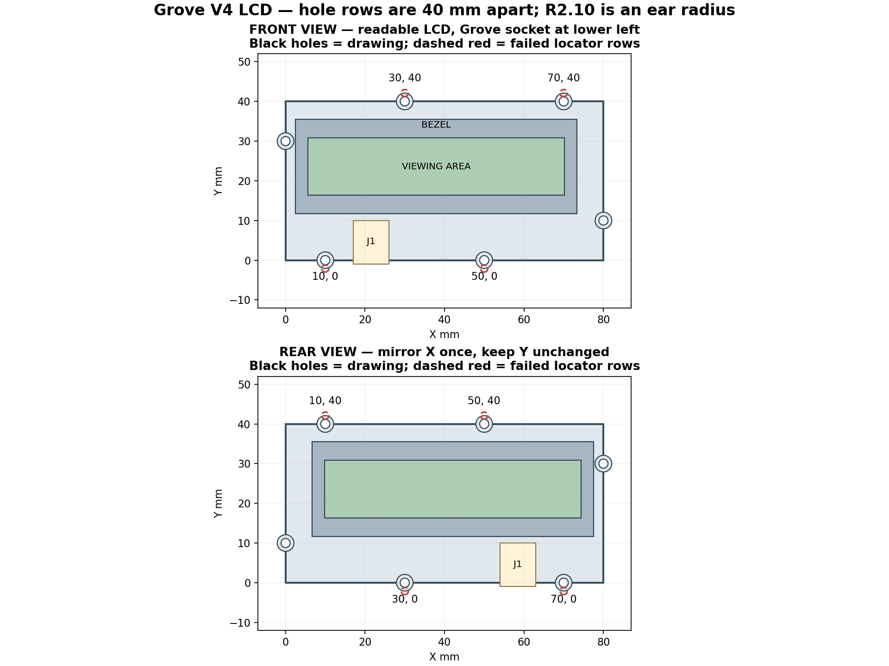
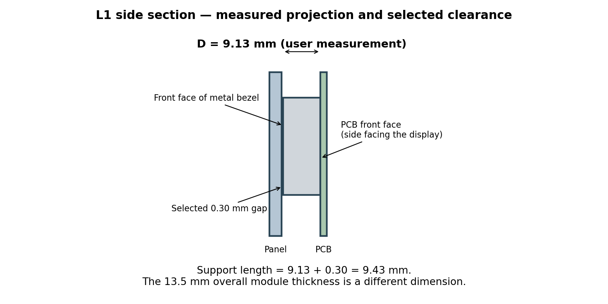
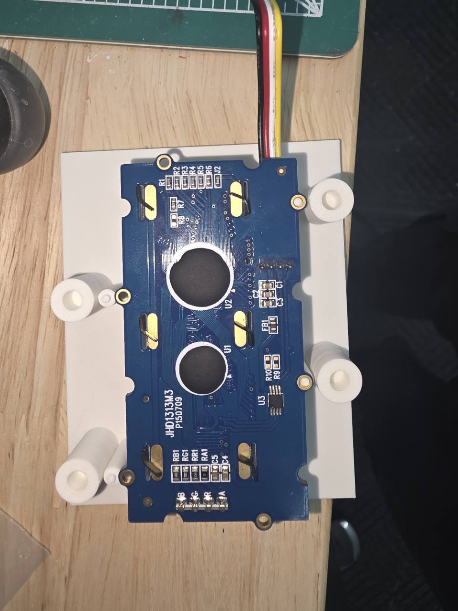
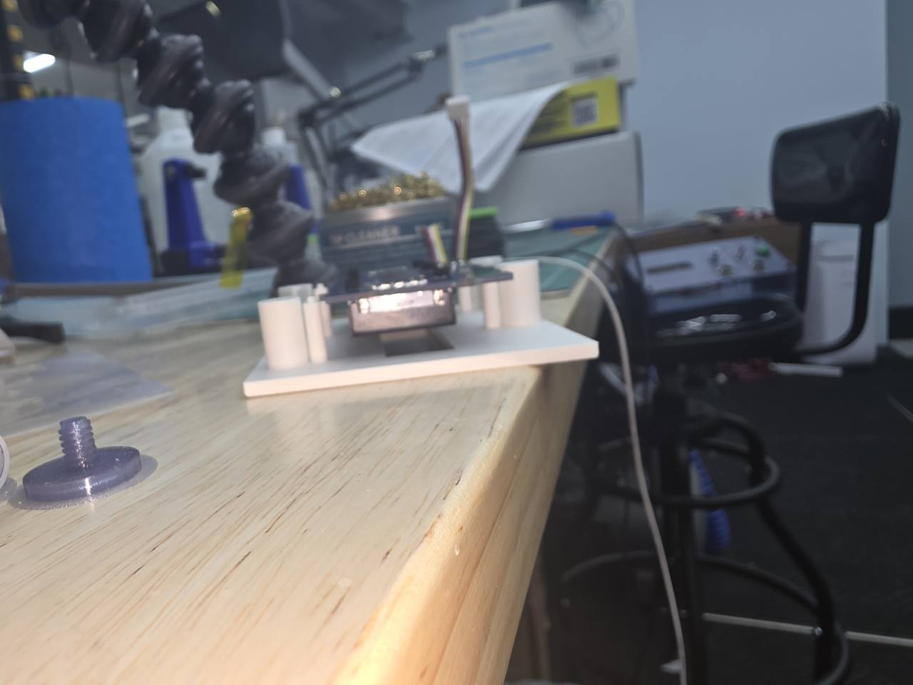
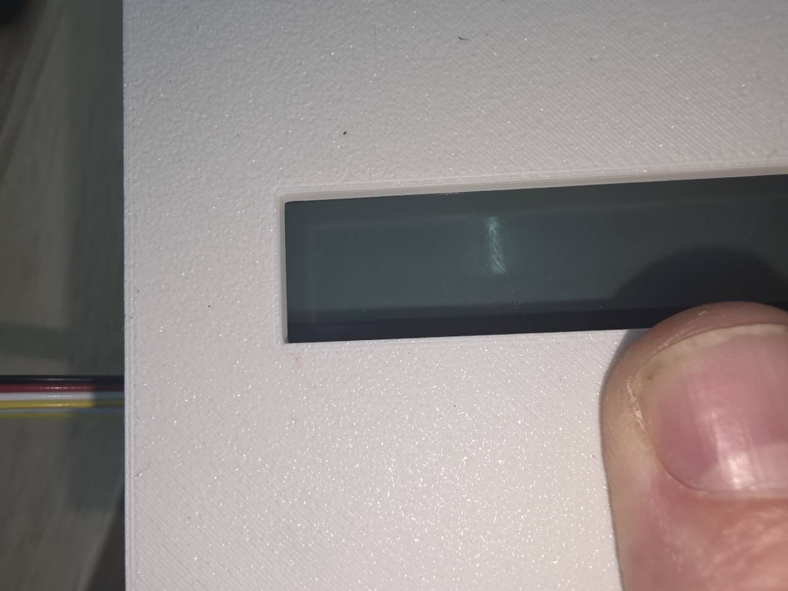

# LCD fit correction L1 — original coupon failed

The user physically tested the original B2 screen coupon and reported that its
size and alignment failed. **L1 replaces that geometry in both B2 and C1** using
the corrected drawing datums and the user's **9.13 mm** bezel projection.
Retest the new coupon before a full panel. The original digital checks validated
the generated geometry, not its correspondence to the physical display.

## What was wrong

1. I misread **R2.10** in the manufacturer's drawing as a displacement of the
   mounting holes. It is the radius of each mounting ear. The four used hole
   centers are at front-view **(10,0), (50,0), (30,40), (70,40)**, in mm. The row
   spacing is **40 mm**, whereas I generated **44.2 mm**. This error was copied
   from B2 into C1.
2. The viewing window was **2.45 mm too low** relative to those holes. The
   14.5 mm viewing area's bottom is **40 − 9.16 − 14.50 = 16.34 mm** above the
   PCB bottom datum. With 0.5 mm per-side clearance, the window bottom is 15.84 mm,
   rather than the generated 13.39 mm. Its nominal size remains 65.5 × 15.5 mm.
3. The clearance reference omitted two unused side ears. L1 includes all six,
   even though only four are supported. To clear the unchanged left rail by
   0.5 mm, the board datum moves to X15.6 in B2 and X12.6 in C1. This is a reference
   correction, not a PCB alteration.
4. The 14 mm support depth was chosen from overall module thickness rather than
   the front projection. The side photograph shows the resulting large bezel gap.
   The supplied **9.13 mm PCB-front-to-bezel-front** measurement gives a new
   **9.43 mm** seat depth including the selected 0.30 mm gap. This is 4.57 mm
   shorter than the failed support; the 13.5 mm overall thickness is a different
   measurement.

Source: [JHD1313 V4 drawing, page 23](https://files.seeedstudio.com/wiki/Grove_LCD_RGB_Backlight/res/JHD1313%20FP-RGB-1%201.4.pdf#page=23).
The photographs establish a physical failure; dimensions above come from the
drawing rather than perspective-image scaling. The [physical failure record](verification/lcd-fit/failed-coupon-2026-11-17.json)
retains the reported result and affected revisions.

*Front view has the Grove socket at lower left. Rear view mirrors X once and
retains Y. The four used holes are labeled; the two unused side ears remain in
the interference reference. Red circles show the original failed locator rows.*

## Measured depth and the revised coupon

The user reports **D = 9.13 mm**, from the PCB front face to the front face of the
metal bezel. The [caliper photograph](images/lcd-fit/bezel-projection-caliper.jpg)
records the setup; the numeric reading is user-supplied because the photograph's
display was blurred. L1 sets the seat **9.43 mm** behind the panel rear face.
The **0.30 mm air gap** is a selected clearance, avoiding bezel preload. The
nominal 1.6 mm PCB rear is Z−11.03 relative to the panel rear; C1's 3 mm clip
starts at Z−14.03. B2's 2.4 mm printed screw head starts at Z−13.43.

The [shared interface definition](../mechanical/interfaces/grove-lcd-v4.json)
and [helper](../tools/grove-lcd-v4.py) now supply B2 and C1 hole/window datums from
one source. Both native panels/coupons and their primary 3MF projects are
regenerated from that definition. All six ears are included in rail clearance,
even though four are used for retention. The original 14 mm value is removed;
generation refuses a missing depth instead of guessing one.

For the shortest B2 retest, open [lcd-fit-l1.3mf](../manufacturing/lcd-fit/lcd-fit-l1.3mf)
and reuse the four undamaged printed thumb screws. This project contains only
the corrected screen coupon. Its full [print/fitting procedure](../manufacturing/lcd-fit/README.md)
includes exact dimensions and acceptance checks. The primary
[B2](../manufacturing/bench-panel-b2/README.md) and
[C1](../manufacturing/enclosure-c1/README.md) projects retain their own separate
test plates. C1's M3/insert clip retention must be checked in its own PLA/profile.
Do not enlarge LCD holes, bend ears or use torque to draw a misaligned module
onto its pins. L1 digital checks do not constitute physical fit acceptance.

## Physical evidence

