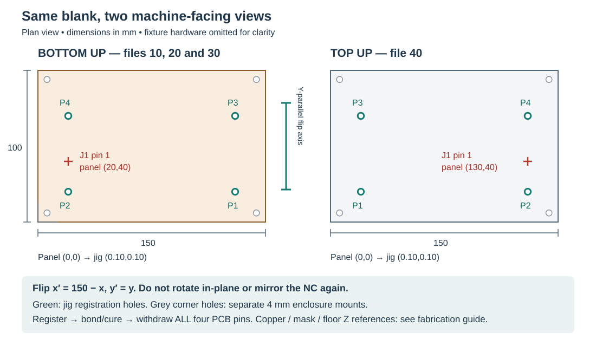
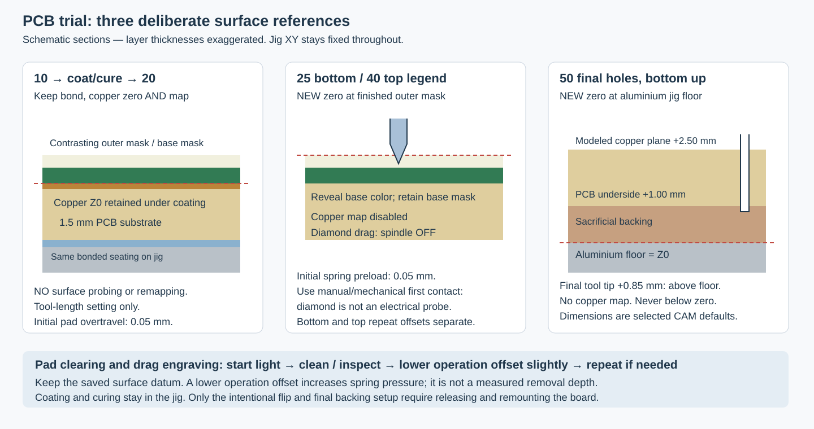
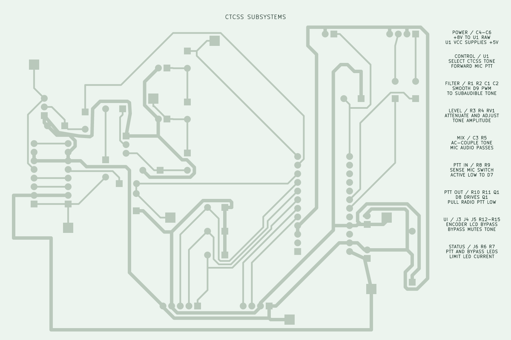

# Making the Icom CTCSS PCB on the Carvera Air

**Archived 2026-11-10 diamond-drag candidate.** The sublimation feature branch
uses the [current white-mask guide](pcb-fabrication-guide.md). This file preserves
the former procedure; its linked shared files remain the unchanged review CAM.

Start with a **150 × 100 × 1.5 mm single-sided blank**, 150 mm along machine X,
**bottom copper up**. Use the four accepted jig registration holes; skip file 00
if they are already prepared. Machine before fitting components.

This **2026-11-10 candidate** keeps all coating/curing in the jig, engraves both
legends through contrasting outer mask layers, with the bottom legend optional,
and drills only after both faces
are finished. Files are review outputs; no machine run or physical acceptance
is claimed. Record results in the [archived attempt log](pcb-diamond-drag-attempt-log.md).

## Sequence at a glance

| Run this linked file | Holding and reference | Afterward |
| --- | --- | --- |
| [00 — registration preparation](../manufacturing/pcb/carvera-air/review-nc/00-registration-preparation.nc), unprepared blanks only | Jig absent; blank-corner XY, copper-top Z0; sacrificial wasteboard | Deburr and accept all four jig holes; move to jig |
| [10 — bottom isolation](../manufacturing/pcb/carvera-air/review-nc/10-bottom-copper.nc) | Registered tape/CA bond; PCB pins removed; exposed-copper Z0 and thorough height map | Inspect copper and check continuity/isolation |
| Coat/cure bottom, then [20 — pad clearing](../manufacturing/pcb/carvera-air/review-nc/20-bottom-mask-removal.nc) | Same undisturbed bond, original copper Z0 **and map** | Clean/inspect and repeat conservatively if needed; no circuit holes |
| [25 — optional bottom legend](../manufacturing/pcb/carvera-air/review-nc/25-bottom-legend-drag.nc) | Same bond/XY; new finished-mask surface Z0; disable copper map | Inspect contrast/base mask, or skip from accepted pad clearing directly to the top-face flip |
| Flip, coat/cure top, then [40 — top legend](../manufacturing/pcb/carvera-air/review-nc/40-top-legend-drag.nc) | Top up; register/bond/remove pins; new finished-mask surface Z0 | Clean/inspect; repeat only if needed |
| [50 — final holes](../manufacturing/pcb/carvera-air/review-nc/50-bottom-holes.nc) | Remove board; zero aluminium floor; add sacrificial backing; remount bottom up; no height map | Inspect 111 electrical holes and four enclosure mounts; deburr/check electrically |
| Conditional final profile | Last, retained workholding and same floor limit | Not needed on this finished-size blank; no profile NC supplied |

Each program ends separately. Complete the intervening coating, cleaning and
inspection before loading the next; NC does not enforce manual transitions.

## Tools, supplies and initial settings

- Blank and completed jig; four **4 × 20 mm setup-only PCB pins**. The two bed
  locator pins and jig mounting screws stay installed.
- Painter's tape/CA, IPA, wipes, light sanding abrasive, chip/deburring tools,
  magnification, multimeter and representative component/header leads.
- Base-color and contrasting-color UV solder mask plus the curing source.
  Record the actual products, coats and cure times; use product curing instructions.
- Sacrificial wasteboard for optional file 00. For final holes, **1 mm flat
  sacrificial backing is the selected starting setup**, keeping sockets and
  release ports clear. The aluminium is never sacrificial material.
- **T2:** 30° V-bit / 0.2 mm tip. **T3:** Makera 0.8 mm corn bit.
- **T4:** Makera spring-loaded mask remover, 0.3 mm / 30°, 3.175 mm shank.
- **T6:** owned spring-loaded diamond drag tool, **6.35 mm / ¼-inch shank**,
  **90° tip** selected for this attempt, matching collet, **spindle off**.
  The owned 120° tip is an alternative for a later trial.

Diamond cannot use electrical tip touch-off. Set finished-mask contact manually
or mechanically and follow the applicable tool-length procedure. Native tool
length 95.25 mm and nominal line width 0.127 mm are matching WidgetWorks model
references, not measurements of the owned tool. Check actual body/holder reach
and clearance to the bed pins, screws and jig before running.

| Program / tool | RPM | Feed / plunge, mm/min | Initial depth and motion |
| --- | ---: | --- | --- |
| 00 / T3 | 12,000 | 500 / 100 | Copper Z−1.65; 0.3 mm stepdown; 40% stepover |
| 10 / T2 | 12,000 | 100 / 30 | Copper Z−0.10; 0.15 mm isolation offset |
| 20 / T4 | 6,000 | 400 / 200 | Copper Z−0.05 initial spring overtravel |
| 25 and 40 / T6 | **0 / off** | 300 / 100 | Mask Z−0.05 initial spring preload; 0.05 mm hatch |
| 50: 46 × 0.9 mm bores / T3 | 12,000 | 55 / 50 | Floor Z+0.85; helix pitch 0.01 mm/revolution |
| 50: 65 × 1.1 mm bores / T3 | 12,000 | 135 / 50 | Floor Z+0.85; helix pitch 0.03 mm/revolution |
| 50: four 4 mm mounts / T3 | 12,000 | 500 / 100 | Floor Z+0.85; 0.3 mm stepdown; 40% stepover |

Clearance is Z+15 mm. Normal safe height is 2 mm above the modeled work surface,
Z+4.50 for file 50. The holes are corn-bit interpolations, not twist-drilled holes.
File 50 models the PCB underside at +1.00, copper plane +2.50 and 0.15 mm
breakthrough. Thin adhesive/coating below the PCB increases penetration into
backing. No tip path may reach or pass below floor zero. For materially different
support, update native `SupportHeight`, regenerate and check file 50.

[Makera's reference](https://global.makera.com/products/uv-solder-mask-removal-tool-1-8-shank)
is 6,000 RPM, 400/200 mm/min and 0.2 mm DOC. Our **0.05 mm** initial overtravel
is a conservative selected trial value. The
[matching drag-tool manual](https://bitsbits.com/wp-content/uploads/2022/02/CNC-Engraver-250-Directions-for-Use-2021.pdf)
supports nonrotating operation; our drag preload/feed/hatch are trial choices for
this coating stack. These settings are not physically qualified here.

## Face, registration and surface references

Keep **XY at the jig pocket lower-left / Anchor 1**. Panel-to-jig mapping is
J=(x+0.10,y+0.10). Flip about the Y-parallel midline: x′=150−x, y′=y.
FreeCAD applies the face transform once; do not mirror NC/artwork again.
J1 pin 1 is bottom J=(20.10,40.10), top J=(130.10,40.10).

For every mounting: register on four PCB pins, seat/cure the tape/CA bond,
withdraw **all four**, then check no movement. Pins locate; the bond retains.
Do not unnecessarily rebond between programs on an undisturbed setup.

| Stage | Z reference and compensation |
| --- | --- |
| 10 through 20 | Original copper Z0 and original copper height map; unchanged seating |
| 25 and 40 | New finished-mask surface Z0 for the presented face; copper map disabled |
| 50 | New aluminium-floor Z0 established with board removed; backing added afterward; no map |

Reference changes are manual **between programs**. NC selects G54 but does not
rewrite its origin. The copper map is retained/applied in Controller; it is not
embedded in the nominal NC. Between initial copper mapping and pad clearing,
**NO probing except tool-length setting** is allowed. Tool-length setting must
preserve the work datum and map.

## 00 — prepare registration holes only if needed

1. Keep the jig absent. Bond the blank to sacrificial wasteboard with independent
   edge datums. Set blank lower-left XY0 and actual copper-top Z0.
2. Preview/run file 00 with T3; protect its Z−1.65 breakthrough.
3. Remove, deburr/clean both faces and accept spacing and slip fit before production.

| Holes | Panel centers, mm | Finished fit for measured 4.000 mm pins |
| --- | --- | --- |
| P1/H5, P2/H6 | (20,20), (130,20) | 4.02–4.04 mm, nominal 4.03 |
| P3/H7, P4/H8 | (20,70), (130,70) | 4.10–4.15 mm, nominal 4.12 |

For other pin sizes, use pin +0.02–0.04 / +0.10–0.15 respectively. Check
110 × 50 mm spacing; never force binding pins. H1–H4 are separate enclosure mounts.
An accepted prepared blank skips file 00 entirely.

## 10 — isolate and inspect bottom copper

1. Clean/register/bond bottom up, keeping the top support face bare. Keep tape/CA
   out of sockets and push-off mouths. Remove PCB pins and check seating/XY.
2. Establish exposed-copper Z0 and obtain a thorough board height map. Retain
   both through file 20; disable subsequent start options that would replace either.
3. Preview/run file 10 with T2. Clear chips, inspect channels and remove whiskers
   without lifting copper, particularly around pad/track junctions and headers.
4. Check continuity and unintended shorts against the
   [schematic](reference/schematic-complete.pdf), including +8 V, +5 V and GND.
   Accept exposed copper before coating.

## Coat/cure bottom in place, then 20 — open pads

1. Leave the board bonded in the jig. Apply thin base-color layers; cure, lightly
   sand between layers for bonding and clean away residue before recoating.
   Keep registration holes clear and seating unchanged throughout.
2. If running the optional bottom legend, add just enough thin contrasting outer
   layers to hide the base; cure them. Otherwise, contrasting bottom coats are
   unnecessary; complete/cure the protective base coating before pad clearing.
   **All coating and curing happen without removing the board from the jig.**
3. Fit/calibrate T4 while retaining copper zero/map. No surface probing or remapping.
4. Run file 20 over all **111 pads**. Paths retain at least a planned 0.10 mm mask
   rim; the conservative XY allowance from 0.2 mm overtravel remains despite the
   lighter 0.05 mm initial setting. Clean and inspect useful pad exposure and copper.
5. Prefer removing too little. If needed, lower **`MaskPassOffset`** slightly
   (−0.01 mm is a selected example increment), recompute/export/recheck and repeat.
   Preserve the saved copper zero/map. Inspect between passes; record total offset.

This changes spring pressure, not a known removal depth. Stop for copper lifting,
tool bottoming or coating tearing. Circuit/enclosure holes must not exist yet;
do not rerun this pad path over drilled holes where its tip could drop in or snag.

## 25 — optional bottom subsystem legend

**Run this toolpath only if you want the supplied bottom subsystem lettering.**
The artwork and CAM job remain available. To omit it, finish and inspect pad
clearing, then proceed directly to the top-face flip below. Skip the bottom drag
tool setup and mask-surface Z setting as well. Top legend and final-hole steps
are unchanged.

*Actual B.SilkS/B.Cu bottom-view geometry. Pale copper is an orientation reference,
not exposed copper in the finished coating.*

1. Retain bond/XY; disable copper mapping and obtain **new finished-mask Z0**
   by manual/mechanical first contact with T6. Keep the spindle off.
2. Preview/run file 25 with the 90° tip. Clean and inspect the revealed base color.
3. If needed, lower **`BottomDragPassOffset`** slightly, regenerate/recheck and
   repeat. Keep the saved mask-surface datum. Stop for peeling, chipping or base-mask
   penetration; retain continuous base insulation and readable lettering.

The legend gives component references and jobs for power, control, PWM filtering,
level adjustment, audio mixing, PTT input/output, UI and status LEDs.

## Flip, coat/cure top in place, then 40 — top legend

1. Release carefully, protect the finished bottom, flip about Y and register/bond
   top up. Withdraw PCB pins and check J1 pin 1.
2. This board needs **no top copper isolation or top pad opening**. Apply/cure thin
   base coats, lightly sand/clean between layers, then add/cure contrasting coats.
   Keep the board in the jig throughout.
3. Obtain finished-mask Z0 with copper mapping disabled; fit/set T6, spindle off,
   and preview/run file 40. Clean and inspect.
4. If needed, adjust **`TopDragPassOffset`**, regenerate/recheck and repeat.
   It starts at zero independently of any bottom repeat-pass correction.

For future double-sided boards, map/isolate top copper first and preserve that
face's zero/map through coating and pad clearing, with only tool-length setting
in between. Additional top copper/pad jobs would be needed; this single-sided
package intentionally does not contain them.

## 50 — final holes with sacrificial backing

1. After both faces are finished, remove the board and clean the jig. Obtain new
   Z0 at the **aluminium floor**, preserving jig XY.
2. Add the sacrificial backing and register/bond bottom up. Keep sockets/release
   ports clear; remove all PCB pins. Do not zero on the PCB or reuse its copper map.
3. Preview file 50: nominal 1 mm support, minimum tip **Z+0.85 mm**, complete
   breakthrough into backing and every motion above floor Z0. Fit/calibrate T3
   while preserving floor zero. Keep this a practical hobby setup.
4. Run 111 electrical bores and four enclosure mounts. Do not recut jig holes.
   Clean/deburr, inspect all holes/both coatings, check lead fit and repeat electrical
   checks. No perimeter operation is needed for the finished-size board.
5. A later profile job, if needed, runs last with retained workholding and the
   same floor limit; prepare and check it before use.

## Release, clean and hand off

1. Stop the spindle and release the bond with the established IPA method; allow
   surfaces to dry. If needed, remove the jig from its bed locators and use gentle
   alternating pressure through the board push-off ports. Do not force a still-bonded
   board or confuse pin-ejection bores with release ports.
2. Remove adhesive, debris and burrs. Inspect copper, pads, all **119 holes**
   including four prepared jig holes, both coating stacks and any engraved legends.
3. Record actual products/coats/cures, offsets/pass counts, exposure, adhesion and
   contrast in the [attempt log](pcb-attempt-log.md), separately from CAD checks.
4. Continue to [assembly and bring-up](implementation/assembly-and-bring-up.md)
   using the [BOM](reference/bom.csv) after fabrication checks pass.

## Editing and evidence

- [Native CAM](../mechanical/pcb/icom-ctcss-pcb-cam.FCStd),
  [manufacturing package](../manufacturing/pcb/carvera-air/README.md),
  [regeneration tools](../tools/README.md).
- [Revision manifest](verification/pcb-revision.json),
  [saved CAM readback](verification/pcb-cam-reopen.json),
  [posted-motion checks](verification/pcb-posted-motion.json),
  [bottom legend verification](verification/pcb-bottom-legend.json).
- [Registration drawing](../manufacturing/pcb/carvera-air/registration.svg)
  and [coordinate contract](implementation/pcb-jig-and-freecad-cam.md).

The laser and [folded-transparency experiment](folded-mask-guide.md) are historical
alternatives. Do not substitute their programs into this attempt. Physical success
is pending; keep this workflow local until results justify skill-library promotion.
