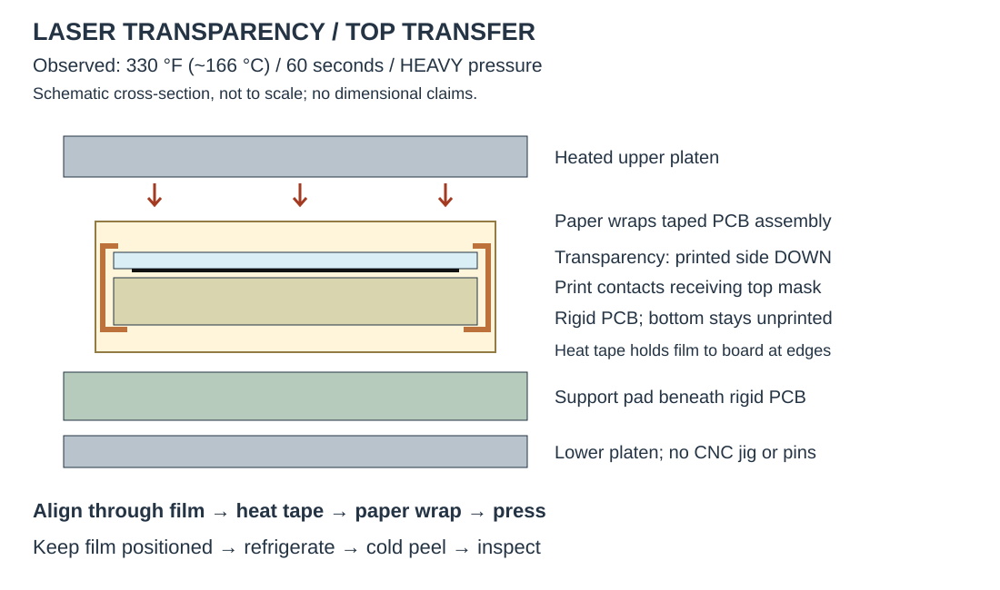
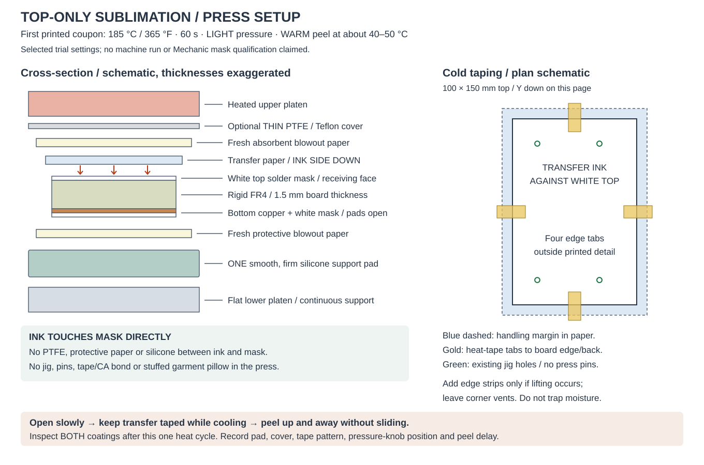
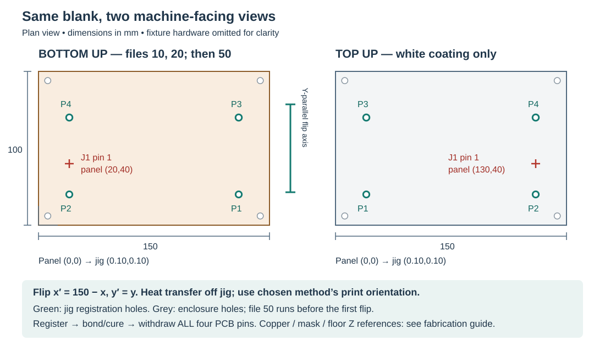
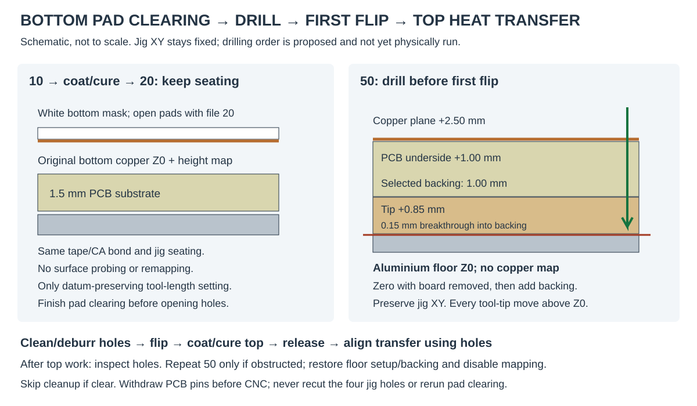
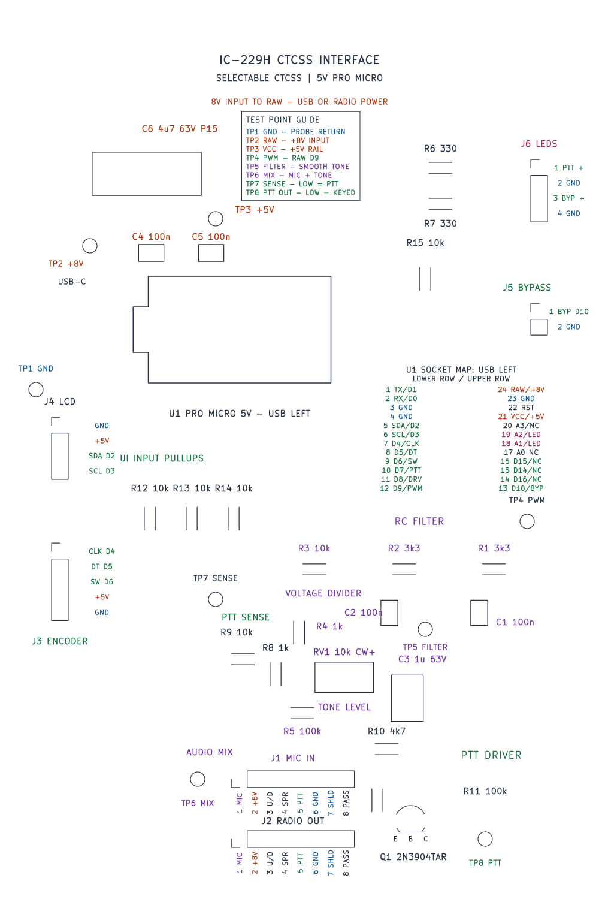

# White-mask PCB with a heat-transferred top legend

**Heat transfer is the legend process.** The user's laser transparency test
demonstrates that this model is viable and provides the confidence and
repeatability sought for this build. Choose one of these sibling methods:

| Method | Recipe / evidence | Procedure |
| --- | --- | --- |
| Laser transparency transfer | **Tested successfully:** sharp, clean transfer; easy alignment at **330 °F / 60 s / heavy pressure**, followed by refrigeration and a cold peel | [Flow A: tested recipe](#flow-a-laser-transparency-tested-recipe), [physical test record](pcb-attempt-log.md#laser-transparency-transfer-test) |
| Sublimation | **Not yet tested**; selected starting trial **365 °F / 60 s / light pressure / warm peel** | [Flow B: untested trial](#flow-b-sublimation-untested-trial), [print package](../manufacturing/pcb/sublimation/README.md) |

The fabrication sequence is shared. Section 1 contains both transfer flows:
follow **A** to use the successful transparency recipe, or **B** to test
sublimation. The scrap-coupon qualification and temperature ladder belong to
flow B. Flow A proceeds with the recipe established by the user's real test.

Process updated **2026-11-13** on `feature/sublimation-silkscreen`. Start with the
existing **150 × 100 × 1.5 mm single-sided blank**, 150 mm along machine X,
bottom copper up. Both faces use **white UV solder mask**. Keep the board
unpopulated through coating, transfer and drilling. Accepted prepared jig holes
allow registration preparation to be skipped.

**For sublimation: positive artwork; no transfer mirroring in the files. The printer mirrors
automatically. Leave file/application mirroring off.** White means unprinted mask.
Only the top carries artwork. The bottom has protective white mask and exposed
pads, with no printed legend or second transfer setup.

## Sequence at a glance

| Run / action | Holding and reference | Next check |
| --- | --- | --- |
| Select [flow A](#flow-a-laser-transparency-tested-recipe) or [flow B](#flow-b-sublimation-untested-trial); for B, qualify the [sublimation coupon](../manufacturing/pcb/sublimation/transfer-coupon-letter.pdf) first | A uses the tested transparency recipe; B starts on matching coated scrap | Keep each method's temperature, pressure and peel instructions together |
| [00 registration preparation](../manufacturing/pcb/carvera-air/review-nc/00-registration-preparation.nc), only if needed | Jig absent; blank-corner XY / copper Z0; sacrificial wasteboard | Accept four slip-fit jig holes |
| [10 bottom isolation](../manufacturing/pcb/carvera-air/review-nc/10-bottom-copper.nc) | Registered tape/CA bond; PCB pins removed; copper Z0 + thorough map | Inspect copper continuity/isolation |
| Cure white bottom mask; [20 pad clearing](../manufacturing/pcb/carvera-air/review-nc/20-bottom-mask-removal.nc) | Undisturbed seating; original copper zero/map | Accept 111 pad openings; no circuit holes |
| [50 holes before first flip](../manufacturing/pcb/carvera-air/review-nc/50-bottom-holes.nc) | Zero aluminium floor with board removed; add backing; remount bottom up; no map | 111 electrical holes + four enclosure mounts |
| Flip; coat/cure white top | Register/bond/remove pins; preserve jig XY | No top copper isolation/pad clearing on this board |
| Release; top transfer using chosen method | Separate supported flat press setup; no jig or tape/CA bond under heat | Inspect printed top and unprinted bottom coating/pads after heating |
| Conditional hole cleanup after top work | Restore floor-referenced bottom-up setup/backing; no copper map; repeat file 50 only if holes are obstructed | Clear holes without pad/coating damage; skip if clear |
| Conditional profile; clean, deburr, inspect | Profile last with retained workholding and floor limit | Finished-size blank needs no routine profile; hand off to assembly |

The machining programs in this process are **00 if needed, 10, 20 and 50**.
They are review outputs; physical machining acceptance remains separate from
the reported successful transparency transfer. **Drilling before the first flip**
is the proposed order so holes can help align transparency; it has not yet been
physically run. File numbering does not require drilling last.

## Supplies and settings

### Shared fabrication supplies

- Existing blank/jig, four **4 × 20 mm setup-only PCB pins**, painter's tape/CA,
  IPA/wipes, light abrasive, magnification, multimeter, deburring tools and
  representative component/header leads. Bed locator pins/screws stay installed.
- White UV solder mask and curing source, flat heat press, lower support pad,
  heat tape, protective paper, heat gloves and trimming tools.

### Flow A supplies: laser transparency

- Laser printer/toner and laser-compatible transparency.
- Pad beneath the rigid PCB, heat tape to hold the aligned film, paper to wrap
  the board, and refrigerator for the cold peel, as used in the successful test.
- Use **330 °F / 60 seconds / heavy pressure** and the refrigerated cold peel.
  See [flow A](#flow-a-laser-transparency-tested-recipe) for the complete procedure.

### Flow B supplies and trial settings: sublimation

- **Converted Epson E-15000**, **Cosmos Ink sublimation ink**, **Mechanic white UV
  solder mask**: established user inputs. Exact mask product code, ink version,
  transfer paper and color settings remain to be recorded. The supplied printer
  name is retained as given, rather than silently selecting another model.
- **Generic 12 × 12-inch clamshell T-shirt heat press**, the user's instructed
  trial assumption; make/model unspecified. A smooth, firm silicone press pad,
  sublimation heat tape, fresh white unwaxed blowout/butcher paper, an optional
  thin PTFE/Teflon press-cover sheet, heat gloves, scissors, lint-free wipes,
  a flat heat-resistant cooling surface and matching coated scrap. The press's
  existing silicone lower pad is sufficient if smooth and continuously supported;
  do not automatically stack another pillow on it. If a separate pad is needed,
  a **2–3 mm firm heat-press silicone sheet**, rated for at least **210 °C**, is
  the selected accessory specification; it should extend at least 10 mm beyond
  every board edge. These consumables are a preparation checklist, not a claim
  of inventory-confirmed stock. See the
  [equipment and process record](implementation/pcb-sublimation-trial.md).

| Setting | Value / provenance |
| --- | --- |
| Print geometry | Top 100 × 150 mm portrait; no bottom artwork |
| Print setup | Letter, simplex, Actual size / 100%, no Fit; selected export contract |
| Transfer mirror | Printer automatic, user supplied; file/application mirror off |
| Press format | Generic 12 × 12-inch clamshell; user-directed assumption. Nominal platen 304.8 × 304.8 mm; the 150 × 100 mm board fits in either artwork orientation |
| Color | Six sRGB design colors; record actual Cosmos ink/paper/driver settings; coupon acceptance pending |
| White-mask cure | Follow exact Mechanic product instructions; actual coats/cure not recorded |
| First printed coupon | **185 °C / 365 °F, 60 s, light pressure, warm peel at approximately 40–50 °C**; agent-selected starting trial, not a Mechanic specification |
| Trial progression | 195 °C / 383 °F for 60 s, then 90 s if needed; optional final 200 °C / 392 °F for 90 s only if coating remains sound |
| Pressure adjustment | Start light; test medium only to correct demonstrated contact loss. No heavy pressure in this initial series |
| Sublimation physical qualification | Not yet run; use the [attempt log](pcb-attempt-log.md) |

The [Cosmos color-profile page](https://cosmos-ink.com/pages/color-profiles-cosmos-ink%C2%AE)
is the supplier reference; do not substitute another ink's profile. No retrieved
manufacturer source qualifies direct sublimation into this particular Mechanic
mask. White is the required visual foundation; dye uptake and heat behavior are
the experiment. Sublimation needs a receptive polymer surface according to
[Sawgrass substrate guidance](https://www.sawgrassink.com/blog/coated-or-uncoated-products/).
The starting recipe below is a concrete test proposal for that uncertainty.
Start with direct transfer into cured white mask; do not silently add a clear
receptive overcoat. The basis and limits of the selected
recipe are in [the process record](implementation/pcb-sublimation-trial.md#starting-recipe-and-source-basis).

## 1. Choose the transfer flow

### Flow A: Laser transparency (tested recipe)

The user's real test produced a **sharp, clean transfer**. The transparency
made alignment **really easy**, and refrigerating before the cold peel worked
very well. Use that successful combination directly:

| Setting / handling | Successful test |
| --- | --- |
| Flat heat press | **330 °F (approximately 166 °C), 60 seconds, heavy pressure** |
| Rigid-board support | **Pad beneath the PCB** |
| Alignment restraint | **Heat tape holds the transparency in position** |
| Press protection | **PCB wrapped in paper** |
| Film removal | **Refrigerate the board with film in place, then cold peel** |

For the board, complete the shared bottom work, pre-flip drilling and top
coating in sections 2–4, then perform these steps with the released board:

1. **Print and align.** Print the top legend on laser-compatible transparency
   at actual size. Place the printed side against the receiving top face so
   the finished text will read correctly. Look through the film to align with
   drilled holes and board features. Keep the 100 × 150 mm artwork field at
   100% scale. The Epson automatic-mirror setting belongs to sublimation;
   use the laser printer's appropriate transfer orientation.
2. **Tape.** Use heat tape to hold the transparency in its aligned position
   throughout pressing and cooling. Check that securing it did not shift it.
3. **Wrap and support.** Wrap the taped PCB in paper and place the assembly
   on the lower pad. The pad supports the rigid board. Keep the paper smooth
   and the support free of chips or hard ridges.
4. **Press.** Set the flat heat press to **330 °F**, use **heavy pressure**,
   and press for **60 seconds**. Lift out with heat gloves, keeping the film
   positioned against the board.
5. **Refrigerate and cold peel.** Leave the film attached while cooling the
   board in the refrigerator, then remove the film cold. This is the removal
   method that worked very well in the user's test.
6. **Inspect and continue.** Check the sharpness of small text, alignment,
   coating and exposed pads. Inspect the drilled holes and use section 5's
   cleanup only if they are obstructed. Record the result in the
   [attempt log](pcb-attempt-log.md#laser-transparency-transfer-test), then
   continue with final cleaning and electrical checks before assembly.

The [standalone transparency guide](pcb-laser-transparency-guide.md) gives the
same flow for use at the press. Flow A does not require the sublimation coupon,
heat-only witness, temperature ladder or peel comparison below.

### Flow B: Sublimation (untested trial)

This method has **not yet been tested**. Complete the scrap qualification below
before using it on the board. All settings, pressure limits, coupon criteria
and peel comparisons in this flow apply to sublimation.

#### Build this press stack

From the bottom up: **lower platen → smooth firm silicone pad → fresh blowout
paper → PCB, white top up → transfer, printed side down → fresh blowout paper
→ optional thin PTFE cover → heated upper platen**. The inked paper touches the
white mask directly. No PTFE film, release paper or air gap goes between them.
Protect the unprinted bottom too; it still gets hot and carries exposed pads.

The silicone is a supported cushion for a rigid board: it accommodates small
surface differences without making the PCB balance on high spots. Use one flat,
continuous pad, with no seams, wrinkles, pillow edge, folded tape bundle or debris
under the board. A soft stuffed garment pillow is a poor starting support here.
Do not put a thick silicone pad above the transfer; that changes heat delivery
and invalidates this starting dwell. The press remains outside the CNC setup.

**PTFE/Teflon:** a thin reusable cover may protect the upper platen, but keep
fresh absorbent paper between it and the transfer. It does not replace the
silicone cushion or disposable blowout paper. Start without an extra loose PTFE
sheet if the platen already has a suitable cover; if using one, use the same
sheet throughout the comparisons. Replace the blowout paper every press so dye
does not mark the next coupon. Do not use waxed paper. Clean/reject contaminated
or textured cover sheets; woven texture can imprint softened mask. The
[Transfer Press handling guide](https://www.thetransferpress.co.uk/PBCPPlayer.asp?ID=2374266)
explains why absorbent paper helps moisture escape whereas PTFE does not.

#### Set light pressure on the actual stack

With the press cold, load an unprinted scrap of the same thickness and all the
chosen pad/paper/cover layers. Back off the pressure knob, close gently, then
increase until the handle latches with modest one-hand effort and the whole
stack is held flat. **Light** means secure contact without forcing the latch,
visibly bowing the PCB or deeply indenting its edges into the pad. Check front
and rear edges; a clamshell can load them differently. Thin paper feelers at
the four corners should all be gripped when closed; remove them before heating.

**Medium** is a small additional tightening that gives firm full-area contact
with noticeably more handle resistance, still without board bending or coating
imprints. Mark the knob and record turns from first contact. These are practical
settings for this press, not calibrated psi. **Heavy** pressure is excluded from
the initial trial: it adds coating-imprint and board-flex risk without fixing a
non-receptive coating. Recheck pressure whenever the stack thickness changes.

#### Heat-and-transfer trial sequence

Use a **fresh, room-temperature coated coupon and fresh transfer for every row**.
Use the same mask cure, paper, pad, cover, center-platen position and light
pressure unless the row explicitly changes one. Keep transfers top-side only.

| Test | Temperature / dwell | Pressure / removal | Purpose and next action |
| --- | --- | --- | --- |
| H0, heat-only witness | 185 °C / 365 °F, 60 s; clean unprinted paper against mask | Light; cool before inspecting | Check coating release, yellowing, adhesion and bottom-pad imprint before spending a printed coupon |
| T1, first printed coupon | **185 °C / 365 °F, 60 s** | **Light; warm peel, approximately 40–50 °C** | Selected starting recipe; accept if colors/detail/adhesion pass |
| T2, if T1 is uniformly weak but intact | 195 °C / 383 °F, 60 s | Same light / warm peel | Change temperature only |
| T3, if T2 improves but remains weak | 195 °C / 383 °F, 90 s | Same light / warm peel | Change dwell only |
| T4, optional last temperature check | 200 °C / 392 °F, 90 s | Same light / warm peel | Only if T3 leaves the coating sound; do not exceed this initial series |

These are **agent-selected experimental settings**, not manufacturer ratings or
physical results. They bracket useful hard-substrate conditions while beginning
below the common 195–205 °C range. Do not run the whole ladder after a good result.
If H0 damages the mask, resolve cure/coating behavior before printed tests; a
fresh 175–180 °C / 60 s witness is a reasonable lower-temperature comparison.
If T1–T4 give almost no retained dye, further heating/pressure is a poor default:
check ink/paper orientation and whether this mask accepts dye. A known-good
sublimation blank, if available, can separate printer/process trouble from mask
uptake. No receptive overcoat is silently introduced.

1. **Prepare and dry.** Coat matching scrap on both sides as the board will be
   coated, with representative exposed copper on the bottom witness. Fully UV
   cure using the actual Mechanic product's instructions. Remove sanding dust,
   clean and let solvent evaporate fully. The final top must be dry, smooth and
   non-tacky. Do not substitute an unverified thermal bake for UV cure. Keep
   paper dry. The first run does not need a separate hot prepress of the coated
   PCB; H0 is a separate witness, not an extra cycle on each printed coupon.
2. **Print and proof.** Print the [coupon PDF](../manufacturing/pcb/sublimation/transfer-coupon-letter.pdf)
   at Actual size, 100%. Measure **54 × 38 mm** between crop-mark centers on a
   plain-paper proof. File F L shapes are readable; the printer automatically
   reverses the sheet and the transferred result must be readable again.
   Let the print dry at least **10 minutes** as an initial handling allowance,
   longer if needed until smear-free; do not touch or wipe the printed image.
   Trim labels/crop marks away, keeping a **5–10 mm unprinted handling margin**
   where practical. Cut out any crop marks left in that margin. Keep the artwork
   field full size; do not scale it to create a margin.
3. **Align and tape while cold.** Lay the transfer face up, place the coupon's
   white receiving face down onto it, and align the field to the coupon edges.
   Use **6–10 mm sublimation heat tape**, not painter's/masking tape. Start with
   two opposite edge tabs, then secure the other two edges. Bridge paper to the
   board edge/back so the sheet cannot slide or lift when the clamshell opens.
   Burnish tape to the paper/edge without creasing the image. Keep tape off ink,
   functional labels and exposed pads; test its release on the witness coating.
   Turn the assembly top-up and verify contact without bubbles or slack.
4. **Edge seal, without wrapping the whole board.** Four well-seated tabs are
   the starting arrangement. If the paper edges lift, add short strips along the
   lifting edge, outside the image, leaving a small vent gap at corners. A
   tape hinge on one side plus tabs on the other edges is useful. This seals
   against movement/edge lift; an airtight envelope is unnecessary. Do not wrap
   a thick tape ridge underneath the rigid PCB or seal damp paper into the stack.
   Never tape directly across a printed test-point legend to hold it down.
5. **Heat and press.** Warm the empty press to the test setpoint and allow
   **3–5 minutes after it first reaches temperature** for stabilization. Center
   the cold taped assembly on fresh bottom paper, top/transfer up. Add fresh
   upper paper and the chosen cover; close gently without dragging the paper.
   Start the dwell timer when fully closed. Keep hands clear of the clamshell
   hinge; use heat gloves for the hot assembly. Record the displayed setpoint;
   a contact temperature measurement, if available, is separate evidence of
   actual platen/interface temperature, not interchangeable with the display.
6. **Open without ghosting.** At the timer, raise the upper platen slowly.
   If paper/board follows it, stop lifting and let it release back onto support
   rather than allowing a drop. Remove the loose upper cover/blowout sheet
   without shifting the taped transfer. Move the assembly with gloves to a flat
   heat-resistant cooling surface, still taped. Do not slide or rub the paper
   over the warm image, bend the board, water-quench it or stack it against a
   previously printed surface.
7. **Warm peel first.** Keep the paper restrained while cooling to approximately
   **40–50 °C**, then release the retaining tabs while holding the paper still.
   Lift one edge and remove the paper in one smooth motion up and away, avoiding
   a second touch to the image. This is dye transfer, not an HTV film being peeled
   down onto the board. If paper binds or mask starts to lift, stop pulling and
   let it cool to room temperature before trying again gently. A stuck/lifted
   coating is a failed coupon, not a cue to scrape the finished board clean.
8. **Compare peel timing only if needed.** On fresh coupons at the best thermal
   recipe, compare warm peel with **cold peel at about 20–30 °C** if sticking or
   coating softness was a problem. If warm peel produces ghosting despite good
   restraint, test a **hot peel within about 5 seconds** on another coupon using
   gloves and supported handling, provided the mask showed no softening.
   Hot peel removes the transfer quickly but gives the least recovery from
   sticking; cold peel reduces handling of warm mask but keeps dye paper against
   it longer. Keep all other settings fixed and record actual delay/temperature.
9. **Inspect cool.** Compare against an unpressed white witness under the same
   light. Check swatches, white knockout, readable F L, ghosting, color spread,
   paper fiber residue, coating adhesion and board flatness. Lines under each
   swatch are **0.10 / 0.15 / 0.20 / 0.30 mm**, top to bottom. Accept continuous
   0.15 mm detail; 0.10 mm is exploratory. Transfer a cropped sample of the top
   test-point guide too, checking its 0.8 mm text and 0.12 mm strokes. Inspect
   the unprinted bottom for sticking, pad imprints and mask lifting. Check a
   copper witness's solderability after the same cooling/cleaning procedure.
10. **Accept and carry forward.** Record the successful recipe, paper/cover/pad
    stack, knob position, tape pattern, peel delay and photos in the
    [trial log](pcb-attempt-log.md). Then use that recipe for one full board,
    checking center and corners: a small coupon does not prove full-board contact.
    Do not change paper, cushion, PTFE cover and dwell together for that step.

#### Read the failure before changing the next coupon

| Observation after cooling | Next controlled change |
| --- | --- |
| Evenly faint print, coating intact | Follow T1 → T2 → T3; verify paper's printed face touches mask |
| Faint patches, good color elsewhere | Check wrinkles, debris, support and front/rear contact first; then try **medium** pressure on a fresh coupon at the same temperature/time |
| Offset double image / fuzzy edges | Improve tape restraint and slow opening/removal; do not compensate with heavy pressure |
| Brown/yellow white mask, broad dye bleed or loss of fine detail | Reduce temperature or dwell on a fresh coupon; compare the unpressed witness |
| Tape/paper texture, edge dents, softened or lifted mask | Reduce pressure; check full UV cure and pad/cover texture; compare cold peel |
| Paper sticks but coating remains hard | Compare cold removal and fresh dry paper; do not rub paper fibers into the image |
| No useful dye after the bounded ladder | Check a known-good sublimation blank if available; record possible mask non-receptivity rather than continuing to add heat |

No second-side transfer is part of this workflow. The unprinted bottom is
inspected because it shares the single top-transfer heat cycle.

## 2. Isolate, coat and clear bottom pads

Keep **XY at pocket lower-left / Anchor 1**; **J=(x+0.10,y+0.10)**.
Flip about the Y-parallel midline, **x′=150−x, y′=y**, never end-for-end.
Four PCB pins locate while seating/curing the bond; withdraw all four and confirm
no movement before CNC. Bed locator pins/screws stay fixed. Keep sockets/release
ports clear of adhesive and retain the full blank/four holes through all setups.

1. For unprepared holes only, file 00 runs with jig absent and independent
   sacrificial restraint. Use copper-top Z0 and blank-corner XY. Accept centers
   (20,20), (130,20), (20,70), (130,70) mm at 110 × 50 mm spacing. For measured
   4.000 mm pins, first-row fit is 4.02–4.04 mm, second-row 4.10–4.15 mm. See
   the [registration drawing](../manufacturing/pcb/carvera-air/registration.svg).
   H1–H4 are separate enclosure mounts. Prepared accepted blanks skip this step.
2. Clean/register/bond bottom up. Establish exposed-copper Z0 and thorough map;
   run file 10. Clean channels and check continuity/isolation against the
   [schematic](reference/schematic-complete.pdf), including +8 V, +5 V and GND.
3. Leave the seating undisturbed. Apply/cure enough thin white coats for a
   continuous opaque foundation. Intercoat sanding/cleaning and all curing stay
   in the jig.
4. Retain the **original copper zero and map** through pad clearing. Between
   mapping and clearing: **no probing except tool-length setting**, which must
   preserve both. Disable start options that replace the datum/map.
5. Run file 20 over **111 pads**; clean and inspect exposure, copper and mask
   rims. Prefer too little removal. If needed lower `MaskPassOffset` slightly,
   recompute/export/check and repeat without moving zero/map. −0.01 mm is a
   selected example increment. Spring overtravel adjusts pressure, not known
   removal depth. Stop for lifting, tearing or bottoming; do not drill yet.

| File / tool | RPM | Feed / plunge mm/min | Depth / motion |
| --- | ---: | --- | --- |
| 00 / T3, Makera 0.8 mm corn bit | 12,000 | 500 / 100 | Copper −1.65 mm; 0.3 mm stepdown; 40% stepover |
| 10 / T2, 30° V-bit / 0.2 mm tip | 12,000 | 100 / 30 | Copper −0.10 mm; 0.15 mm isolation offset |
| 20 / T4, 0.3 mm / 30° spring mask remover | 6,000 | 400 / 200 | Copper −0.05 mm initial spring overtravel |

These are inherited review settings. T4 speed/feed follow the
[Makera reference](https://global.makera.com/products/uv-solder-mask-removal-tool-1-8-shank);
0.05 mm overtravel is a conservative trial choice. Clearance is Z+15 mm; inspect
actual holder reach/fixture clearance before running. No physical run is claimed.

## 3. Drill before the first flip

1. After bottom pad clearing is accepted, remove board; clean jig; establish **aluminium-floor Z0** while preserving jig
   XY. Add selected **1 mm flat sacrificial backing**, keeping sockets/release
   ports clear. Register/bond bottom up; remove PCB pins. No copper map.
2. File 50 models underside +1.00, copper +2.50, minimum tip **Z+0.85 mm**:
   0.15 mm breakthrough into backing. Aluminium is never sacrificial. Different
   support requires updating native `SupportHeight`, regeneration and path checks.
   Every tool-tip motion must stay above floor zero. Clearance +15; safe +4.50 mm.
3. Preview/run T3 at 12,000 RPM: 46 × 0.9 mm bores at feed/plunge 55/50 mm/min,
   0.01 mm/rev helix; 65 × 1.1 mm at 135/50, 0.03 mm/rev; four 4 mm enclosure
   mounts at 500/100, 0.3 mm stepdown, 40% stepover. These are inherited corn-bit
   interpolations, not twist-drilled holes. Do not recut the four jig holes.
4. Clean chips and deburr both faces without lifting pads. Inspect the 111
   electrical holes and four enclosure mounts for size, registration and lead
   fit; do not proceed with burrs that prevent flat seating. Inspect the four
   prepared jig holes too: **119 holes total**. Check continuity/isolation.
   Pad clearing is complete; do not run its spring tip over open electrical holes.
5. Release/clean the board for the first flip. The floor-referenced drilling
   setup ends here; retain jig XY and use the established Y-parallel flip.

## 4. Cure white top, then transfer off the jig

1. Release with the established IPA method and dry. Protect bottom; flip about
   Y, register/bond top up, remove PCB pins and check seating. No top isolation
   or top pad clearing is required. Coat/cure white top in the jig, keeping the
   drilled holes clear. Inspect hole openings after curing; any remaining
   obstruction is handled by the conditional cleanup after transfer.
2. After both white faces and pad openings are accepted, release and clean all
   adhesive residue. Copper zero/map has completed its job; do not reuse it
   after release. Move only the board to the separate flat press support.
   Keep the CNC jig, tape/CA bond and all pins out of the heat press.
3. For laser transparency, use [flow A](#flow-a-laser-transparency-tested-recipe)
   for printing, alignment, pressing and cold peeling, then continue at step 6.
   For sublimation, print and measure the [full-size top PDF](../manufacturing/pcb/sublimation/top-color-letter.pdf);
   trim off all page furniture. It is
   portrait and readable from the finished top face. The printer handles transfer
   mirroring. No bottom artwork is supplied or needed.

Colors supplement text: burnt orange power, blue ground, green logic, purple
analog, magenta status, dark gray neutral. Top includes a boxed test-point guide
above the Pro Micro, in place of the decorative waveform. It remains visible
outside the selected component-body envelopes. The 0.8 mm lettering uses the
same native KiCad stroke style as the other small labels; include it in the
coupon's board-text readability check.
No new polarity, tolerance or high-voltage claims are implied. Top ink excludes
jig-hole edges plus **1 mm**. This is a selected artwork clearance, not measured
registration. The bottom has no ink or legend-clearance requirement.

| Test point | Purpose of the printed guidance |
| --- | --- |
| TP1 | Ground reference / probe return for the other points |
| TP2 | RAW supply input, nominal +8 V when powered from that input |
| TP3 | Regulated +5 V rail |
| TP4 | Raw D9 PWM, before the RC filter |
| TP5 | Filtered tone after the second RC stage |
| TP6 | Microphone audio plus the injected tone at the mix node |
| TP7 | Microphone PTT sense input; active low |
| TP8 | Radio PTT output; Q1 pulls it low to key the radio |

Use TP1 for the scope ground clip. TP8's inactive voltage depends on the
connected radio/pull-up; the legend does not promise a logic-high voltage there.
Tone presence depends on firmware/PTT/bypass state. Supply labels are nominal
functions, not measured results or acceptance limits.

4. Align using board edges, drilled circuit/enclosure holes and the prepared
   four-hole jig pattern, with a plain-paper
   outline proof/backlighting as needed. Unequal row-end margins identify
   orientation. Top J1 pin 1 is **(40,130)** mm from portrait upper left.
   Check the corresponding board
   location before taping. Text centers are not pad centers. Previews contain
   no printed hole targets; do not add hot press pins to locate the transfer.
5. Tape top paper ink-side against the mask. Support flat without trapped chips
   or local hard pressure points. Use the accepted coupon recipe and peel/cool
   method. Inspect fine text and registration at J1/headers and board edges.
   **≤0.25 mm** is the selected initial alignment target, to be logged physically.
6. Leave the bottom unprinted. Inspect its coating and pads for support residue,
   heat damage or mask lifting. Reject impaired pads or unreadable functional
   labels. For the untested sublimation flow, carry a scrap pad witness through
   the same heat/cleaning cycle and check solderability before populating the
   board; that witness is part of sublimation qualification.

## 5. Conditional hole cleanup and finish

1. After the top transfer is complete, inspect every circuit/enclosure hole.
   **Skip the cleanup pass if holes are clear and lead fit is accepted.** If
   top coating obstructs holes, repeat file 50 only after restoring the setup
   in [section 3](#3-drill-before-the-first-flip): board removed for floor Z0,
   sacrificial backing, bottom-up registration, PCB pins withdrawn and no map.
   Preserve jig XY and positive floor clearance; do not reuse copper Z0.
2. Inspect the output/controller preview for that setup before repeating the
   hole job. Keep the finished top supported and protected from trapped chips.
   Do not recut jig holes or rerun pad clearing. Inspect pads/coatings and hole
   fit afterward. Repeating the full hole job is conditional, not routine.
3. Finished-size stock needs no perimeter cut. Any needed profile runs last
   with retained workholding and floor protection, after native CAM preparation
   and output checks.
4. Release with IPA. If needed remove jig from bed locators and alternate gentle
   pressure through push-off ports; do not force an intact bond. Clean adhesive,
   chips and burrs; inspect all **119 holes**, pads, coatings and labels. Check
   lead fit and continuity/isolation before assembly.
5. Record settings, offsets and checks in the [trial log](pcb-attempt-log.md),
   then proceed to [assembly/bring-up](implementation/assembly-and-bring-up.md)
   using the [BOM](reference/bom.csv).

## Evidence and editing

[Artwork evidence](verification/pcb-sublimation.json) binds the saved PCB, native
exports, metadata, generator and print files by hash. Generation refuses stale
inputs. [Regeneration](../tools/README.md) overwrites derived color SVGs/PDFs.
The [package README](../manufacturing/pcb/sublimation/README.md) links all files.
Circuit geometry and CAM remain unchanged; digital checks do not establish
physical machining acceptance. See the [equipment/process record](implementation/pcb-sublimation-trial.md)
for sublimation inputs and the [attempt log](pcb-attempt-log.md) for the observed
transparency results. No generalized skill-library changes.
