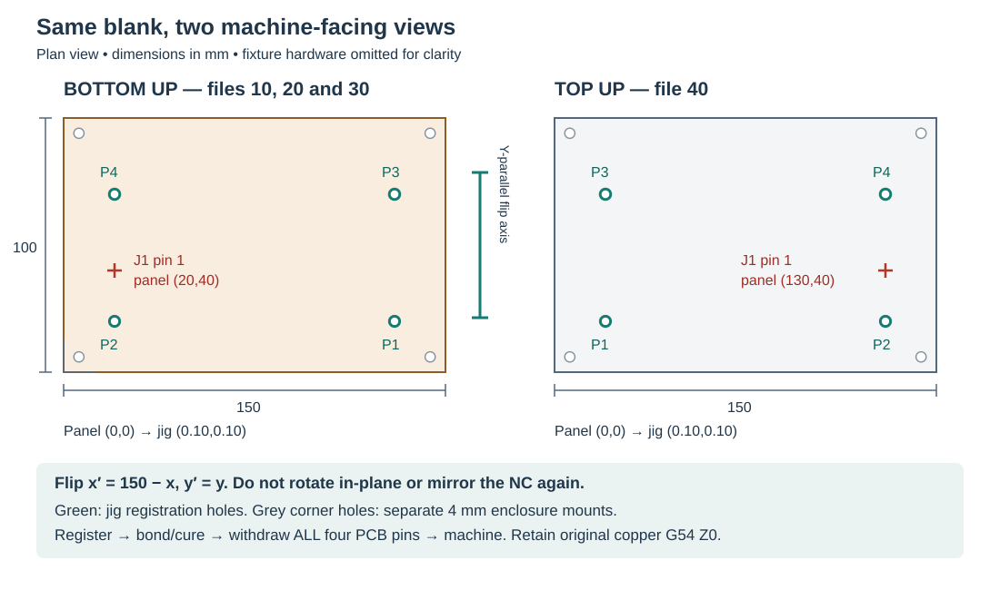

# Making the Icom CTCSS PCB on the Carvera Air

This guide follows the current **150 × 100 × 1.5 mm single-sided blank** and
the five programs in [review-nc](../manufacturing/pcb/carvera-air/review-nc/).
Place the 150 mm length along machine X and the 100 mm width along Y.
Copper faces upward for isolation, bottom mask opening and drilling; the
component face faces upward for white coating and laser legend marking.
Machine the board before fitting any components.

The programs are **review copies**, with saved-project and posted-motion
checks recorded for the [current revision](verification/pcb-revision.json).
No machine run or physical process qualification has been performed. Check
the Controller preview and actual cutter/holder/fixture clearance before use;
qualify isolation, drilling and spring-tool pressure on representative material.
The full first board is the top-legend trial piece.

## The sequence at a glance

| Step | Run this file | Holding and face | What you do afterward |
| --- | --- | --- | --- |
| 00 — only for an unprepared blank | [00-registration-preparation.nc](../manufacturing/pcb/carvera-air/review-nc/00-registration-preparation.nc) | Independent edge datum; copper up on sacrificial wasteboard; aluminium jig absent | Deburr and accept all four jig holes; move to the jig |
| 10 — isolate copper | [10-bottom-copper.nc](../manufacturing/pcb/carvera-air/review-nc/10-bottom-copper.nc) | Copper up, pin-registered tape/CA bond; all PCB pins withdrawn | Clean and inspect channels; check continuity and shorts before coating |
| Coat/cure bottom, then 20 — open pads | [20-bottom-mask-removal.nc](../manufacturing/pcb/carvera-air/review-nc/20-bottom-mask-removal.nc) | Copper up; same registered support height; original copper zero retained | Inspect removal and intact pad copper; electrical holes do not yet exist |
| 30 — initial holes | [30-bottom-holes.nc](../manufacturing/pcb/carvera-air/review-nc/30-bottom-holes.nc) | Copper up; original datum and protected breakthrough | Clean/deburr; inspect 111 electrical holes and four enclosure mounts |
| Flip, coat/cure top, then 40 — legend | [40-top-legend-laser.nc](../manufacturing/pcb/carvera-air/review-nc/40-top-legend-laser.nc) | Component face up; re-register/rebond, then remove PCB pins; retain original zero | IPA-clean and inspect dark marking; inspect every hole after both coatings |
| Optional final clearing | [30-bottom-holes.nc](../manufacturing/pcb/carvera-air/review-nc/30-bottom-holes.nc) again | Copper up again; reproduce original seating and retain the original zero | Clean, check pad integrity/lead fit and repeat electrical checks |

**Already prepared your blank for the jig? Skip file 00.** Accept its four
existing registration holes below, then start at the registered setup for
file 10. Do not run file 00 again on a prepared blank.

Each file ends as a separate program. Load the next one only after completing
the intervening cleaning, coating, curing or inspection. The NC does not
automatically enforce these transitions. No perimeter-routing file is needed
for this finished-size blank.

## Gather the tools and supplies

- The 150 × 100 × 1.5 mm single-sided blank and completed Carvera Air PCB jig.
- Four **4 × 20 mm setup-only PCB pins** matching the jig; the two bed locators
  stay fitted. Jig mounting screws remain installed during PCB machining.
- Painter's tape, CA adhesive, release/cleaning IPA and chip/deburring tools.
- A flat sacrificial support for optional file 00, plus a qualified protective
  stack beneath the board for production through-holes. The aluminium pocket
  floor is not sacrificial material.
- **T2:** owned 30° V-bit with 0.2 mm tip, for copper isolation.
- **T3:** Makera 0.8 mm corn bit, for registration pockets, electrical bores and
  enclosure mounts. The small electrical holes are interpolated with this bit;
  this package does not request separate 0.9 or 1.1 mm twist drills.
- **T4:** Makera spring-loaded UV solder-mask remover, 0.3 mm tip, 30°,
  3.175 mm shank. Its spring action is essential to this program.
- Bottom UV solder mask, white top UV solder mask, and the flood-curing UV
  source appropriate to the selected coating instructions.
- The Carvera Air laser accessory, its enclosed operating setup and specified
  eye protection. Keep IPA cleaning separate from laser operation and let the
  cleaned surface dry before marking.
- Magnification, a multimeter, representative component/header leads and the
  measured pins for checking actual hole fit.

Follow the Air's tool-change and tool-length calibration prompts while
preserving the work coordinate datum. Check the complete spring-tool body,
laser module and holders against remaining fixture hardware, not just tip
diameters. There is no automatic tool change between these separate files.

### Settings in the delivered files

| Operation | Tool | RPM | Feed / plunge, mm/min | Programmed depth or motion |
| --- | --- | ---: | --- | --- |
| Registration-hole pockets | T3, 0.8 mm corn | 12,000 | 500 / 100 | Z−1.65; 0.3 mm stepdown, 40% stepover |
| Copper isolation | T2, 30° / 0.2 mm tip | 12,000 | 100 / 30 | Z−0.10; centerline 0.15 mm outside merged copper |
| Bottom pad opening | T4, spring tool | 6,000 | 400 / 200 | Z−0.20 relative to original copper zero; spring overtravel |
| 46 electrical bores, 0.9 mm | T3 | 12,000 | 55 / 50 | Z−1.65; 0.01 mm/revolution helix pitch |
| 65 electrical bores, 1.1 mm | T3 | 12,000 | 135 / 50 | Z−1.65; 0.03 mm/revolution helix pitch |
| Four 4 mm enclosure mounts | T3 | 12,000 | 500 / 100 | Z−1.65; 0.3 mm stepdown, 40% stepover |
| Top dark legend | Laser | — | 500 feed | 5% power, 0.05 mm hatch, one pass; programmed focus plane Z0 |

Milling clearance is Z+15 mm and normal safe height is Z+2 mm. These programmed
heights are not proof of actual holder/fixture clearance. The laser program
uses its separate focus-plane motion and zero power on rapids/entries.

The mask-tool feed, plunge, RPM and 0.2 mm reference DOC follow the current
[Makera product specifications](https://www.makera.com/products/uv-solder-mask-removal-tool-1-8-shank).
The retained older OEM FreeCAD profile differs on RPM and shank size; the
[package notes](../manufacturing/pcb/carvera-air/README.md#setup-20-bottom-solder-mask-and-pad-opening)
record the correction. The other milling settings are recorded candidate CAM
settings requiring physical qualification. The laser settings are agent-selected
first-board trial values. None is presented as a physically proven recipe.

## Know the face, registration and zero

*Views look down onto the face presented to the machine. Circles show holes,
not pins left installed. Coordinates below are panel-local unless marked J.*

For production, **G54 X0 Y0 is the jig pocket lower-left / Anchor 1**. The
physical blank's lower-left is at J=(0.10,0.10) mm. Do not add a jig wall offset
or enter firmware homing coordinates. FreeCAD already applies the face transform;
do not mirror the posted NC or artwork again in Controller.

| Feature | Panel-local top-view center, mm | Finished fit for measured 4.000 mm pins |
| --- | --- | --- |
| P1 / H5 | (20,20) | 4.02–4.04 mm; nominal 4.03 |
| P2 / H6 | (130,20) | 4.02–4.04 mm; nominal 4.03 |
| P3 / H7 | (20,70) | 4.10–4.15 mm; nominal 4.12 |
| P4 / H8 | (130,70) | 4.10–4.15 mm; nominal 4.12 |

For other measured pin diameters, primary holes are pin +0.02–0.04 mm and
secondary holes pin +0.10–0.15 mm. Accept burr-free slip fit and 110 × 50 mm
spacing. Never force the board onto binding pins. The four corner **H1–H4**
are separate 4 mm enclosure mounts; they do not locate the PCB in this jig.

**Establish copper G54 Z0 once, before trace cutting in setup 10. Retain that
same work zero for all subsequent operations.** Do not capture a fresh zero on
mask, exposed pads or the opposite face, including during final hole clearing.
Tool-length calibration preserves this zero; it does not replace it.

Record the original support/adhesive stack and reproduce it at each remount.
An added coating on the support face can change seating height. Account for
that mechanically or through a deliberate operation offset relative to the
original zero, without redefining G54. The delivered files contain no extra
remount-height compensation. If seating changes, resolve that difference before
running them; the next program cannot infer it.

The top laser file also retains G54 and marks at programmed Z0. Set optical
focus for the presented coated surface without changing the work zero. Any
required programmed focus-plane offset belongs in the editable CAM/post and
its rechecked output, not in a newly captured work datum.

## File 00 — prepare an unprepared blank, then stop

Skip this section if the four registration holes already meet the fit and
spacing checks above. The nominal fits alone do not establish the result of
a particular cutter/runout combination.

1. Leave the aluminium jig out of this setup. Secure the blank on a flat
   sacrificial wasteboard using independent straight-edge datums and tape/CA
   or the qualified equivalent. Unmade registration holes cannot locate it.
2. Set this preparation setup's G54 X0 Y0 at the panel lower-left and Z0 at
   its actual copper top. This independent setup precedes the production zero.
3. Confirm the wasteboard can accept Z−1.65 mm: on nominal 1.5 mm stock this
   enters it by 0.15 mm. Include stock variation and actual usable tool reach.
4. Load **00-registration-preparation.nc**, fit/calibrate T3 and inspect its
   four pockets in Controller. Run only after its setup has been accepted.
5. When the program ends, remove the blank, deburr both faces and clear chips.
   Check all four holes against the table, including spacing and pin slip fit.

**Preparation ends here.** A passing blank moves to the registered jig setup.
A binding or misplaced hole needs correction and renewed fit checks before
production; do not machine the functional PCB while forcing its registration.

## Set up the registered bottom face

1. Mount the jig on its normal bed locators and fasteners. Clean its supporting
   surfaces and provide protected breakthrough under the intended hole paths.
   Reconcile the protective layer and adhesive stack with the 1.50 mm pocket
   depth, board seating and available pin engagement. The current CAM does not
   specify a physically qualified backing material/thickness for this stack.
2. Keep tape and CA out of pin sockets and push-off/vent mouths. Those fixture
   ports are release features, not holes to machine in the PCB.
3. Present the copper face upward. Register on all four PCB pins, seat the
   painter's-tape/CA bond and let it cure without lifting or bending the blank.
4. Withdraw **all four PCB pins** and check that the board did not move. The
   bed locating pins stay installed. Pins register; the cured bond retains.
5. Set production G54 XY at the pocket lower-left / Anchor 1. Check the
   asymmetric **J1 pin 1 at bottom J=(20.10,40.10) mm** against the preview.
6. Establish the copper-top Z0 and initial copper surface map before cutting.
   Record the support stack and retain this datum for the rest of production.
   Do not blindly apply a bottom-face height map after flipping the board.

**Ready for file 10:** bottom orientation is correct, no PCB pins remain,
the bond is secure, copper zero is recorded and the tool/holder clears the
actual fixture. Through-hole breakthrough will be protected when file 30 runs.

## File 10 — isolate copper and inspect it while exposed

1. Load **10-bottom-copper.nc** with T2. Its only cutting stage is isolation;
   it neither drills holes nor opens mask.
2. Check the preview against the [bottom copper drawing](reference/copper-bottom.svg)
   and run with the qualified isolation setup.
3. At program end, clear chips and inspect every channel, especially pad/track
   junctions and compact socket/header gaps. Remove whiskers and burrs without
   cutting retained traces or lifting pads.
4. Check continuity along each net and shorts between neighboring nets using
   the [schematic](reference/schematic-complete.pdf). Confirm the +8 V, +5 V and
   GND rails are not shorted. Use the circuit to interpret intended resistive
   paths; not every nonzero resistance is a fault.

**Accept exposed copper before coating.** Mask must not conceal bridges,
broken traces or lifted pads. Keep the top support face bare through this
precision milling stage.

## Coat and cure the bottom, then run file 20

1. Clean the bottom copper, apply bottom UV solder mask and fully UV-cure it
   according to that product's instructions. Keep the four registration holes
   clear. Record the coating/product and cure used for the trial.
2. If coating required removal from the machine, repeat register/bond/cure/
   withdraw/check with the original support height and retained G54 zero.
   Successive programs on an undisturbed bond need no unnecessary rebonding.
3. Fit T4, the **spring-loaded Makera remover**, and preserve the work datum
   during tool-length calibration. Do not zero on the cured coating.
4. Load **20-bottom-mask-removal.nc**. It exposes pad regions only, leaving
   tracks masked and at least a planned 0.10 mm masked rim at pad edges.
   Its ten native operations cover all 111 pads; see the
   [pad-clearing view](verification/pcb-mask-paths.png).
5. Qualify preload/removal before the production pass. The commanded Z−0.20 mm
   is below the known copper plane; the spring absorbs overtravel and coating
   thickness. It is **not an instruction to cut 0.20 mm into copper**. A rigid
   V-bit is not a substitute. Stop if the tool bottoms out, lifts copper or
   damages the substrate; correct the process in CAM and recheck the output.
6. Run, then clean and inspect the exposed soldering area. Check pad rims,
   copper adhesion and removal on small socket/header pads. A calculated
   planar sweep does not establish real spring contact or usable solder wetting.

**Electrical holes must not yet exist.** This pad-opening path crosses the
future hole areas on solid stock. Do not rerun it over already-drilled holes,
where the spring tip could drop in or snag an edge.

## File 30 — make electrical holes and enclosure mounts

1. Keep the copper face upward and retain the original copper G54 zero.
   Confirm protected breakthrough beneath every hole. On nominal 1.5 mm
   stock, Z−1.65 penetrates 0.15 mm beyond the underside; allow for variation
   without entering aluminium. Do not use mask thickness as a new Z reference.
2. Load **30-bottom-holes.nc** and fit/calibrate T3. It interpolates 46 × 0.9 mm
   electrical holes, then 65 × 1.1 mm electrical holes, then clears four 4 mm
   enclosure mounts. Feed-controller changes still use the same physical T3.
3. Run, clear chips, deburr without lifting pads, and check representative
   component/socket leads for usable clearance. Inspect every small hole and
   all four enclosure mounts. Holes are unplated; there is no electrical top
   copper layer in this blank.
4. Repeat continuity/short checks after drilling and deburring.

The program excludes all four jig holes. Leave those holes clean and retain
the full blank for the remaining registration-dependent operations.

## Flip about Y — coat the top and run file 40

1. Stop the machine and release the board without bending it or lifting copper.
   Inspect the completed bottom face and protect it during the next bond.
2. Flip about the **Y-parallel vertical midline**: panel x′=150−x, y′=y.
   Do not rotate the board 180° in its own plane or flip about X. Register,
   bond/cure, withdraw all four PCB pins and check seating again.
3. Retain the original G54 zero and reproduce the original support height.
   Check **J1 pin 1 at top J=(130.10,40.10) mm**. Its change from the bottom
   check proves more than the symmetric hole pattern alone.
4. Apply a thin, uniform **white** top UV solder-mask coating, keeping all
   holes clear, and fully UV-cure it. This is a coating followed by dark
   laser marking, not laser exposure of uncured mask.
5. Install the laser and set focus at the programmed plane without resetting
   G54. Inspect **40-top-legend-laser.nc** in the appropriate laser mode.
   It uses M321/M322 and explicit zero power on rapid/entry moves.
6. Run the initial **5% / 500 mm/min / one-pass** full-board trial. No separate
   legend coupon is required. When marking is complete, clean with IPA and
   inspect the actual labels for readable edges and retained dark marks.

**Accept after cleaning:** no loose soot, smearing, blistering, flaking,
broad discolored halos or exposed substrate. Record the result and settings;
adjust a subsequent board from the observed marking rather than calling
this first recipe proven.

## Inspect holes after both coatings — clear only if needed

1. Inspect all electrical holes and enclosure mounts for coating obstruction.
   If they are clear and lead fit is acceptable, skip another cutting cycle.
2. If clearing is needed, return to **copper up** using the same Y-axis flip,
   register/rebond, remove all PCB pins, reproduce support height and retain
   the original copper G54 zero. Protect the finished top coating and provide
   sacrificial breakthrough beneath it.
3. Run **30-bottom-holes.nc again**. It repeats the complete 115-hole cycle at
   full original depth. It is not a shallow scraping program or a selective
   clogged-hole-only pass. Do not run files 10 or 20 for this operation.
4. Clear debris and inspect hole edges, pad adhesion, lead clearance and the
   top coating. Repeat continuity/short checks before any components are fitted.

There is no final registration-hole recut and no routine perimeter separation.

## Release, clean and hand off to assembly

1. Stop the spindle/laser and release the tape/CA bond using the qualified IPA
   method. Protect the finished surfaces and allow cleaning solvent to dry.
2. For a stubborn bond, use the jig's underside push-off access with the jig
   removed from its bed locators as necessary. Support the jig perimeter and
   catch the board; apply gentle alternating pressure through the larger
   push-off ports. Do not hammer or force a still-bonded board free. Small
   pin-ejection bores are separate from the board-release ports.
3. Remove adhesive, debris and burrs from the board and fixture. Inspect the
   substrate, isolated tracks, pad rims, all holes and legible top markings.
4. Check every net and neighboring isolation gap, rail-to-ground shorts and
   representative lead fit. Record the first-board outcomes separately from
   the existing CAD/CAM checks.
5. Continue with the [assembly and bring-up procedure](implementation/assembly-and-bring-up.md)
   and [BOM](reference/bom.csv). Radio power and functional acceptance belong
   to that later procedure; do not fit components before fabrication checks pass.

## Sources for editing and deeper checks

- [Editable FreeCAD CAM](../mechanical/pcb/icom-ctcss-pcb-cam.FCStd) and
  [manufacturing package](../manufacturing/pcb/carvera-air/README.md).
- [Dimensioned registration drawing](../manufacturing/pcb/carvera-air/registration.svg)
  and [jig/coordinate contract](implementation/pcb-jig-and-freecad-cam.md).
- [Current source/output manifest](verification/pcb-revision.json),
  [native saved-project checks](verification/pcb-cam-reopen.json), and
  [posted-motion checks](verification/pcb-posted-motion.json).
- [Engineering tool usage](../tools/README.md) for regeneration. Changes to
  tools, depth, geometry or focus plane need refreshed affected outputs/checks.

This guide reflects the 2026-10-31 package: all 111 pad regions and 115
electrical/enclosure holes pass the recorded planar checks, and the programs
contain no work-zero reset commands. Fixture collision, actual backing/adhesive
stack, isolation/hole fit, spring preload/removal, flip repeatability and cleaned
legend retention remain physical acceptance work.
