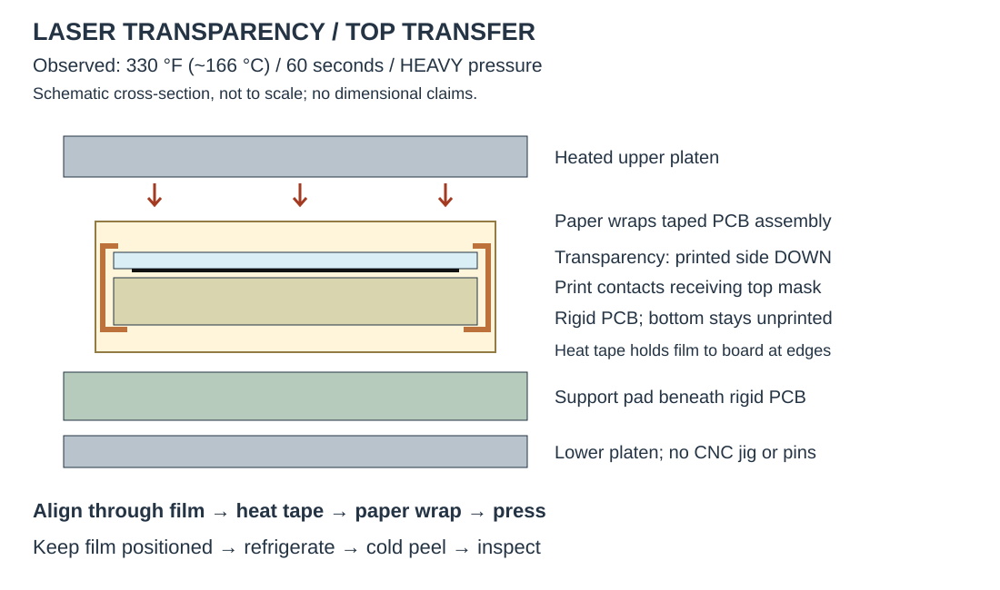

# Laser transparency top-legend transfer

This is the tested laser transparency flow from the
[fabrication guide](pcb-fabrication-guide.md#flow-a-laser-transparency-tested-recipe).
The user's real test produced a **sharp, clean transfer**, with **really easy
alignment** through the transparency and a cold peel that worked very well.
Use the successful recipe below.

## Recipe and supplies

| Setting / handling | Successful test |
| --- | --- |
| Flat heat press | **330 °F (approximately 166 °C), 60 seconds, heavy pressure** |
| Support | **Pad beneath the rigid PCB** |
| Restraint | **Heat tape holds the transparency in position** |
| Protection | **PCB wrapped in paper before pressing** |
| Cooling / film removal | **Refrigerate with film attached, then cold peel** |

Have the laser printer/toner, laser-compatible transparency, flat heat press,
lower pad, heat tape, paper, heat gloves, trimming tools and refrigerator ready.
The board stays unpopulated, with the receiving top face up and bottom unprinted.

## Sequence at a glance

| Action | Holding / reference | Next check |
| --- | --- | --- |
| Bottom work | [Isolation, coating and pad clearing](pcb-fabrication-guide.md#2-isolate-coat-and-clear-bottom-pads); original copper zero/map | Clean exposed pads |
| Drill before first flip | [Floor-referenced setup](pcb-fabrication-guide.md#3-drill-before-the-first-flip), backing, bottom up, no map | Deburr; check holes |
| Flip, coat/cure top, release | [Top preparation](pcb-fabrication-guide.md#4-cure-white-top-then-transfer-off-the-jig); keep holes clear | Dry cured mask; adhesive removed |
| Align, tape, wrap and press | Look through film to board features/holes; pad below; separate flat press | 330 °F / 60 seconds / heavy pressure |
| Refrigerate and cold peel | Film stays positioned while cooling | Inspect sharpness and alignment |
| Finish | [Hole cleanup only if obstructed](pcb-fabrication-guide.md#5-conditional-hole-cleanup-and-finish) | Clean/deburr, lead fit and electrical checks before assembly |

## At the press

1. **Prepare the board.** Complete the shared bottom work, pre-flip drilling
   and top coating. Release the board and remove adhesive residue. Let cleaning
   solvent evaporate. Only the PCB goes to the press; jig, pins and tape/CA
   workholding stay at the CNC setup.
2. **Print and align.** Print the top legend on laser-compatible transparency
   at actual size, keeping the 100 × 150 mm field at 100%. Put the printed side
   against the receiving top face so the transferred text reads correctly.
   Look through the film to align with holes and visible board features.
   Use the laser printer's appropriate transfer orientation; the Epson
   automatic-mirror setting belongs to the sublimation printer.
3. **Tape.** Secure the transparency with heat tape so it stays positioned
   throughout pressing and cooling. Check that taping did not move it.
4. **Wrap and support.** Wrap the taped PCB in paper and place it on the lower
   pad, which supports the rigid board. Keep paper smooth and the support free
   of chips or hard ridges.
5. **Press.** Set the flat heat press to **330 °F**, use **heavy pressure**, and
   press for **60 seconds**. Remove with heat gloves without shifting the film.
6. **Refrigerate and cold peel.** Keep the film attached while cooling the board
   in the refrigerator, then remove the film cold. This reproduces the removal
   method that worked very well in the user's test.
7. **Inspect and finish.** Check small text, alignment, coating and exposed
   pads. Inspect drilled holes; skip cleanup if clear with accepted lead fit.
   If obstructed, use the guide's conditional hole pass with restored backing,
   floor Z0, bottom-up registration and no copper map. Clean, deburr and check
   continuity/isolation before assembly. Let any condensation dry before
   electrical checks. Record the run in the
   [attempt log](pcb-attempt-log.md#laser-transparency-transfer-test).

This flow uses the successful transparency recipe directly. Sublimation's
coupon qualification, heat-only witness, temperature ladder and peel comparisons
are part of [flow B](pcb-fabrication-guide.md#flow-b-sublimation-untested-trial).
