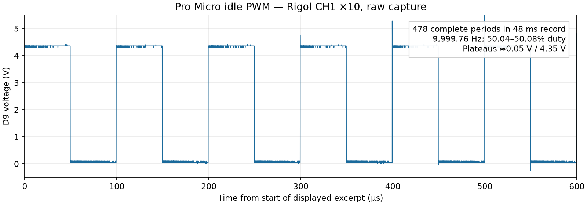

# Verification restart — November 13, 2026

**Learning guide:** [Illustrated firmware testing field guide (PDF)](../../../learning/firmware-testing-field-guide-2026-11-13.pdf)
explains the session's setups, manual and automated procedures, instrument readings,
annotated captures, results and remaining integration checks in one document.

**Current installed image:** [Grove production regression](grove-ui/production/README.md)
records the verified production HEX, bench commands rejected, UI save/restore and
12 PTT transitions ≤5.1478 ms. [Mixed bench UI/PTT stress](grove-ui/mixed-stress/README.md)
passes 80 pairs with 80 accepted detents; it is historical bench-image evidence.
Production bypass/PWM and serial-closed operation now also pass: suppression
≤10.2598 ms, modulation onset ≤5.3940 ms; six-second production tone estimate
151.39628797 Hz for 151.4 Hz, with 59,998 complete carrier periods and no missing
periods detected. Bus faults remain deferred for space. See production record
for remaining integration gates and exact timebase/physical-test limits.

**Subsequent Grove UI stage:** [Grove V4 display and simulated EC11](grove-ui/README.md)
now uses a newly uploaded/verified Grove-enabled bench image. The user confirmed
home/menu screens and both encoder directions. Physical preset/manual saves,
four-digit editing, restoration and Cancel pass; VCC with backlight is about
4.5 V. Display-enabled PTT now also passes 28 captured transitions (worst
5.3574 ms), including save/bounce cases, plus both watchdog cases (release
upper bound ≤327.94 ms; no rekey for three seconds while held).
Earlier electrical results below identify the preceding LCD-disabled
image; display-enabled bypass timing separately passes eight transitions, including save-active cases (midpoint ≤9.9358 ms; modulation onset ≤5.3384 ms).

**Latest physical checks:** the user completed the minimal NUCLEO fixture.
[Physical bypass-to-PWM timing](bypass-electrical/README.md) passes eight transitions,
including save-active cases: midpoint settling ≤10.1378 ms, modulation onset
≤5.4692 ms, with continuous carrier in the records.
[Electrical PTT response, save-active/bounce response and watchdog release](ptt-electrical/README.md)
pass: worst captured PTT response 5.3622 ms; watchdog upper bounds 328.58/326.72 ms,
with no rekey for three seconds while held.
[NUCLEO-driven tone, bypass/latch, endpoint and held-reset checks](nucleo-minimal/README.md)
pass, and read-only flash comparison matches all 11,470 bench application bytes.
The [actual-sketch host integration](sketch-loop/README.md) also passes nine
executions each under MSVC and Clang. Earlier deferred/disconnected notes below
describe the preceding session state. Actual UI, loaded carrier/radio and
rated-supply acceptance remain open; these are the completed bare-board checks.

**Earlier USB/idle stage:** offline, USB and idle PWM screening passed. The
later sections and links above record subsequent physical acceptance.

**Supply finding:** the user subsequently measured VCC ≈4.38 V with the
multimeter. This is below the ATmega32U4's specified 4.5 V minimum at 16 MHz
([Microchip datasheet summary](https://ww1.microchip.com/downloads/en/DeviceDoc/Atmel-7766-8-bit-AVR-ATmega16U4-32U4_Summary.pdf), maximum-frequency specification).
The USB and PWM results below remain valid observations at this measured supply,
but do not qualify operation within the rated 16 MHz supply envelope. A different
USB cable/port is not currently available. The user explicitly chose to continue
as-is, accepting likely rework. Continue exploratory/conditional tests at the
measured rail, retaining the nominal-supply acceptance gap rather than blocking
bench work. Keep external bench/RAW power disconnected from USB.
See the [campaign](../../../implementation/firmware-verification-plan.md) for
the staged bench work and [manifest](manifest.json) for current source/image
hashes, build sizes and device-discovery scope. [Host output](host-tests.txt)
records the actual run using MSVC 19.44 with warnings as errors.

| Check executed | Result |
| --- | --- |
| Existing control, journal, capture and display suites | Pass |
| Complete uint16 range validation | 65,536 inputs pass |
| Manual editor commit/Cancel bounds | All 10,000 four-digit values pass |
| Pending save and bypass/TX latch | All 1,872 allowed settings pass |
| Startup input sequences | All 65,536 eight-event microphone/bypass combinations pass |
| Actual `tone.cpp` against a host register model | All 1,872 settings pass, 20,000 measured nominal carrier samples each; worst frequency estimate error 0.011875 Hz |
| Tone bounds, idle, attack bound, completed release, timer guards and fault stop | Pass in host model |
| AVR bench, production and production/0x27 builds | Pass; all three HEX hashes match November 2 images |

The explicit uint32 cast in `tone.cpp` expresses an existing narrowing conversion
for the strict host compiler; it changes none of the three AVR HEX files. No
functional firmware correction was required by these checks.

The host model runs the real ISR/setter, but does not establish physical clock
accuracy, AVR interrupt execution deadlines, atomicity, hardware timer buffering,
USB responsiveness or pin behavior. The journal and display models likewise
do not qualify EEPROM power interruption or an actual LCD. Static RAM figures
do not measure stack high-water use.

Windows reported present Rigol, Saleae and supply USB identities. The read-only
Rigol identity query succeeded. The Arduino/ST-Link serial devices were absent
at discovery. No flash/upload, waveform capture, stimulus, supply command or
meter mode change occurred. Instrument connections and DUT pin states were
not measured. November 2 USB evidence remains historical.

## Subsequent live USB session

After the user connected the boards, discovery identified the Pro Micro at
COM14 and F767ZI ST-Link VCP at COM5. The Pro Micro reported bench=1,
LCD disabled, no waveform fault and released PTT. The F767 reported the expected
STANDIN1 phase-one identity; STOP readback confirmed `armed=0 drive=0`.
Unwired sense inputs reported `sense=6`; floating inputs are excluded from acceptance.

[Live USB results](usb-results.json) record successful completed saves of
67.0, 151.4, 254.1 and 100.0 Hz. The intentional HANG/watchdog reset retained
100.0 Hz; USB reconnection took about 0.921 s. This is not an electrical
watchdog/PTT-release measurement. The original 151.4 Hz setting was restored.
Maximum reported loop gap during the save sequence was 2,064 µs; this diagnostic
is not a pin-latency measurement. No new image was flashed/read back, so source
hashes do not establish the currently installed image's identity.

The device-absence paragraph above describes the earlier discovery before the
user connected the boards. This later session supersedes that connectivity state.

## Subsequent D9 waveform and USB robustness session

The user connected D9 to Rigol CH1 and the probe ground to Arduino GND, USB
power restored, with no other Arduino connections. The setup requested physical
×10 attenuation; the scope channel was explicitly configured to ×10. A separate
VCC reading subsequently returned approximately 4.38 V, consistent with the
4.35 V output plateau. This establishes a low board rail; it does not identify
whether the drop is in the host/cable or the clone module's power path.

[USB robustness results](usb-diagnostics.json) passed malformed/overlong-command
rejection, parser resynchronization, fragmented STATUS/CRLF, 200 consecutive
STATUS requests and recovery after 16 queued requests with a 0.5 s stalled
reader. Saved/active setting, PTT, bypass, arm, display and fault state stayed
unchanged. No valid SAVE, HANG, upload or stimulus command was sent in that run.

| Physical measurement | Observed result |
| --- | --- |
| Acquisition | Normally triggered RAW CH1, 1,200,000 points at 40 ns/sample, 48 ms total |
| Complete periods evaluated | 478 |
| Frequency | 9,999.7573 Hz, derived from whole rising-edge intervals |
| Period min/max | 100.00–100.04 µs |
| Duty min/max | 50.04–50.08% |
| LOW/HIGH plateaus | Approximately 0.051/4.353 V, from 10th/90th percentile sample codes |
| Screening result | All selected coarse idle-PWM limits pass |
| Scope cleanup | Relevant original settings and run state restored by readback |

[Raw samples](idle-pwm/capture/waveform.u8),
[preamble/scaling](idle-pwm/capture/capture.json),
[evaluation and before/after settings](idle-pwm/result.json), and
[scope view](idle-pwm/scope.png) are retained. The screenshot was obtained after
the helper resumed acquisition; the plotted excerpt comes from the exact saved
RAW data. Edge spikes are visible; plateau values are not overshoot limits or
edge-quality qualification. Absolute calibrated timing/voltage accuracy is not
established. No missing PWM periods were detected in this finite record; the
USB traffic and scope capture were sequential, not simultaneous stress evidence.

The initial acquisition attempts did not obtain a waveform: attempts a/b hit
error-query timeouts after a memory-depth command; attempt c rejected a depth
readback mismatch. All restored settings. The
[command diagnostic](idle-pwm/acquisition-development/idle-pwm-command-diagnostic.json)
and [explicit recovery](idle-pwm/acquisition-development/idle-pwm-recovery.json)
are retained alongside failed reports. Letting channel-enable changes settle
before selecting memory depth resolved the observed setup failure. The accepted
run used the requested 1.2 Mpoint depth and normal trigger without forcing.

Project-owned [bench tools/procedure](../../../../tools/bench/README.md) contain
the repeatable commands and dependencies. Seven offline evaluator tests passed,
including wrong frequency/duty/level, clipping, static and incomplete data;
these are separate from live measurements. No firmware was changed or flashed
during this session. Next: qualify the F767 stimulus fixture for active-input
and independent timing tests under the user's accepted low-supply condition.

## Continued low-supply testing

The user authorized continuing at VCC ≈4.38 V with the understood possibility
of rework, and requested NUCLEO-driven inputs instead of manual grounding.
No attempt is made to turn this authorization into rated-voltage acceptance.

The [concurrent USB/PWM run](idle-pwm-usb-stress/result.json) passed with **541**
STATUS exchanges spanning the scope acquisition call (about 2.5 s). The
normally triggered 48 ms RAW record contained 478 complete periods, with the
same 9,999.7573 Hz and 50.04–50.08% duty estimates as the prior idle run.
No missing period was detected in that finite window. USB state stayed
unchanged; scope settings were restored. This adds simultaneous observation
under this specific STATUS load; it does not cover every USB fault/load.

The first concurrent-run attempt failed before acquisition because pyserial was
missing from the inventory Python environment. Its restored-settings report is
retained. A project-local venv was then created using the delivered requirements;
the successful run used that environment. No inventory environment was modified.

A minimal two-input F767 wiring setup has been requested: common ground,
PF12→1 kΩ→Arduino D7 and PF13→1 kΩ→Arduino D10, each Arduino input with a
10 kΩ pull-up to Arduino VCC. D9 stays on scope CH1. It has no feedback dividers;
NUCLEO sense/latency fields must therefore be excluded. The full fixture remains
necessary for independent D8/LED timing. The prepared NUCLEO/scope orchestrator
has not yet been run on that wiring. Six offline tone-decoder tests passed;
physical modulated-tone testing remains pending wiring completion.
