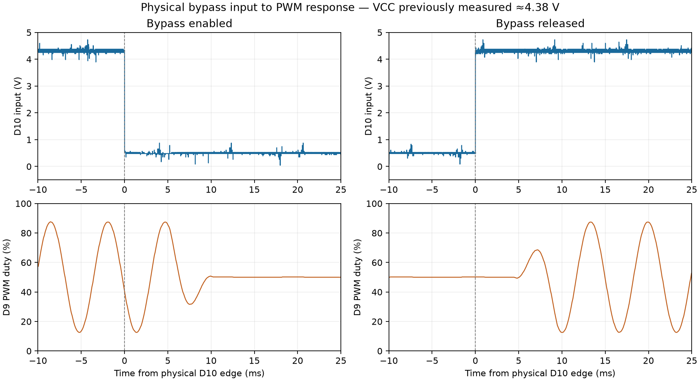

# Physical bypass-to-PWM response

**Pass: eight physical bypass transitions, including two with a save active.**
CH1 measured Arduino D10, CH2 D9, both probes/channel settings ×10, both grounds
on Arduino GND. The existing F767 PTT/bypass drive fixture was unchanged. PTT
stayed commanded throughout each sequence at a latched 151.4 Hz. Radio, carrier,
external supply, actual LCD and encoder stayed disconnected. Results apply to
the user-accepted setup with previously measured VCC ≈4.38 V.



| Measurement | Three ordinary on/off pairs | One save-active on/off pair | Limit |
| --- | ---: | ---: | ---: |
| Enable bypass: settled midpoint PWM | 9.9790–10.1378 ms | 9.7622 ms | ≤25 ms |
| Release bypass: modulation onset | 4.4186–5.4692 ms | 4.9578 ms | ≤25 ms |
| Release bypass: observed 20–80% duty span | 12.6694–13.1188 ms | 11.8580 ms | Selected additional ≤25 ms check |

The resumption-span metric uses **≤20% and ≥80% duty thresholds**; it is not a
claim that exact nominal 12.5/87.5% peaks were first reached at that instant.
The historical JSON field is named `full_modulation_span_ms`; the thresholds
above define its actual meaning. Suppression settles when duty stays within
**49.5–50.5%** for the remaining record, with at least 10 ms of confirmation.
These metrics include input qualification and the digital modulation ramp,
but **exclude analog reconstruction-filter decay and audio/RF behavior**.

Every event contains two synchronized **600,000-point, 200 ns/sample records
(120 ms)** from the same stopped acquisition. No trigger was forced. D10 must
have exactly one appropriate edge. PWM period checks remain 98–102 µs through
the entire record: no missing carrier period was detected, and captures are
unclipped. Each record has 1,199 complete carrier periods. The explanatory duty
plot is independently reconstructed from retained raw edges, not the DDS table.
Observed D10 LOW/HIGH plateaus were approximately 0.482/4.335 V.

The save-active run confirms `busy=1` immediately before each bypass stimulus,
then validated durable completion afterward. The active transmission remains
latched at 151.4 Hz despite pending selection changes. USB `tx=1` remains set
before/after transitions; **D8 is not independently observed in these particular
captures**. Broader multichannel capture can check D8 and LEDs simultaneously.

Reports: [ordinary](baseline/result.json), [save-active](save-active/result.json).
Each event contains raw channels, preambles, source/settings identity and a
measurement record. All runs restored scope settings/run state and finished
NUCLEO **armed=0 drive=0**, Arduino **saved/active=1514, tx=0, bypass=0, fault=0**.

## Repeatable procedure

Use [check-bypass-timing.py](../../../../../tools/check-bypass-timing.py) with
the [bench dependencies](../../../../../tools/bench/README.md). With both boards
unplugged (Arduino first), connect CH1 tip to D10 and CH2 tip to D9, ×10 probes,
grounds to Arduino GND. Keep minimal fixture wiring; reconnect NUCLEO first,
then Arduino. Keep external supply/radio disconnected. Rediscover ports before
running, close other clients, and choose new output directories:

```powershell
.agent-scratch/firmware/bench-venv/Scripts/python.exe tools/check-bypass-timing.py --pro COM14 --standin COM5 --pairs 3 --output NEW_BYPASS_DIRECTORY
.agent-scratch/firmware/bench-venv/Scripts/python.exe tools/check-bypass-timing.py --pro COM14 --standin COM5 --pairs 1 --save-before-edge --output NEW_SAVE_DIRECTORY
```

The tool temporarily selects 151.4 Hz and physically keys PTT, then toggles
bypass. It refreshes the fixture lease between transfers. Save-active mode
alternates pending settings. Handled cleanup STOPs/releases all fixture inputs,
restores the original saved selection and verifies idle Arduino state. It
configures both channels at 1 V/div, offset −2.5 V, DC coupling, 10 ms/div,
600 kpoints and a 2 V D10 edge trigger, allowing 0.8 s arming. Settings are
restored by readback, but the old acquisition buffer is replaced.

On interruption, send STOP to the F767 and verify armed=0/drive=0; check Arduino
tx=0 and restore the recorded original setting. A terminated scope transfer
requires restoration from `scope_before`. Accept only exit 0, `passed=true`,
`scope_restored=true` and clean final state; a timeout/partial file cannot pass.
Seven offline evaluator tests cover suppression/resumption, late or absent
response, misaligned records and missing carrier:

```powershell
python tools/bench/test_bypass_measurement.py -v
```

`waveform.u8.gz` is lossless gzip; decompression gives original BYTE samples.
Adjacent `capture.json` provides exact time origin/scaling. Source snapshots match
each run's hashes. [Manifest](manifest.json) records archived and raw-buffer
hashes. No manufacturing or firmware write was performed by these tests.

Together with the [physical PTT/watchdog results](../ptt-electrical/README.md),
this closes the initial PTT/bypass digital response-budget checks. Actual UI,
loaded carrier/audio/RF, physical power-cycle/interrupted-write testing, the
broader physical sweep/soak campaign and rated-supply acceptance remain open.
