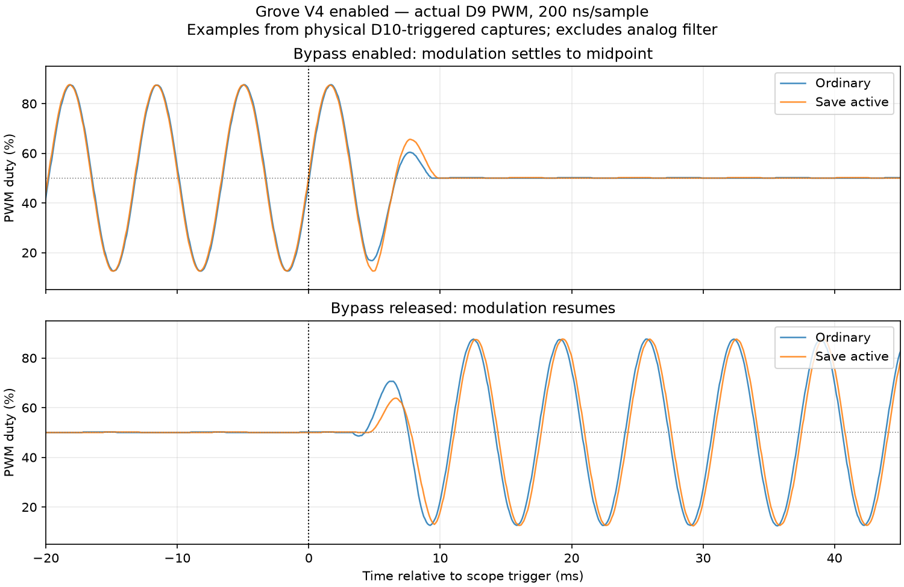
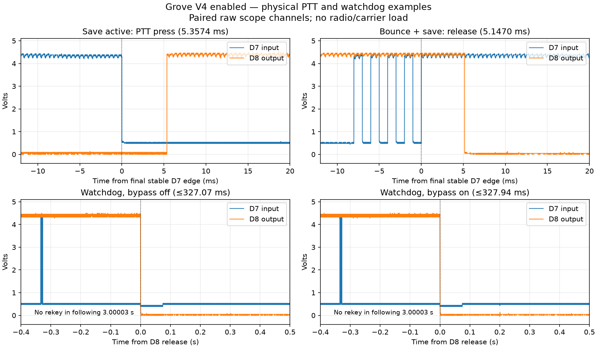

# Grove V4 display and simulated EC11 bring-up

**Current installed firmware:** the [Grove production image](production/README.md)
has replaced the bench image after the checks below. Upload/verification, disabled
SAVE/HANG commands, physical UI saves and 12 production PTT transitions pass.
Production bypass/PWM also passes eight transitions, including serial-closed
operation; the serial-closed six-second tone estimate is 151.39628797 Hz for
151.4 Hz. The user confirmed the final production home screen.
The [mixed bench campaign](mixed-stress/README.md) separately passes 80 pairs and
80 accepted detents; its first count-expectation failure is retained and explained.

## Scope and current state

The user has connected the Grove-LCD V4.0 and all three encoder/button fixture
lines. The physical EC11 is bare and remains substituted by the NUCLEO. The
NUCLEO was powered first; ID matched F767ZI and STOP/status confirmed armed=0,
drive=0. After Arduino USB was restored, the existing display-disabled bench
image reported saved/active=1514, tx=0, bypass=0, busy=0, fault=0, lcd=0.
The Grove bench image was subsequently uploaded: all 15,118 application bytes
verified by avrdude against the selected HEX. EEPROM settings remained 1514;
no fuse, bootloader or EEPROM programming operation was requested. Status then
reported lcd=1, tx=0, bypass=0, busy=0, fault=0. The user confirmed the lit home
screen with “Tone 151.4 Hz” / “RX  Tone enabled”. Broader UI and timing
qualification remains pending.

The user measured approximately **4.5 V before the upload/backlight setup**,
with the display dark. The user subsequently measured approximately **4.5 V with the backlight on**.
This single approximate reading does not establish rail margin or transient
behavior at the specified 16 MHz minimum.

A first physical 120 ms button closure/release completed with saved=1514,
tx=0, lcd=1 and fault=0 unchanged; fixture STOP readback was armed=0, drive=0.
The user confirmed the resulting “>Presets” / “Press=Select” menu. See `first-short.json`.

## Repeatable individual UI gestures

[exercise-ui-input.py](../../../../../tools/exercise-ui-input.py) sends one
gesture per invocation, checks Arduino health, then STOPs/releases the fixture.
Dependencies are the existing bench requirements. Select `short` (120 ms),
`long` (950 ms), `forward` or `reverse` (one four-transition detent with 50 ms
host pauses). These are selected functional-test intervals, not measured
contact-edge timing. Use a fresh output directory and establish the current
screen visually first: a short/long press may save depending on that screen.

```powershell
.agent-scratch/firmware/bench-venv/Scripts/python.exe tools/exercise-ui-input.py --pro COM14 --standin COM5 --action forward --output NEW_DIRECTORY
```

An exit-zero result checks execution, released fixture and status health; it
does not read screen content or prove a correct detent. Record visual outcomes
separately. On interruption send STOP and confirm armed=0/drive=0; the fixture
also releases on lease expiry. No gesture tool infers meaning from floating
sense inputs. Reuse the existing source/image identity and raw waveform tools
for subsequent timing qualification.

## Wiring and power sequence

Keep the radio and bench supply disconnected. The two board power rails stay
separate; grounds are shared. Preserve the existing PTT/bypass fixture and
scope connections CH1=D10, CH2=D9. Wire changes require Arduino USB unplugged
first, then NUCLEO; reconnect NUCLEO first, verify STOP, then Arduino.

| Connection | Destination | Series / pull-up |
| --- | --- | --- |
| Grove GND | Arduino GND | Direct |
| Grove VCC | Arduino VCC | Direct, not RAW or NUCLEO power |
| Grove SDA | Arduino D2 | I²C bus |
| Grove SCL | Arduino D3 | I²C bus |
| NUCLEO PF15 / D2, CN10 pin 12 | Arduino D4, encoder A | 1 kΩ series; 10 kΩ from Arduino input to Arduino VCC |
| NUCLEO PE13 / D3, CN10 pin 10 | Arduino D5, encoder B | Same |
| NUCLEO PF14 / D4, CN10 pin 8 | Arduino D6, button | Same |

Schematic view of each simulated contact (three separate circuits):

```text
Arduino VCC
    |
   10 kΩ
    |
    +---------------- Arduino input D4, D5 or D6
    |
   1 kΩ
    |
NUCLEO open-drain pin ---- sinks LOW or releases

Arduino GND ------------- NUCLEO GND
```

The five drive commands use 1=sink/contact closed, 0=release. STOP releases
all five, and the fixture has a five-second arm lease. The configured positive
detent is AB 11→01→00→10→11. Individual USB commands establish functional
sequences; they do not establish precise edge timing or a qualified fast/bounce
generator. Real EC11 direction/contact behavior still needs physical testing.

## Driver and verification

Build with `tools/build-firmware.ps1 -Target ProMicro -Bench -GroveV4` (pass
`-ArduinoCli` if needed). This selects LCD address 0x3e and the Grove protocol,
plus PCA9632 backlight 0x62. The original PCF8574 option and disabled default
remain available. The screen layout and control logic are unchanged.

The initialization is a timed state machine, at most one I²C transaction per
service call, retaining the 1.5 ms Wire timeout. White backlight is selected at
64/255 per channel; this is a bench default, not measured brightness/current.
LCD or backlight initialization failure keeps the UI offline and retries after
one second. The backlight is not continuously polled after initialization.

MSVC and Clang host suites pass, including both display protocols and eight
Grove actual-sketch executions: normal, held PTT, bypass, both held, millis wrap,
missing LCD, standalone serial absence and EEPROM readback fault. Grove tests
decode control/data bytes independently, check backlight registers, reject
backlight NACK and verify recovery. These are host-model results, not electrical
I²C, AVR latency or visible-display acceptance.

Bench Grove build: 15,118 flash bytes, 1,434 static RAM bytes. Production Grove:
14,260 flash, 1,370 static RAM. Static RAM does not establish stack headroom.
The rebuilt display-disabled bench HEX remains byte-identical to the prior
verified image (SHA256 55d763b768fa7bb3692934231d2d0b7dbc89c74b2937bc4062a96c35d360aeff).
Core new.cpp unused-parameter warnings remain toolchain warnings.

Protocol reference: [Seeed documentation](https://wiki.seeedstudio.com/Grove-LCD_RGB_Backlight/)
and [vendor source](https://github.com/Seeed-Studio/Grove_LCD_RGB_Backlight).
Grove V4 is specified for 5 V; this bench previously measured about 4.38 V and
the user authorized continued conditional testing. Measure loaded VCC before
claiming supply acceptance. V5 is a different backlight variant.

## Next physical checks

1. Completed: record VCC-to-GND and initial display appearance before uploading.
2. Completed: upload/verify Grove bench image and readable home screen, preserving
   saved tone. Backlight-on VCC was approximately 4.5 V.
3. Exercise short/long button presses and both encoder directions. Check exact
   menu/preset/manual results visually, Cancel and save persistence.
4. Repeat PTT/bypass timing and PWM checks during UI traffic, then display
   faults/recovery. Keep these results separate from the older LCD-disabled image.
5. Finish with STOP/readback, original saved tone and released PTT; retain image
   identity, raw captures and observations before declaring acceptance.

The user confirmed one forward detent selected >Manual, then one reverse detent plus Select opened Preset 151.4 Hz / Press=Save. Both directions and the initial four-transition detent mapping work physically.


## Completed physical UI sequence

The following checks use the uploaded Grove image and actual Arduino GPIO
inputs, with F767 open-drain contact emulation. No USB SAVE command was used.
Every gesture report retains before/after status and verified fixture STOP.
PTT remained released, LCD online and fault=0; saved tone stayed unchanged
through browsing/editing until the designated save. These status checks do not
independently measure D8 or prove display pixel contents at every intermediate
screen. User visual confirmations cover home, menu, forward movement and
opening the preset screen. The user confirmed the final home screen.

| Sequence | Expected and observed saved value | Evidence |
| --- | --- | --- |
| Forward from 151.4 preset, short-press save | 156.7 Hz | [Preset steps](preset-save-restore/2-short/result.json) |
| Reopen preset, reverse, short-press save | 151.4 Hz restored | [Restore](preset-save-restore/5-short/result.json) |
| Enter Manual; adjust all four digits 1514→2514→2414→2424→2425; 950 ms press | 242.5 Hz, only after explicit save | [Manual save](manual-save-cancel/10-long/result.json) |
| Reopen Manual; reverse all four edits; 950 ms press | 151.4 Hz restored | [Manual restore](manual-save-cancel/19-long/result.json) |
| Reopen Manual; change first digit; four short presses to Cancel; 950 ms press | 151.4 Hz unchanged | [Cancel](manual-save-cancel/26-long/result.json) |
| Select Back | 151.4 Hz, home expected | [Final status](manual-save-cancel/28-short/result.json) |

Successful subsequent navigation also checks that the tested 950 ms long press
did not generate a second short-press action on release. This does not locate
or qualify the exact 750 ms threshold. No reset occurred in these sequences;
power-cycle persistence and display-enabled electrical timing remain pending.
The fixture is disarmed with every simulated contact released. User-reported
VCC with the enabled backlight is approximately 4.5 V.


## Display-enabled physical bypass timing

Both scope runs passed: six ordinary transitions plus two immediately after
confirmed EEPROM busy=1. CH1=D10, CH2=D9, both ×10, common Arduino ground;
fixture wiring is unchanged. Each event has paired 600,000-point RAW channels
at 200 ns/sample (120 ms), actual edge triggering and 1,199 complete PWM periods.

| Metric | Worst of eight transitions | Acceptance |
| --- | ---: | ---: |
| Bypass to settled midpoint | 9.9358 ms | ≤25 ms |
| Release to modulation onset | 5.3384 ms | ≤25 ms |
| Release to observed 20–80% duty span | 14.1386 ms | Selected ≤25 ms check |

No missing carrier periods or ADC clipping were detected. Midpoint tolerance
is 49.5–50.5%; the span metric is not literal nominal peak amplitude. Results
exclude analog-filter/audio behavior. D8 was not simultaneously measured.
These runs exercise the live display driver and its TX/bypass/save-related
updates; they do not add simultaneous encoder rotation during acquisition.

[Ordinary report](bypass-baseline/result.json) and
[save-active report](bypass-save-active/result.json) retain actual Arduino
lcd=1 state. Both restored scope settings/run state (not its old buffer),
original saved/active 1514, tx=0, bypass=0, busy=0, fault=0 and fixture
armed=0/drive=0. The final screen is expected home after USB saves; no user
visual claim is added for this later cleanup. Raw BYTE files are lossless
`.u8.gz`; decompress to the original `.u8` name referenced in capture metadata.
The manifest includes compressed-file and original-buffer SHA256 values.



## Display-enabled physical PTT and watchdog

After the user moved the probes with power off, **CH1=D7 input, CH2=D8 PTT
output**, both ×10 and grounds at Arduino GND. Display and five fixture-drive
lines remained connected. Rediscovery/STOP confirmed the F767 identity and
released drives; Arduino startup reported lcd=1, saved=1514, tx=0, fault=0.
The firmware image is the same verified Grove bench HEX above.

| Test | Captured transitions | Physical response | Acceptance |
| --- | ---: | ---: | ---: |
| Ordinary, three press/release pairs per bypass state | 12 | 4.3368–5.3036 ms | ≤25 ms |
| Save confirmed busy before each edge | 12 | 3.9362–5.3574 ms | ≤25 ms |
| Eight 1 ms toggles, final stable edge, save active | 4 | 3.9282–5.1470 ms | ≤25 ms |

All 28 passed. Each 120 ms paired record has 600,000 samples/channel at 200 ns,
from the same stopped acquisition with matching axes and actual edge trigger.
Ordinary records contain exactly one input and one output transition; bounce
records contain nine input transitions and exactly one output transition.
Latency starts at the final stable input edge, including input qualification.
No extra D8 pulse was detected in these windows. Bounce scheduler lateness is
retained in each event report. These are measurements under the live display
driver and its PTT/save/bypass updates, not simultaneous continuous encoder stress.

Reports: [ordinary](ptt-baseline/result.json),
[save active](ptt-save-active/result.json),
[bounce during save](ptt-bounce-save/result.json).

Two intentional HANG/watchdog cases also passed with physical PTT held:

| Bypass state | Pre-HANG marker to D8 LOW upper bound | Held input after output release |
| --- | ---: | ---: |
| Off | 327.07 ms | 3.00003 s, no rekey |
| On | 327.94 ms | 3.00003 s, no rekey |

The last of four short physical release pulses precedes HANG; marker-to-D8
is a conservative bound rather than an exact software-HANG timestamp. Paired
600,000-point records use 10 µs/sample over six seconds. USB disappearance and
recovery were observed, held-input status stayed tx=0/armed=0 after reset,
and release/new press was checked. LCD initialization succeeded after recovery.
See [watchdog report](ptt-watchdog/result.json). D8 has only the scope load;
carrier/Q1/radio loading remains untested. D9 is not observed in these records.

Every run verified scope settings/run-state restoration, fixture armed=0,
drive=0 and Arduino saved/active=1514, tx=0, bypass=0, lcd=1, busy=0, fault=0.
All raw channels are losslessly archived as `.u8.gz`; re-evaluation of these
archived buffers must reproduce the recorded measurement. The scope's original
acquisition buffer is replaced. No supply commands were sent.

Repeat with [check-ptt-timing.py](../../../../../tools/check-ptt-timing.py),
following the [bench procedure](../../../../../tools/bench/README.md). Use fresh
output directories and the identified ports:

```powershell
.agent-scratch/firmware/bench-venv/Scripts/python.exe tools/check-ptt-timing.py --pro COM14 --standin COM5 --pairs 3 --output NEW_BASELINE
.agent-scratch/firmware/bench-venv/Scripts/python.exe tools/check-ptt-timing.py --pro COM14 --standin COM5 --pairs 3 --save-before-edge --output NEW_SAVE
.agent-scratch/firmware/bench-venv/Scripts/python.exe tools/check-ptt-timing.py --pro COM14 --standin COM5 --pairs 1 --save-before-edge --bounce --output NEW_BOUNCE
.agent-scratch/firmware/bench-venv/Scripts/python.exe tools/check-ptt-timing.py --pro COM14 --standin COM5 --watchdog --output NEW_WATCHDOG
```

On interruption, send STOP and confirm armed=0/drive=0, verify Arduino idle and
original saved tone, and restore scope from the retained `scope_before` settings.
Partial capture/timeout is not a passing test. Normal cleanup does these checks;
the arm lease/watchdog also releases fixture drives after host loss.



## Remaining acceptance

**Disposition:** the completed digital tests support staged carrier integration;
they do not establish that the complete assembled solution is qualified. The
installed production image and the exact remaining gates are recorded in
[production regression](production/README.md#remaining-integration-gates).

The [physical SCL-clamp campaign](display-fault/README.md) is deferred: the user
cannot fit the proposed wiring changes on the breadboard. No physical display
bus fault was injected. Seven offline qualification/cleanup checks pass, but
display-bus fault tolerance remains physically unqualified. Resume this case
when the fixture or assembled carrier provides access; current valid bench
results do not depend on completing this additional hookup.

These results close the first display-enabled PTT/bypass/save/bounce/watchdog
regression. Still open: real display bus faults and recovery, longer simultaneous
UI/stimulus stress and frequency coverage, power-cycle/interrupted-save behavior,
the physical EC11, and final production-image regression. Supply margin and
loaded carrier/filter/audio/radio acceptance remain separate. Approximately
4.5 V is the user's current measured rail, not a qualified supply envelope.
