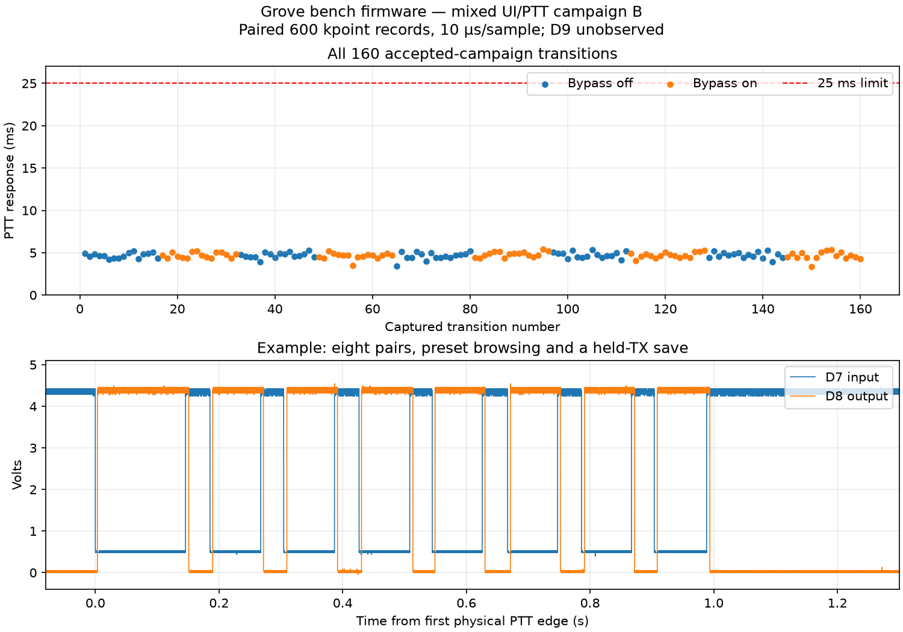

# Mixed UI and PTT stress

**Accepted campaign B passes:** 80 press/release pairs, 160 physical PTT
transitions, 80 counted preset detents, alternating bypass and two background
saves while keyed. Original saved tone 151.4 Hz was restored. The unchanged
Grove bench image was installed throughout these runs; CH1=D7, CH2=D8, ×10,
all five original fixture drives connected. No display-fault wiring was added.

| Run | PTT pin measurements | UI count oracle | Campaign disposition |
| --- | --- | --- | --- |
| A | 160 edges, 3.20–5.50 ms, no extra pulses | Expected 77.0 Hz; observed 71.9 Hz | Failed test expectation; retained |
| B | 160 edges, 3.39–5.39 ms, no extra pulses | Expected and observed 77.0 Hz | Pass |

Reports: [A](ui-ptt-stress-a/result.json), [B](ui-ptt-stress-b/result.json).
Both restored scope settings/run state and finished fixture armed=0/drive=0,
Arduino saved/active=1514, tx=0, bypass=0, lcd=1, busy=0, fault=0.

## Why run A did not pass

The actual sketch deliberately gates UI gestures while `Storage::busy()`.
Run A incorrectly counted the two detents begun immediately after observing
busy=1 as guaranteed accepted edits. Its final 71.9 Hz selection corresponds to
78 rather than 80 forward detents from the initial 151.4 Hz preset index, which
is consistent with one discarded detent during each of the two saves. The
queries bracket save activity but do not timestamp the final encoder edge, so
this is an inference supported by the known gate and exact count, not a direct
electrical measurement of each discarded detent.

Run B waits for observed busy=0 before each counted detent. It still holds PTT
through the save, confirms the active tone remains latched, and then rotates
while keyed. The exact 80-detent check now passes. No firmware correction or
acceptance-limit relaxation was made. Run A's script is reconstructed only by
removing the later wait block; its archived source bytes match the SHA256
recorded at that run's start. Other tool snapshots likewise match each report.
The inter-run HANG/reset was performed with fixture STOPped, saved=1514 and
PTT released; USB disappearance/recovery and healthy display status were observed.

## Measurement envelope

Every batch retains one six-second paired 600,000-point/channel record at
10 µs/sample, after a real D7 falling trigger. Three seconds of prehistory
are filled. Eight pairs fit within about one second after triggering and
have more than 50 ms of post-release confirmation. The evaluator checks every
D7 and D8 edge at a fixed 2 V threshold, rejects extra/missing transitions and
requires each response within 25 ms. Edge-pair sample resolution is 20 µs;
absolute calibrated timebase accuracy is not established. Ten records provide
60 seconds of captured windows; gaps during transfers are not glitch-free proof.

Preset browsing drives the real A/B inputs and display updates. Saving the
final selection through the physical button supplies an independent count
check against the preset table. This traverses the list and its wrap; it does
not measure tone frequency at each preset or visually inspect every screen.
Neither D9, LED outputs nor I²C waveforms are captured in this setup.

`waveform.u8.gz` files decompress losslessly to the original BYTE buffers named
in `capture.json`; the exact preambles/time axes remain adjacent. All archived
buffers were decompressed and re-evaluated to reproduce the recorded results.
The manifest records archived and original-buffer hashes. Scope settings were
restored, but original acquisition buffers were replaced.

## Manual range rejection

Following run B, the physical controls entered Manual, changed 151.4 to 351.4 Hz
and held the button for 950 ms. Saved tone remained 151.4 Hz, PTT released and
fault=0. The user confirmed **Manual 351.4 Hz** and **Range 067-254.1** on the
display. [Gesture evidence](manual-range-error/6-long/result.json) is retained.
The later production-image upload resets this uncommitted edit buffer.

Repeat with [check-ui-ptt-stress.py](../../../../../../tools/check-ui-ptt-stress.py)
and the [bench procedure](../../../../../../tools/bench/README.md). A freshly
reset home screen/default menu selection is required, along with the original
encoder wiring. Eight offline evaluator tests cover correct data, late/missing
response, extra pulse, sample/axis errors, trigger placement and posthistory.

