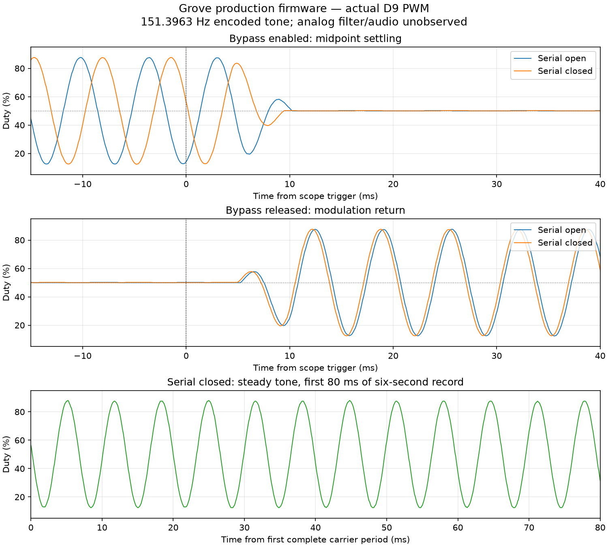

# Grove production-image regression

**Installed image:** [grove-production.hex](grove-production.hex), SHA256
`cbdd81b59ab4645b21e01b0dddfd0898f1fc502f9de407f76f385aabcf86deee`.
Build: `build-firmware.ps1 -Target ProMicro -GroveV4`, without `-Bench`, using
the pinned Pro Micro 5 V/16 MHz toolchain. Size: 14,260 flash bytes, 1,370 static
RAM bytes. Build/configuration and host tests are in the parent Grove record.

## Upload and protocol identity

With the fixture STOPped and saved=1514, tx=0, busy=0, fault=0, the existing
1200-baud upload request entered the observed clone Caterina bootloader
(USB 2341:0036). avrdude confirmed ATmega32U4 signature 0x1e9587, programmed
and **verified all 14,260 application bytes**. No EEPROM, fuse or bootloader
programming operation was requested. [Upload transcript](upload.txt) and
[status evidence](upload.json) retain the outcome.

Application status returned bench=0, saved/active=1514, lcd=1, tx=0, bypass=0,
busy=0, fault=0. Both `SAVE 1000` and `HANG` returned **ERR command**, with
saved=1514 and healthy status afterward. The production image remains installed;
it has not been replaced with the bench image for this regression.

## Physical UI save and restore

Starting at the freshly initialized home/default menu, simulated physical
controls opened Presets, advanced one detent and saved **156.7 Hz**. Reopening
Presets, reversing one detent and saving restored **151.4 Hz**. No USB SAVE
was used. Each of ten gestures checked bench=0, lcd=1, tx=0, fault=0 and the
expected saved value; fixture STOP/readback followed each gesture. Finally Back
was selected, so the home screen is expected. [Save](ui-save-restore/04-short/result.json)
and [restore](ui-save-restore/07-short/result.json) are retained. These status
checks do not substitute for visual inspection of every intermediate screen.

## Physical PTT response

**Pass: 12 transitions**, three press/release pairs in each bypass state, with
CH1=D7, CH2=D8, ×10 probes and common ground. Actual stable-input-to-output
response was **3.7508–5.1478 ms**, all within 25 ms, with exactly one input
transition and one appropriate output transition in every 120 ms record.
Each paired acquisition contains 600,000 samples/channel at 200 ns/sample.
No trigger was forced and no extra D8 pulse was detected in these windows.
See [PTT report](ptt-baseline/result.json). D9 and LEDs are not observed.

The production-aware runner sends no SAVE or HANG during these captures. Six
[offline guard tests](guard-tests.txt) check that production baseline runs are
accepted while bench-only stimulus is rejected before acquisition. Both baseline
and guard-tool changes preserve the earlier reports' exact archived snapshots.

Scope settings/run state were restored by readback; the previous buffer was
replaced. Final Arduino status: bench=0, lcd=1, saved/active=1514, tx=0, bypass=0,
busy=0, fault=0. Final fixture: armed=0, drive=0. Raw channels are lossless
`.u8.gz`, adjacent capture metadata supplies time/voltage scaling, and archived
buffers were re-evaluated to reproduce the recorded measurements.

## Production bypass and tone, including closed serial port

After the user moved only the scope tips, **CH1=D10, CH2=D9**, both ×10 and
grounds Arduino GND. The original fixture/display wiring remained unchanged.
STOP/readback and idle production status were checked before stimulation.

| Metric | Six transitions, serial open | Two transitions, serial closed | Limit |
| --- | ---: | ---: | ---: |
| Bypass to settled midpoint | ≤10.2598 ms | 9.3902 ms | ≤25 ms |
| Release to modulation onset | ≤5.3940 ms | 5.0488 ms | ≤25 ms |
| Release to observed 20–80% duty span | ≤13.9942 ms | 11.5490 ms | Selected ≤25 ms check |

All eight passed; every 120 ms paired record has 600,000 points/channel at
200 ns/sample and 1,199 complete carrier periods. No missing carrier period
or ADC clipping was detected. Midpoint tolerance is 49.5–50.5%; the span metric
does not mean exact nominal peaks. These are digital PWM measurements, excluding
filter decay/audio behavior. D8 is not simultaneously observed in this probe map.
Reports: [ordinary](bypass-baseline/result.json),
[serial closed](bypass-serial-closed/result.json).

The serial-closed mode explicitly closes the Arduino COM client **before PTT
is asserted**, keeps it closed through captures and reopens it for final status.
No SAVE/HANG is sent. In-capture USB status is intentionally absent; independent
D10/D9 records establish actual suppression/resumption. The USB cable remains
connected to this computer, so this is not an electrically detached USB-data test.

A further serial-closed **six-second** D9 capture at **500 ns/sample,
12,000,000 points** passed:

| Encoded PWM measurement | Observed |
| --- | ---: |
| Selected tone | 151.4 Hz |
| Estimated tone | 151.39628797 Hz |
| Error on nominal scope timebase | −0.00371203 Hz |
| Carrier | 9,999.75833 Hz |
| Complete carrier periods | 59,998 |
| Duty range | 12.5–88.0% |

Every complete carrier period was within 98–102 µs, no missing periods were
detected, and modulation reached both selected extremes. The producer DDS code
is not used to estimate frequency. Absolute calibrated timebase accuracy is
not established; this passes the selected ±0.1 Hz check on the nominal scope
reference. It is not a filtered-audio frequency/amplitude/distortion measurement.
See [tone report](tone-current-serial-closed/result.json) and its nested raw
capture/preamble. The parent refreshes the F767 arm lease while its scope child
runs, without opening the Arduino serial port during capture.



Every run restored scope settings/run state, original 151.4 Hz, Arduino healthy
idle production status and fixture armed=0/drive=0. The user confirmed the final
home display **Tone 151.4 Hz / RX Tone enabled**. Ports are closed. Original
scope buffers are replaced; only the relevant settings/run state is restored.

## Repeat these production checks

Follow [bench setup/recovery](../../../../../../tools/bench/README.md), rediscover
ports and use fresh directories. Probes must be CH1=D10 and CH2=D9 for bypass,
with CH2 still on D9 for the current-tone capture. These commands temporarily
key PTT; do not connect a radio or bench supply for this fixture campaign.

```powershell
.agent-scratch/firmware/bench-venv/Scripts/python.exe tools/check-bypass-timing.py --pro COM14 --standin COM5 --pairs 3 --output NEW_BYPASS
.agent-scratch/firmware/bench-venv/Scripts/python.exe tools/check-bypass-timing.py --pro COM14 --standin COM5 --pairs 1 --serial-closed --output NEW_CLOSED_BYPASS
.agent-scratch/firmware/bench-venv/Scripts/python.exe tools/nucleo-tone-test.py --pro COM14 --standin COM5 --current-only --scope-channel 2 --output NEW_TONE
```

Current-only mode measures the selected tone without changing settings or using
bench commands. Its scope child supports either D9 probe channel. On interruption,
STOP/read back the fixture, check idle/original tone and restore scope settings
from the child report. The arm lease also releases drives after host loss.

## Remaining integration gates

The digital firmware is a strong candidate for staged carrier integration.
Physical display-bus faults remain deferred for breadboard space. Real EC11,
broader physical frequency coverage, the longer planned soak, cold-power/held
startup and interrupted-write testing, plus loaded carrier, analog and radio
checks remain separate acceptance items. The latest user rail measurement was
approximately 4.5 V, without supply-margin qualification. Begin carrier work
with the actual regulated power path and controlled load checks; these digital
results do not establish the final solution's electrical/audio/RF acceptance.
