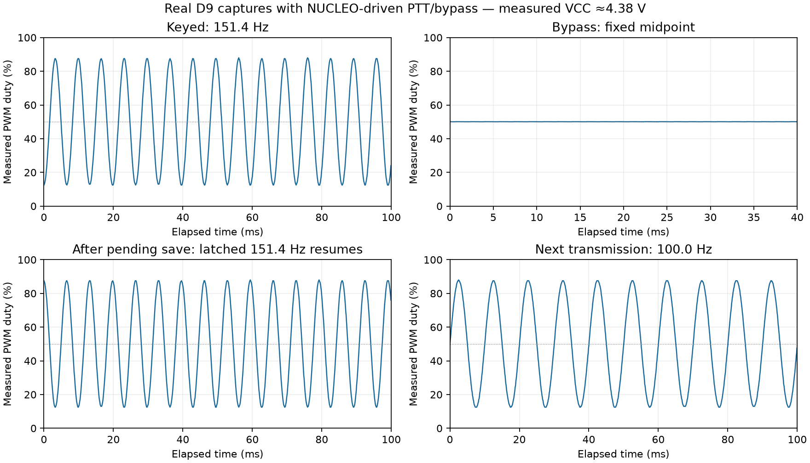

# NUCLEO-driven bare-Arduino checks

**Pass: minimal fixture control, scope-observed tone/bypass/latch behavior,
endpoint frequencies, held-PTT watchdog interlock and application flash comparison.**
These are current physical results, separate from the earlier host models.
The user accepted continuing with the previously measured **VCC ≈4.38 V**;
rated-supply acceptance at 16 MHz remains open. No radio, carrier PCB, LCD,
encoder or external supply was connected.

## Setup and identities

- Pro Micro: 5 V / 16 MHz project module, application COM14, bench firmware,
  display disabled, original setting 151.4 Hz.
- F767ZI: ST-Link VCP COM5, `STANDIN1 phase=1 board=NUCLEO-F767ZI`, 96 MHz
  system/1 MHz timer declaration, Release fixture previously programmed.
- Open-drain PF12→1 kΩ→Arduino D7; PF13→1 kΩ→Arduino D10; separate 10 kΩ
  pull-ups from both Arduino inputs to Arduino VCC; common ground. Board power
  rails stay separate. The user wired this minimal configuration.
- Rigol DS1202Z-E firmware 00.06.04, USB/WinUSB/PyVISA-py, CH1 ×10 on D9,
  probe ground on Arduino GND. Channels/settings restored after each capture.
- No NUCLEO output-sense dividers: `sense=6` is excluded; `latency_valid=0`
  is not a failed Arduino latency test. Electrical D8/LED behavior is not measured.

The [prepower record](minimal-fixture-prepower.json) verifies fixture identity
and STOP/readback before Arduino power. The
[initial qualification](minimal-fixture-qualification.json) verifies the
Arduino's idle state and actual response to brief physical PTT and bypass drives.
PTT/bypass returned released after each check. This is functional control-state
evidence, without a numerical pin-latency claim.

## Tone and pending-save sequence



| Physical stimulus / state | Scope result | Outcome |
| --- | --- | --- |
| PTT pressed, saved 151.4 Hz | Encoded tone **151.396592 Hz** | Pass |
| Bypass enabled while keyed | Fixed **50.04–50.08%** duty, carrier 9,999.757 Hz | Pass; USB tx remained asserted |
| Save 100.0 Hz while keyed/bypassed, then release bypass | Encoded tone **151.396642 Hz** | Original transmission latch preserved |
| Release PTT, then press again | Encoded tone **99.997720 Hz** | Pending saved selection applied to new transmission |
| Endpoint 67.0 Hz | Encoded tone **66.998483 Hz** | Pass |
| Endpoint 254.1 Hz | Encoded tone **254.093936 Hz** | Pass |

All five modulated captures contain **12,000,000 samples at 0.5 µs/sample
(6 seconds)**, each with 59,998 complete PWM periods. Captured period extrema
are 100.0–100.5 µs; measured duty reaches 12.5–88.0%, consistent with the selected
modulation and sample quantization. No missing carrier period was detected in
these windows. All five nominal-timebase tone estimates meet ±0.1 Hz; the
largest observed error is about **−0.006064 Hz** at 254.1 Hz. Absolute scope
calibration/reference accuracy is not established by these runs.

The plotted duty is independently reconstructed from raw waveform crossings;
it is not filtered audio or a copied DDS table. It illustrates the shape and
frequency latch. Reconstruction-filter distortion, amplitude, clicks, carrier
residue and radio deviation remain separate acceptance items.

[Sequence report](sequence/result.json) and [endpoint report](endpoints/result.json)
contain serial transcripts, checks, settings, raw-file hashes and cleanup states.
Each capture subdirectory contains its exact preamble and raw samples. Scope
screenshots were taken after acquisition resumed; the plotted duty uses the
exact retained RAW records.

## Physical PTT held through watchdog reset

The NUCLEO kept PTT asserted continuously across an intentional bench `HANG`
and watchdog reset, first with bypass released and then enabled. Its lease was
refreshed throughout each reset and capture. USB disappearance was observed
before recovery was accepted.

| Bypass input | First recovered Arduino state while PTT remained held | Scope / subsequent stimulus |
| --- | --- | --- |
| Released | `armed=0 tx=0 bypass=0 saved=1514 fault=0` | D9 midpoint PWM; release then new press permitted tx |
| Enabled | `armed=0 tx=0 bypass=1 saved=1514 fault=0` | D9 midpoint PWM; release then new press permitted tx |

Host recovery took about **0.859 s** and **0.843 s**, respectively. These times
are USB observations, **not electrical watchdog/D8 release latency**. The held
line was the real physical input, not software injection. The D9 captures
confirm tone suppression; USB state confirms the interlock decision. D8 remains
an unmeasured physical output until the next probe setup.

See the [held-reset report](held-reset/result.json). Each post-reset D9 record
has 1.2 Mpoints at 40 ns/sample, 48 ms duration, with 478 complete periods.

## Programmed application identity

A read-only AVR109/Caterina flash read compared **all 11,470 application bytes**
specified by the rebuilt bench HEX, with **zero mismatches**. Expected HEX SHA-256:

```text
55d763b768fa7bb3692934231d2d0b7dbc89c74b2937bc4062a96c35d360aeff
```

The observed clone bootloader is **USB 2341:0036 on COM16**, whereas the running
SparkFun-profile application is 1B4F:9206 on COM14. The first attempt incorrectly
expected the bootloader to share SparkFun's identity; it did not invoke avrdude.
Discovery of the actual new bootloader port resolved that assumption. The
[initial attempt](flash-readback/initial-bootloader-discovery-attempt.json) and
[successful result](flash-readback/result.json) are retained.

Avrdude used `-n` and a read-only `flash:r:...:r` operation. No application,
EEPROM, fuse or bootloader write was performed. The programmer returned 32,730
bytes (trailing erased bytes trimmed); the verified address set is the 11,470
application bytes, not a claim that every bootloader byte was checked against
a source. [Programmer log](flash-readback/avrdude.log) and compressed readback
are included. The application returned with saved/active=1514, tx=0, bypass=0,
armed=1 and fault=0.

## Reproduction, data and final state

The maintained [bench procedure](../../../../../tools/bench/README.md) describes
the exact setup, tool dependencies, acceptance and recovery. In the project venv:

```powershell
# PTT / bypass / pending-save / next-transmission sequence
.agent-scratch/firmware/bench-venv/Scripts/python.exe tools/nucleo-tone-test.py --pro COM14 --standin COM5 --output NEW_SEQUENCE_DIRECTORY
# Endpoint-only sweep; values are tenths of Hz
.agent-scratch/firmware/bench-venv/Scripts/python.exe tools/nucleo-tone-test.py --pro COM14 --standin COM5 --tones 670 2541 --output NEW_ENDPOINT_DIRECTORY
# Held-input watchdog interlock, both bypass states
.agent-scratch/firmware/bench-venv/Scripts/python.exe tools/nucleo-tone-test.py --pro COM14 --standin COM5 --held-reset --output NEW_RESET_DIRECTORY
```

Rediscover ports before another session. Do not use these D9 capture commands
after moving the probes for the later PTT timing setup.

Raw BYTE captures are **losslessly gzip-compressed** as `waveform.u8.gz` to keep
the evidence compact. Decompressing returns the original bytes whose SHA-256
is in each `result.json`; scaling/time origin are in the adjacent
`capture.json` preamble. For example, Python's standard library can read them
with `gzip.decompress(Path('waveform.u8.gz').read_bytes())`. The `.png` plots
are supporting views, not substitutes for samples. Historical controller
snapshots are stored as `controller-source.txt`, matched to each run's source
hash; reusable current scripts remain in `tools/`.

Every NUCLEO test completed with **armed=0, drive=0**, and the Arduino restored
to **151.4 Hz, tx=0, bypass=0, fault=0**. The readback reset returned the same
Arduino state. No stimulus remains held. The next requested setup moves scope
CH1 to D7 and adds CH2 on D8 for actual input-to-output timing; it remains
pending user setup. No electrical ≤25 ms or ≤1 s D8-release acceptance is
claimed from the present minimal fixture.
