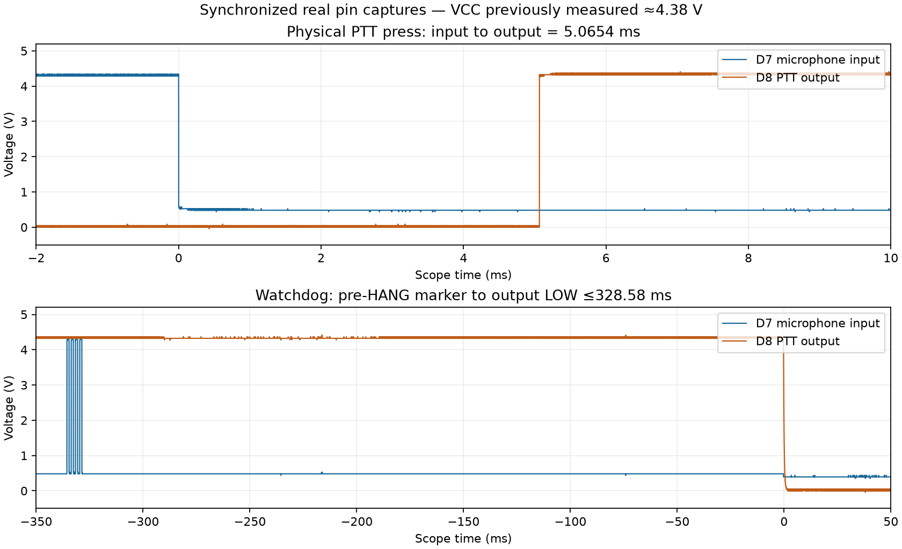
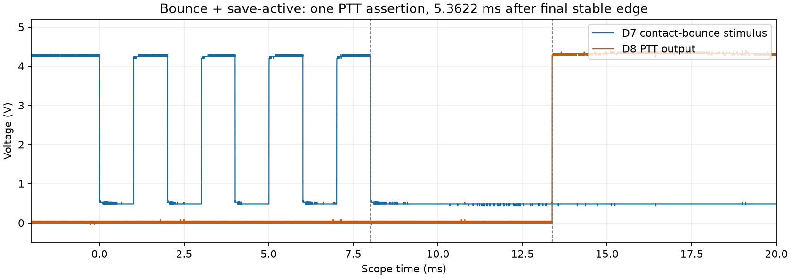

# Physical PTT response and watchdog release

**Pass: 28 captured PTT transitions and two electrical watchdog-release cases.**
CH1 measured Arduino D7, CH2 Arduino D8, with physical/channel probes at ×10
and grounds on Arduino GND. The F767 minimal open-drain fixture supplied inputs.
Radio, carrier and bench supply stayed disconnected. The previously measured
≈4.38 V rail and the user's authorization to continue at that voltage apply;
rated 16 MHz supply acceptance remains open.



## PTT response

| Cases, each including normal and bypass operation | Count | Physical input→output delay | Limit |
| --- | ---: | ---: | ---: |
| Stable press/release | 12 | 4.3706–5.1580 ms | ≤25 ms |
| Save confirmed busy immediately before stimulus | 12 | 3.8726–5.2060 ms | ≤25 ms |
| Save busy plus eight 1 ms contact toggles | 4 | 4.8072–5.3622 ms after final stable edge | ≤25 ms |

Each accepted window contains exactly one D8 transition, with no opposite/extra
output pulse. Both channels contain **600,000 samples at 200 ns/sample (120 ms)**,
read from the **same stopped acquisition**, with identical time axes and STOP
checks between transfers. Triggering uses the real D7 edge; no trigger is forced.
Midpoint crossings determine delay independently of host/fixture timestamps.
The sampling-only conservative two-edge bound is 0.4 µs; it excludes probe and
absolute timebase uncertainty. This does not establish an exact minimum pulse
rejection interval beyond the tested 1 ms pattern.



The bounce record contains nine input transitions followed by one output change
5.3622 ms after the final stable edge. Save-active tests alternate 100.0/151.4 Hz,
confirm `busy=1` immediately before stimulus, check durable completion afterward,
and restore the original setting. They do not test power interruption.

Reports: [baseline](baseline/result.json), [save-active](save-active/result.json),
[bounce with save](bounce-save/result.json).

## Electrical watchdog release

Before sending HANG, the fixture creates four 1 ms release pulses on the already
held D7 input. The host confirms the pattern has finished and TX is still active,
then sends HANG. The last captured D7 falling edge therefore precedes HANG:
its interval to D8 falling is a **conservative upper bound**, not an exact HANG
execution timestamp.

| Bypass input | Marker→D8 LOW upper bound | No D8 rekey afterward while D7 remained held |
| --- | ---: | ---: |
| Released | **328.58 ms** | **3.00004 s** |
| Enabled | **326.72 ms** | **3.00002 s** |

Both bounds meet the one-second target. Records contain **600,000 samples/channel
at 10 µs/sample (6 seconds)**, triggered by the real D8 falling edge. The evaluator
requires the four short input pulses before release, exactly one D8 falling edge,
no D8 rising edge, and continued held input. Fixture lease refresh continues
throughout. USB disappearance/recovery is independently observed; recovered status
is `tx=0 armed=0`, correct bypass, saved=1514 and fault=0. A release/new press
rearms/keys afterward. See the [watchdog report](watchdog/result.json).

D8 is loaded only by its ×10 probe, without the carrier Q1/base network. This
closes the electrical release gap in the earlier USB-only results, but does not
qualify loaded carrier behavior or cold power cycling.

## Acquisition development

[Unaccepted attempts](acquisition-development/) remain alongside accepted data.
Attempt a timed out and restoration shifted the trigger level when offsets were
restored afterward; an explicit recovery restored the original level. Attempt b
timed out with settings restored. Longer arming in c caught the event, but an
unnecessary STOP command on an already stopped single acquisition changed SING
to AUTO during transfer cleanup.

The corrected tool applies/restores channels before trigger level, verifies
readback, waits 0.8 s for one-shot arming, and preserves an already stopped buffer
without another STOP. All accepted runs restore changed settings/run state by
readback. Static diagnostics confirmed D7 ≈4.32/0.50 V and D8 ≈0.025/4.36 V for
released/pressed states. Initial `9.9E37` average responses are no-result sentinels
and are excluded. Offline tests reject bad timing, missing/extra edges, mismatched
axes, incomplete data, malformed markers, late release and rekey; they also test
the corrected scope state handling.

## Reproduction and retained state

Use [check-ptt-timing.py](../../../../../tools/check-ptt-timing.py) and the
[bench instructions](../../../../../tools/bench/README.md). Source snapshots in
each run match its recorded hashes. Rediscover ports and use fresh output paths:

```powershell
.agent-scratch/firmware/bench-venv/Scripts/python.exe tools/check-ptt-timing.py --pro COM14 --standin COM5 --pairs 3 --output NEW_BASELINE
.agent-scratch/firmware/bench-venv/Scripts/python.exe tools/check-ptt-timing.py --pro COM14 --standin COM5 --pairs 3 --save-before-edge --output NEW_SAVE
.agent-scratch/firmware/bench-venv/Scripts/python.exe tools/check-ptt-timing.py --pro COM14 --standin COM5 --pairs 1 --save-before-edge --bounce --output NEW_BOUNCE
.agent-scratch/firmware/bench-venv/Scripts/python.exe tools/check-ptt-timing.py --pro COM14 --standin COM5 --watchdog --output NEW_WATCHDOG
```

These commands require **CH1=D7, CH2=D8**; do not run after moving probes to D10/D9.
Each channel's `waveform.u8.gz` is losslessly compressed RAW data; adjacent
`capture.json` gives exact scaling/time origin. `gzip.decompress()` restores the
original bytes. [Manifest](manifest.json) records archived/raw hashes. Images
support the raw records. Settings restoration does not restore the old buffer.

All accepted runs ended NUCLEO **armed=0 drive=0**, Arduino **saved/active=1514,
tx=0 bypass=0 fault=0**. On interruption, STOP/read back the fixture, allow USB
recovery and verify tx=0; restore interrupted scope settings from `scope_before`.
Probe movement to D10/D9 was requested afterward for bypass-to-tone timing.
A1/A2 electrical timing, broader stress/soak, all 50 physical presets, actual UI,
carrier/radio and rated-supply acceptance remain separate work. Redundant working
copies remain in repository scratch because tool policy blocked their cleanup;
final evidence has no scratch dependency.
