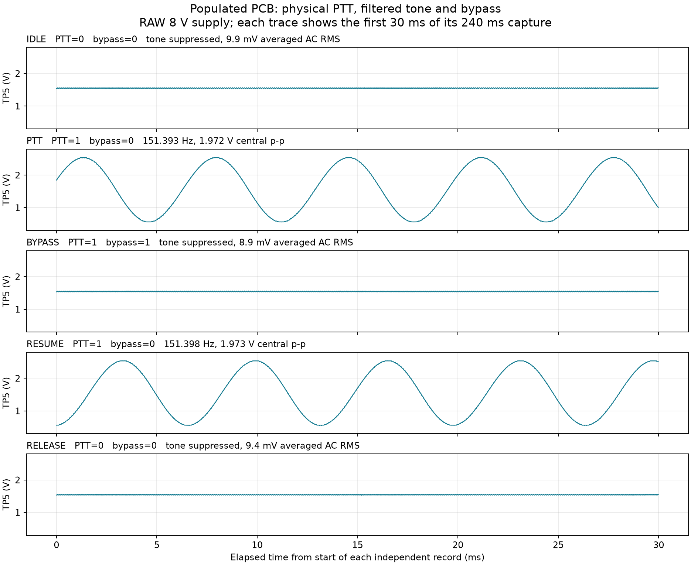
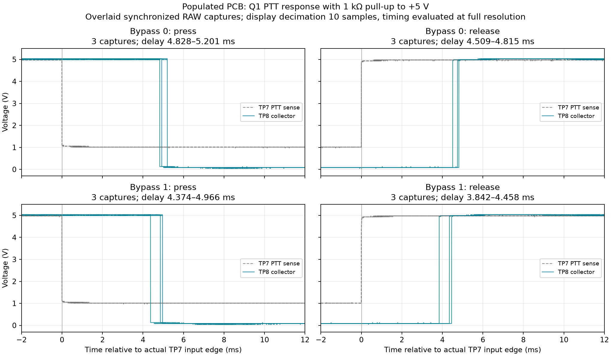
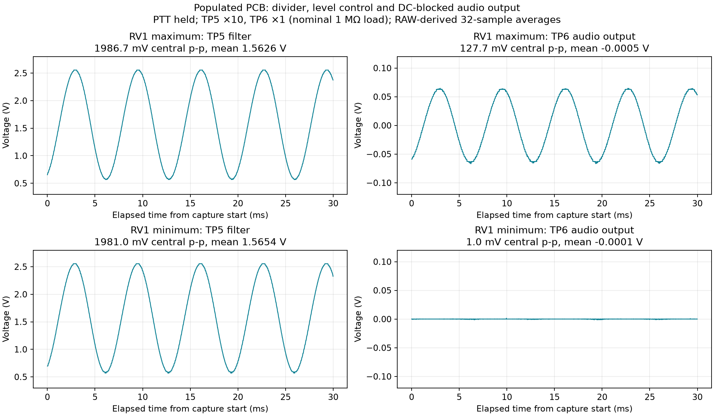

# Populated carrier PCB bench verification

The 14-page illustrated learning guide ([PDF](../../../learning/populated-board-bench-checks-2026-11-16.pdf),
[editable Word](../../../learning/populated-board-bench-checks-2026-11-16.docx))
explains these checks with 13 annotated figures and the limits of each result.

November 16, 2026. **Selected pre-wiring checks complete and passed.**
The populated PCB is ready for staged off-board wiring and integration testing.
This does not establish the final display power budget, radio interface ratings
or RF deviation.

| Block | Current result |
| --- | --- |
| Supply screening | No low-resistance supply shorts observed; RAW 7.9834–7.9839 V; regulated rail approximately 5.000 V |
| Idle PWM | 9,999.77 Hz, duty 50.04–50.08% |
| Filtered tone and bypass | TP5 approximately 151.393–151.398 Hz; tone suppresses/restores with PTT and bypass |
| Q1 collector with 1 kΩ load | LOW approximately 0.084 V; HIGH 5.00–5.02 V; twelve delays 3.84–5.20 ms |
| Final tone output and trimmer | TP6 127.7 mV central p-p at the tested clockwise setting; about 1.05 mV at verified minimum; low mean DC |
| Loaded LED drivers | Both outputs 3.64–3.65 V HIGH with 1 kΩ loads; correct state combinations |
| Physical connector continuity | Operator reports C01–C21 at 0.3 Ω maximum; N01 OL |
| Final bench state | PCB fixtures and power removed; RV1 minimum; supply output OFF; OWON restored to DCV |

The earlier failed/incomplete attempts below are retained with their actual
causes and scope. Two near-zero VCC captures had disconnected meter contacts;
the initial bypass LED load was actually 10 kΩ; the first mixing run needed
scope-setting recovery. None established a PCB defect.

The user reports the PCB fully populated, including a soldered-in Pro Micro,
with no off-board components, test leads or USB cables connected at the start.
Test the module in place; do not use procedures requiring its removal.

**As-built correction and rework:** the user identified TP4 as unpopulated,
paused testing to install it, and subsequently reported TP4 installed.
The PWM probe will use TP4 after the operator confirms the new joint inspection
and restored test connections. That confirmation and the subsequent TP4 tests
are recorded below. The proposed R1 substitute was not used.

## Instrument discovery

| Instrument | Live result | Retained evidence |
| --- | --- | --- |
| OWON XDM1251, COM15 | Firmware V1.0.1.0.4; DCV, autorange, rate S, secondary/relative math off | [Raw status queries](meter-initial-status.json) |
| KORAD KA3005P, COM11 | Output disabled, 0 V / 0 A internal readback; stored 1.00 V / 0.050 A, OCP on | [Status](supply-initial-status.json) |
| Rigol DS1202Z-E | Firmware 00.06.04; USB control responds | [Status](scope-initial-status.json) |
| Pro Micro / NUCLEO | Neither enumerated as a serial device during initial discovery | Not a DUT failure; neither is established as USB-connected |

Discovery used read-only queries. No output enable, meter mode change, firmware
upload, stimulus or PCB measurement occurred. The stored supply settings are
initial state, **not an approved powered-test recipe**. Closing a client does
not disable a supply; require output-off readback before changing connections.

## Bench sequence

Use the [assembly drawing](../../../reference/assembly-top.svg) and
[header locator](../../../images/wiring/board-headers.png) for orientation.
Keep radio, microphone, display, encoder, switch and LEDs disconnected.
Temporary measurement leads and test loads will be connected step by step.

| Stage | Scope | Gate before proceeding |
| --- | --- | --- |
| 1 | With all sources disconnected, measure TP2 and TP3 relative to TP1 in DCV | Establish residual voltage before resistance mode |
| 2 | Unpowered ground/pass-through continuity, rail short screening, PTT separation | Review settled values with module and intentional resistive paths included |
| 3 | Current-limited RAW power only; TP2/TP3, current and heating | Verify regulated supply before functional stimulus; never combine USB and RAW |
| 4 | Idle PWM and analog filter/divider/coupling observations | Capture actual carrier/filter behavior on populated board |
| 5 | Temporary PTT input closure and defined collector test load; bypass/reset | Measure Q1 switching/release and tone behavior before a radio connection |
| 6 | Header pull-ups, LED drive and remaining accessible interfaces | Record coverage and unresolved off-board/load-dependent acceptance |

The NUCLEO can supply controlled open-drain input stimulus after its runtime
identity, wiring, voltage compatibility and released state are established.
The earlier bare-module test fixture is historical evidence; its prior wiring
and readings are not measurements of this populated PCB.

## First connection

Leave USB and all power sources disconnected. OWON black lead in **COM** to
**TP1 GND**, red lead in **V/Ω** to **TP2 +8 V/RAW**. Keep DCV selected.
Wait for the operator to confirm this connection before recording readings.
Then repeat at **TP3 +5 V** before selecting resistance. No rail reading is
accepted without an identified probe connection.

## Measurements

| Check | Connections and conditions | Observed result | Interpretation |
| --- | --- | --- | --- |
| TP2 residual DC voltage | Operator confirmed black COM → TP1, red V/Ω → TP2; USB and all sources disconnected; DCV/autorange/S, math off | Eight polls: +0.0180 to +0.0221 mV | Essentially zero at this measurement scale |
| TP3 residual DC voltage | Operator confirmed black COM → TP1, red V/Ω → TP3; all sources disconnected | Eight polls: +3.8595 → +3.7864 mV | Below selected 50 mV precondition for this PCB's resistance screening |
| TP3 to GND resistance | Same fixed connections; module installed; RES/autorange/S, math off | Initial 90.8 kΩ, then 557 kΩ, settling to about 536 kΩ | No low-resistance short observed at the meter stimulus; not a powered leakage or functional test |
| TP3 after resistance | DCV restored and read back, same fixed connections | Four polls: +0.4616 → +0.4250 V | Meter left charge on the circuit; board remains unpowered |
| TP2 before resistance | Operator reconfirmed black COM → TP1, red V/Ω → TP2; all sources disconnected | Six polls: +2.2668 → +1.9657 mV | Below selected 50 mV resistance-test precondition |
| TP2 to GND resistance | Same fixed connections; module installed; RES/autorange/S, math off | Initially overload, then 634.0 → 748.7 kΩ across remaining polls | No low-resistance short observed; reading still rising, not a settled resistance |
| TP2 after resistance | DCV restored and read back, same fixed connections | Four polls: +0.5945 → +0.4746 V | Charge remains from meter stimulus; all external sources remain disconnected |
| RAW relative to VCC before resistance | Operator confirmed black COM → TP3, red V/Ω → TP2; all sources disconnected | Six polls: −37.06 → −35.82 mV | Below selected ±50 mV precondition |
| RAW to VCC resistance | Same connections, module installed; RES/autorange/S, math off | Initially overload, then 683.2 → 986.4 kΩ | No low-resistance RAW-to-VCC short observed in this polarity; not a regulator/backfeed qualification |
| RAW relative to VCC after resistance | DCV restored and read back, same connections | Four polls: +0.7766 → +0.6279 V | Residual charge from meter stimulus remains |

[TP2 raw queries and readings](tp2-unpowered-dcv.json) retain settings and host
timestamps. Polls are displayed readings, not independently timed conversions.
This is a residual-voltage observation, not a rail-isolation or continuity pass.

[TP3 initial DCV](tp3-unpowered-dcv.json) and
[TP3 resistance plus post-test DCV](tp3-to-ground-resistance.json) preserve raw
queries and meter-mode writes. The last six resistance polls span
536.047–536.272 kΩ. In-circuit semiconductor/capacitor behavior prevents treating
this as a resistor value or a quantified operating-voltage leakage resistance.
The resistance run used the maintained
[measurement helper](../../../../tools/bench/measure-resistance.py).

[TP2 pre-test DCV](tp2-pre-resistance-dcv.json) and
[TP2 resistance/post-test DCV](tp2-to-ground-resistance.json) retain the second
rail screen. Overload is an instrument indication, not a numeric resistance.
Neither rail-to-ground screen proves correct regulator function.

[RAW-to-VCC pre-test DCV](raw-to-vcc-pre-resistance-dcv.json) and
[RAW-to-VCC resistance/post-test DCV](raw-to-vcc-resistance.json) retain the
rail-to-rail screen. The rising, in-circuit result is not a settled insulation
resistance or evidence that USB and RAW may be used together. Continue with only
one source at a time. All three resistance screens completed with DCV restored.

## First RAW-powered test: VCC measurement invalidated by connection correction

The operator confirmed supply + → TP2, supply − and meter black COM → TP1,
meter red V/Ω → TP3, PCB USB disconnected, off-board devices disconnected and
no visible solder bridges/loose strands. **Subsequent operator correction:**
the OWON was not connected to the PCB during that powered attempt. The original
connection confirmation therefore does not establish its VCC probe endpoints.

[First attempt](raw-first-power.json) stopped **before power enable** because
the new wrapper incorrectly expected firmware text in sigrok `--show` output.
The corrected wrapper uses the documented exclusive serial identity query;
it confirmed KA3005P V1.5 before the powered attempt. This was an acquisition
implementation issue, not a PCB test failure.

[Powered attempt](raw-first-power-b.json): supply programmed 8.00 V / 50 mA,
OCP trip disabled to permit CC limiting. Readback after enable was **8.00 V,
36 mA, CV**. After a two-second allowance the first TP3 reading was
**−0.192 mV**, outside the selected 4.75–5.25 V screen. This reading is from the
disconnected meter and **is not a PCB VCC measurement or a PCB power failure**.
The script stopped and
verified supply **output off, 0 V / 0 A**, stored 1.00 V / 50 mA, OCP on.
No additional power was applied automatically. The supply's 8 V / 36 mA
telemetry remains an observation at its terminals. RAW-at-PCB and VCC require
connected-meter measurements. Before the next test, the operator explicitly
confirmed meter red on TP2, black on TP1, supply + on TP2 and − on TP1,
PCB USB disconnected and supply output off.

## RAW measured at the PCB

[Connected-meter RAW test](raw-at-pcb.json) passed the selected input-voltage
screen: eight displayed TP2-to-TP1 readings **7.983436–7.983857 V** at the 8.00 V
supply setting. Supply readback stayed CV, with **36 mA initially and 35 mA
after measurement**. These are asynchronous internal current readings, not a
startup waveform or calibrated load-current measurement. No current limiting
was observed in those status readbacks.

Shutdown verified **output off, 0 V / 0 A**, stored 1.00 V / 50 mA / OCP on.
Post-shutdown TP2 was **2.966 mV**. The VCC measurement is still pending.

## Regulated VCC measured at the PCB

The operator confirmed meter red V/Ω on TP3, black COM on TP1, supply + on
TP2 and − on TP1, supply initially off and PCB USB disconnected.
[Connected-meter VCC test](vcc-at-pcb.json) passed: eight displayed readings
**4.999728–5.000676 V**, with supply readback **8.00 V, CV, 36 mA initially /
35 mA afterward**. This establishes the accessible +5 V rail under the current
populated-board load, without display, encoder, external LEDs or radio. It does
not qualify the final power budget, regulator temperature or supply transients.

Shutdown verified **output off, 0 V / 0 A**, stored 1.00 V / 50 mA / OCP on.
TP3 retained **0.5802 V** at the single post-shutdown poll; that is residual
voltage, not evidence that the supply remained enabled. No resistance/diode
measurement should follow until residual voltage is checked again.

## PWM probe substitute for missing TP4

Read-only Konnect `get_component_pads`, exact board
`electronics/icom-ctcss-board.kicad_pcb`, returned `source=file` for R1:
pad 1 is `/PWM_D9`, rectangular land at (135.00,145.00) mm; pad 2 is
`/FILTER_1`, circular land at (129.92,145.00) mm. The retained
[schematic netlist](../../wiring-guide/schematic.net) independently connects
R1-1, TP4-1 and U1-12 (`PWM_D9_12`) on `/PWM_D9`.

Probe **R1 pad-1 lead**, the square-land end, as the TP4 substitute. With the
component side facing up and J1/J2 along the bottom as in the assembly drawing,
this is R1's **right-hand end**. R1's opposite end is after the first filter
resistor and is unsuitable for measuring the raw PWM waveform. Attach the probe
with supply output off and keep the scope ground at TP1. Use physical ×10.

## Idle PWM after TP4 installation: passed

The operator confirmed the new TP4 joint inspected and CH1 physical ×10 tip
on TP4, scope ground TP1, meter red TP3/black TP1, supply + TP2/− TP1, PCB USB
and all off-board components disconnected, supply initially off.

[Power and capture report](power-with-idle-pwm.json) and
[PWM evaluation](idle-pwm/result.json) pass the selected idle-screen criteria.
The scope collected **1,200,000 RAW samples at 40 ns/sample (48 ms)** in a
completed, real-triggered single acquisition. [Capture scaling](idle-pwm/capture/capture.json)
and [raw BYTE samples](idle-pwm/capture/waveform.u8) are retained.

| Quantity | Observed | Selected screening criterion |
| --- | --- | --- |
| Carrier estimate | 9,999.7657 Hz | 10 kHz ±1% |
| Complete periods | 478 | At least 100 |
| Period range | 100.000–100.040 µs | Every period 98–102 µs |
| Duty range | 50.04–50.08% | Every duty 48–52% |
| LOW / HIGH plateau | 0.1024 / 4.9163 V | −0.3–0.5 / 4–5.5 V |
| ADC clipping | None detected | No raw 0/255 codes |
| VCC before capture | 4.999179–5.000133 V | 4.75–5.25 V |
| VCC after capture | 5.000693 V | 4.75–5.25 V |

The screenshot [scope.bmp](idle-pwm/scope.bmp) was visually inspected. Its
2 ms/div view compresses many cycles; numerical results come from retained RAW
samples, not that display. The screenshot follows capture with acquisition
resumed, so it is illustrative rather than the exact stopped RAW record.
Scope settings/run state were restored and read back. The prior acquisition
buffer was replaced. Absolute timebase accuracy, edge overshoot and modulated
tone frequency are outside this coarse idle test.

Supply remained at 8.00 V, CV, 35–36 mA in status readbacks. Software enable and
disable requests were about 19 seconds apart, not a hardware-timed interval.
Final supply readback: **output off, 0 V / 0 A**, stored 1 V / 50 mA / OCP on.
Post-shutdown TP3 poll: 0.5790 V residual. The seven offline idle-evaluator tests
also passed before the live run, including rejection of wrong frequency, duty,
level, clipping, incomplete and static records. Analog filter, loaded PTT,
headers and off-board integration remain unverified.

## Idle TP5 filter observations

The operator confirmed CH2 physical ×10 tip on TP5, CH2 ground on TP1, CH1
on TP4, meter red TP3/black TP1, RAW supply connections unchanged, PCB USB and
all off-board components disconnected. Each powered run retained the 8 V /
50 mA limit and verified output off afterward. Scope settings were restored.

The nominal ladder calculation uses R1=R2=3.3 kΩ, C1=C2=100 nF, R3=10 kΩ,
R4=1 kΩ and RV1 end-to-end=10 kΩ. The R3-plus-(R4-parallel-RV1) DC load is
10.909 kΩ. Ideal 0–5 V, 50% idle PWM predicts **1.55763 V DC**. The linear
ladder transfer applied to 32 odd square-wave harmonics through 630 kHz,
sampled at 2048 phases, predicts **14.254 mV peak-to-peak**. This is a nominal
calculation, not a physical measurement, tolerance bound or simulation.

| Attempt | CH2 AC scale | Observation | Outcome |
| --- | --- | --- | --- |
| [Initial](idle-filter/result.json), [power/cleanup](power-with-idle-filter.json) | 10 mV/div | DC 1.53646 V; central 1st–99th percentile ripple 23.69 mV; ADC clipping | Incomplete excursion measurement; retained |
| [Wider](idle-filter-wide/result.json), [power/cleanup](power-with-idle-filter-wide.json) | 50 mV/div | DC 1.53664 V; central ripple 22 mV; ADC clipping | Incomplete excursion measurement; retained |
| [Unclipped](idle-filter-100mv/result.json), [power/cleanup](power-with-idle-filter-100mv.json) | 100 mV/div | DC **1.53642 V**; central ripple **24 mV**; AC RMS **7.165 mV**; extrema **−0.268 / +0.288 V** | Coarse DC/central-ripple screen passes; fast-excursion source remains unresolved |

Each DC and AC record contains **600,000 samples at 4 ns/sample (2.4 ms)**,
real-triggered on CH1 PWM, with CH2 20 MHz bandwidth limit. DC and ripple are
**separate acquisitions**. RAW BYTE files and scaling are in each attempt's
`dc/` and `ripple/` directories. Screenshots were visually inspected for the
initial and final attempts; they follow the RAW acquisition with acquisition
resumed. The 100 mV/div raw voltage increment is 4 mV/code, limiting small-ripple
resolution; finer captures retain ripple detail but clip the largest spikes.

Selected screens are DC 1.35–1.75 V, 1st–99th percentile ripple ≤80 mV,
AC RMS ≤20 mV, no ADC clipping and at least ten carrier periods. **The percentile
screen excludes tail excursions by definition; it is not a limit on every spike.**
Brief excursions remain far larger than the nominal ripple. Probe pickup,
grounding and PCB noise have not yet been separated. A grounded-CH2 control is
the next diagnostic; these observations do not qualify radio noise or deviation.

The final run's VCC pre-capture polls were 4.999325–4.999887 V. Supply status
showed 8 V, CV, 35–36 mA. Final readback was output off, 0 V / 0 A, stored
1 V / 50 mA / OCP on; post-shutdown TP3 was 0.5762 V. Offline checks verified
waveform scaling and rejection of incomplete data, and detected synthetic
ADC clipping before the first acquisition.

## Grounded-CH2 control: setup contribution established

The operator confirmed CH2 tip moved from TP5 to TP1 with its ground clip
remaining TP1; CH1 stayed TP4/TP1, meter TP3/TP1, RAW supply unchanged, PCB
USB disconnected. [Control result](grounded-ch2-control/result.json) and
[powered-run/shutdown evidence](power-with-grounded-ch2-control.json) are retained.
This is a noise-control observation, **not another TP5 measurement**.

| CH2 on ground | Mean | AC RMS | 1st–99th percentile span | Full extrema |
| --- | --- | --- | --- | --- |
| DC coupled | −0.409 mV | 4.310 mV | 16 mV | −0.272 / +0.252 V |
| AC coupled | −0.926 mV | 4.414 mV | 16 mV | −0.268 / +0.248 V |

Both 600 kpoint/4 ns records were unclipped; CH2 used 100 mV/div and 20 MHz
bandwidth limit. Scope settings restored. Supply stayed CV at 8 V / 35–36 mA;
final verified state was output off, 0 V / 0 A, stored 1 V / 50 mA / OCP on.
VCC pre-capture was 4.999455–4.999895 V; post-shutdown 0.5758 V residual.

The grounded probe reproduces nearly the same ±0.27 V spikes as the TP5 capture.
**A substantial measurement-setup contribution is established; those extrema
cannot be assigned to TP5 alone.** The exact mechanism (probe pickup, channel
coupling or grounding) is not isolated. No direct peak or RMS subtraction is
used to manufacture a corrected PCB noise result. The TP5 DC and coarse ripple
screen are satisfactory; precise residual ripple and high-frequency noise remain
limited by this setup. This is not final audio/radio-noise acceptance.

## NUCLEO preparation

Operator connected the previously used NUCLEO by ST-LINK USB only, with no
signal wiring to the PCB and PCB supply off. USB enumeration found ST-LINK
VCP **COM5 (0483:374B)**. [Prewire transcript](nucleo-prewire.json) confirms
`STANDIN1 phase=1 board=NUCLEO-F767ZI clock_hz=96000000 tick_hz=1000000`,
then `STOP` and status **armed=0 drive=0 errors=0**. No firmware was flashed.
Unconnected `sense=6` and `latency_valid=0` are excluded from PCB acceptance.

Proposed fixture: CN10-5 GND → TP1; PF12/NUCLEO D8 (CN7-20) → external 1 kΩ
→ J1-5; PF13/NUCLEO D7 (CN10-2) → external 1 kΩ → J5-1. CH1 remains TP4/TP1;
CH2 returns to TP5/TP1; meter remains TP3/TP1. PCB power remains RAW-only.
These NUCLEO outputs use the existing open-drain fixture persona, not a 3.3 V
push-pull HIGH. The PCB supplies R9/R15 pull-ups; no duplicate pull-ups or
power-rail joining is prescribed. Radio and final-product UI remain disconnected.
The operator subsequently confirmed this wiring and CH2 returned to TP5.

The authoritative inventory selected-item records list ten in-stock Vishay
MRS16000C1001FCT00 1 kΩ/1%/0.4 W resistors, sufficient for the two reusable
fixture series resistors. No stock was reserved or decremented. This is a bench
fixture selection, not a fabrication/CAM operation or machine-envelope preflight.

## Physical PTT/bypass to filtered tone: passed

[Sequence evidence](physical-tone-bypass/result.json) and
[power/shutdown evidence](power-with-physical-tone-bypass.json) record five
independent TP5 captures, each **600,000 samples, 400 ns/sample, 240 ms**.
The NUCLEO physically sinks J1-5/J5-1 through the confirmed fixture; no Arduino
USB command or test image was used. Firmware saved-tone expectation was 151.4 Hz
from the prior production-image record; this run did not read or change flash,
EEPROM or USB status. It measures the current installed firmware's physical
response, without re-establishing exact firmware binary identity.

| State | PTT / bypass drive | Analog tone estimate | Central p-p | Averaged AC RMS |
| --- | --- | --- | --- | --- |
| Idle | 0 / 0 | Suppressed | 25.61 mV | 9.90 mV |
| PTT pressed | 1 / 0 | **151.3930 Hz** | **1.9716 V** | **0.7001 V** |
| Bypass while held | 1 / 1 | Suppressed | 24.81 mV | 8.93 mV |
| Bypass removed, still held | 1 / 0 | **151.3979 Hz** | **1.9732 V** | **0.7000 V** |
| PTT released | 0 / 0 | Suppressed | 25.61 mV | 9.42 mV |

Evaluation averages 32 samples (12.8 µs) to reduce switching noise and estimates
frequency from a least-squares line through 36/37 hysteresis-qualified rising
mean crossings. Nominal-timebase limits are expected frequency ±0.2 Hz,
central p-p 1–3 V and averaged RMS 0.3–1 V while active; suppression requires
central p-p ≤0.15 V and averaged RMS ≤0.04 V. All states require mean 1.2–1.9 V,
complete/unclipped records. These are selected assembly screens, not distortion,
deviation, absolute timebase or high-frequency noise specifications. Averaging
and percentile statistics do not bound the previously observed fast spikes.

The figure uses the first 30 ms of each actual RAW record with the documented
32-sample averaging and was visually inspected. The `ptt.bmp` scope screenshot
was captured during screen refresh and is blank; use this RAW-derived figure,
not that screenshot, for the readable waveform evidence. All original samples
and capture preambles remain retained for independent assessment.

NUCLEO `STATUS` keepalive/readback preserved commanded drives during capture.
Final verified NUCLEO state: **armed=0 drive=0**, then parent verified supply
**off, 0 V / 0 A**, stored 1 V / 50 mA / OCP on. Scope settings/run state restored.
VCC before captures: 4.999311–5.000199 V; afterward 5.000376 V. Supply status
before/after showed CV, 8 V, 35–36 mA; these are finite asynchronous readbacks,
not peak-current monitoring. Offline synthetic tests accepted 151.4 Hz,
rejected 100 Hz against that expectation, and distinguished tone from suppression.
This validates the populated J1 PTT-input path, bypass-input path and tone
reconstruction through TP5. Q1's loaded collector and TP6/final mixing path
remain separate checks.

## Loaded Q1 radio-PTT output: passed

The operator confirmed an external **1 kΩ resistor TP3-to-TP8**, CH1 physical
×10 tip TP7 and CH2 physical ×10 tip TP8, grounds TP1; other fixture, meter and
RAW power wiring unchanged, PCB USB disconnected. The test uses an additional
stocked 1 kΩ fixture resistor (three total including the two stimulus resistors).
At nominal 5 V the load dissipates at most 25 mW, calculated, versus the selected
resistor's 0.4 W rating. This is a chosen bench load, not the radio's measured load.

[Twelve-transition report](loaded-ptt/result.json), each transition's raw captures
and [parent power/shutdown record](power-with-loaded-ptt.json) passed. Three
press/release pairs were captured in each bypass state. Each event has **600,000
samples/channel, 200 ns/sample, 120 ms**, from the same real-triggered stopped
acquisition. Both channel time axes and STOP state between transfers were checked.

| Observed quantity across 12 captures | Result | Selected criterion |
| --- | --- | --- |
| TP7 input LOW | 1.01157–1.01161 V | ≤1.5 V with fixture series resistor |
| TP8 collector LOW | **0.083787–0.083872 V** | ≤0.4 V |
| TP8 collector released HIGH | **5.00193–5.02378 V** | 4.5–5.5 V |
| TP7-to-TP8 response delay | **3.8424–5.2008 ms** | 0–25 ms |
| Extra/opposite input or output transitions | None detected in each event window | Exactly one appropriate transition per channel |

Calculated collector sink current is approximately **4.916 mA** using nominal
5 V and 1 kΩ with the measured LOW; it is not an independent current measurement.
The first/last fifth of each record determines plateau means. Delay uses actual
midpoint crossings, with a sampling-only two-edge bound of 0.4 µs, excluding
timebase and probe uncertainties. Figure overlays three captures per condition
with 10-sample display decimation; timing evaluation uses full-resolution RAW.
The generated figure was visually inspected. Six offline tests passed, including
rejection of late response, inadequate sink voltage, axis mismatch, missing
transition and extra pulse.

NUCLEO final readback **armed=0 drive=0**; scope settings/run state restored.
Supply final readback **off, 0 V / 0 A**, stored 1 V / 50 mA / OCP on. VCC
pre-capture was 4.999185–5.000153 V, afterward 4.999746 V; post-shutdown residual
0.56265 V. Supply's pre/post status was 8 V CV, 35–36 mA with PTT released;
these readbacks do not measure keyed peak supply current.

This establishes functional populated-board PTT input/output behavior at the
chosen **5 V / approximately 5 mA collector load**, including bypass forwarding.
It does not establish the actual radio's PTT voltage/current, unpowered external-
pull-up behavior, held-reset acceptance or cold-start transient behavior.

## Final mixing path, RV1 maximum: passed

The operator confirmed the TP3-to-TP8 test load removed, CH1 physical ×10 at
TP5, CH2 physical ×1 at TP6, grounds TP1, RV1 maximum clockwise, other fixture/
meter/RAW wiring unchanged, PCB USB disconnected. The user paused before this
test started and explicitly resumed; no power was enabled during that pause.

The ×1 probe provides a nominal **1 MΩ scope load**, rather than the ×10
probe's nominal 10 MΩ. R5=100 kΩ and C3=1 µF give an approximately **1.1 s**
coupling time constant with that load. The child allowed six seconds after
fixture assertion/setup, in addition to the parent's initial power checks.
This is a selected settling allowance based on nominal parts, not a measured
capacitor-value qualification.

[First attempt](mixing-maximum/result.json) measured valid signals but failed
scope restoration because restoring the old probe factor after scale/offset
rescaled the vertical settings. This is an instrument-control cleanup failure,
not a failed signal path. Fixture release and supply-off were still verified in
[the parent record](power-with-mixing-maximum.json). An explicit
[scope recovery](mixing-scope-recovery.json) restored all original settings with
no mismatches. The corrected child restores probe factors **before** scale and
offset, then the test was repeated.

[Accepted repeat](mixing-maximum-b/result.json) and
[power/cleanup record](power-with-mixing-maximum-b.json) pass. Both channels
contain 600,000 samples at 400 ns/sample (240 ms), from the same real-triggered
stopped acquisition, with matching axes. With PTT held:

| Quantity | TP5, before divider/level/coupling | TP6, final audio net |
| --- | --- | --- |
| Frequency estimate | 151.3974 Hz | **151.3995 Hz** |
| Central 1st–99th percentile p-p | 1.98666 V | **127.7069 mV** |
| Averaged AC RMS | 0.69931 V | **45.3342 mV** |
| Mean DC | 1.56256 V | **−0.4537 mV** |

Measured central-amplitude ratio is **0.06428**. Nominal ratio with the selected
1 MΩ load is approximately 0.0758; this was a coarse functional screen, not a
precision gain/tolerance acceptance. Selected maximum limits are TP6 central
p-p 0.10–0.22 V, RMS 0.02–0.09 V, mean ±30 mV, frequency 151.4 ±0.2 Hz on
nominal scope timebase, and TP6/TP5 ratio 0.05–0.11. Results establish tone
through the divider, RV1, C3 and R5, with low residual DC under this load.
They do not establish exact component values, radio-loaded amplitude or deviation.

Fixture final **armed=0 drive=0**; scope settings/run state restored; supply
final **off, 0 V / 0 A**, stored 1 V / 50 mA / OCP on. VCC pre-capture was
4.999039–4.999972 V. The subsequent minimum-level check is pending.

### Setting RV1's endpoint

The user asked whether to turn until resistance is felt. The specified Bourns
3296W is a multiturn trimmer: the [manufacturer datasheet](https://www.bourns.com/docs/Product-Datasheets/3296.pdf)
states **25 turns nominal effective travel** and **wiper idles at the end**.
It does not provide a firm rotational stop to seek by increasing torque.
With power off, use gentle screwdriver pressure and approximately **30 full
counterclockwise turns** to set minimum from an unknown position, then stop.
Thirty is a selected bench allowance beyond nominal travel, not a manufacturer
specified adjustment count. Stop if it binds; do not force it. Electrical
measurement, rather than torque feel, will verify the minimum. Keep all probe
connections and the supply-off state unchanged while adjusting.

## RV1 minimum and final audio path: passed

The operator reported completion of the gentle counterclockwise adjustment,
with wiring unchanged. [Minimum result](mixing-minimum/result.json) and
[power/cleanup record](power-with-mixing-minimum.json) passed. PTT remained held,
and TP5 still carried the tone; TP6 fell to **1.0479 mV central p-p**, **0.1767 mV
averaged AC RMS** and **−0.0578 mV mean DC**. TP6/TP5 central-amplitude ratio
was 0.000529. This is the residual under the stated bandwidth, averaging, scope
load and sampling conditions, not an independently calibrated tone/noise floor.

The figure was generated from both accepted runs' RAW samples and exact
preambles, using the documented 32-sample averaging, and visually inspected.
It shows the first 30 ms of separate 240 ms records; the two channels within
each run share the same acquisition. The earlier clockwise setting provided
127.7 mV central p-p, and the verified counterclockwise minimum reduces it to
about 1.05 mV while the filter remains active.

Scope settings/run state restored, fixture final **armed=0 drive=0** and supply
final **off, 0 V / 0 A**, stored 1 V / 50 mA / OCP on. VCC pre-capture was
4.999588–5.000188 V. **RV1 is left at minimum.** Exact radio-loaded amplitude,
microphone audio quality and required RF deviation remain radio-stage checks.

## Loaded J6 LED-driver screening: bypass-load discrepancy under investigation

Operator confirmed nominal 1 kΩ loads across J6-1/2 and J6-3/4, CH1 physical
×10 J6-1 and CH2 physical ×10 J6-3, grounds TP1, other fixture/power/meter
wiring unchanged and RV1 minimum. The selected nominal HIGH is
5 V × 1000/(1000+330) = 3.759 V. Screening range is 3.2–4.3 V HIGH,
−0.3–0.4 V LOW, under these temporary resistive loads.

[First loaded-driver result](loaded-leds/result.json) and
[parent power/shutdown evidence](power-with-loaded-leds.json) retain the run.
Static levels were captured with an explicitly **forced** trigger, not an
edge-timing measurement. Idle outputs were near ground; with PTT only,
J6-1 measured **3.6477 V** and J6-3 **−1.28 mV**. With PTT and bypass both
asserted, J6-1 was **3.6497 V** but J6-3 was **4.7782 V**, outside the HIGH
range for the intended 1 kΩ load. The sequence stopped before remaining states.
Scope settings were restored, NUCLEO **armed=0 drive=0**, supply **off,
0 V / 0 A**, stored 1 V / 50 mA / OCP on.

This does not yet identify a PCB defect. The temporary resistor's actual value/
contact, its J6-4 ground return and the onboard R7 path remain candidates.
Next diagnostic: isolate and measure the temporary J6-3/4 resistor, with the
PCB still unpowered. No threshold was relaxed and no failing record discarded.

Before the powered run, three offline power-wrapper tests verified normal,
bad-VCC and capture-timeout shutdown behavior; synthetic LED-level checks
accepted the intended loaded levels and rejected an excessive asserted level
and an asserted level interpreted as LOW. The wrapper dispatch was consolidated
internally without changing its existing command-line options or power limits.

### Temporary bypass-load value identified

Operator isolated the resistor that had been across J6-3/4 and connected it only
between the OWON COM and V/Ω leads. [Resistance evidence](bypass-led-test-resistor.json)
contains twelve readings **9,938.846–9,939.395 Ω**: approximately **9.939 kΩ**,
consistent with a nominal **10 kΩ**, rather than the intended 1 kΩ. DCV was
restored and verified; post-test residual voltage was within about ±3 µV.

This explains the excessive voltage relative to the **1 kΩ-load** criterion:
a 10 kΩ load with the 330 Ω onboard resistor should sit much closer to the
GPIO HIGH. The original failed screen remains a fixture-value discrepancy,
not evidence of a PCB fault. Repeat with a separately verified 1 kΩ load before
claiming the loaded bypass-driver check passed. The measured resistor's maker
and tolerance are not established by its resistance alone.

The operator then connected an isolated replacement nominal 1 kΩ resistor.
[Replacement measurement](bypass-led-replacement-resistor.json) completed twelve
polls **1,000.352–1,000.431 Ω**, confirming an appropriate load value for the
selected screen. DCV restoration was verified; residual was within about ±3 µV.
The loaded-J6 repeat awaits installation of this resistor at J6-3/4 and return
of the DMM to TP3/TP1. The original ~10 kΩ test resistor is excluded from that setup.

### Repeat stopped before LED stimulus on near-zero rail reading

Operator confirmed replacement at J6-3/4 and DMM restored TP3/TP1.
[Repeat power record](power-with-loaded-leds-b.json) stopped at the initial
VCC check: first reading **−0.297 mV**, while source read **8 V, 36 mA, CV**.
No LED child capture was started. Supply final readback was **off, 0 V / 0 A**,
stored 1 V / 50 mA / OCP on. Fixture was not re-armed by this attempt.
Probe seating/contact is the first diagnostic because the DMM had just been
moved from the isolated resistor. The cause is not yet established; do not
count this as a completed LED repeat or assume a new PCB defect.

The operator subsequently identified a meter lead as disconnected/not touching.
The near-zero reading is therefore invalidated as a PCB VCC measurement. The
next bounded repeat uses the corrected contact and fresh evidence paths.

## Loaded J6 repeat with verified bypass resistor: passed

[Accepted five-state repeat](loaded-leds-c/result.json) and
[parent power/cleanup evidence](power-with-loaded-leds-c.json) pass with the
verified approximately 1.0004 kΩ replacement at J6-3/4. The J6-1/2 nominal
1 kΩ load remained in place; the operator confirmed DMM TP3/TP1 and corrected
the disconnected contact. CH1/CH2 physical probes remained ×10 at J6-1/J6-3,
grounds TP1, other fixture/power wiring unchanged, RV1 minimum.

| Commanded state | PTT LED J6-1 mean | Bypass LED J6-3 mean |
| --- | --- | --- |
| Idle | −0.001 mV | −18.36 mV |
| PTT only | **3.6467 V** | −0.67 mV |
| PTT + bypass | **3.6357 V** | **3.6461 V** |
| Bypass only | −0.001 mV | **3.6465 V** |
| Released | −0.004 mV | −11.39 mV |

All means satisfy the unchanged selected loaded-HIGH/LOW criteria. The values
imply approximately 3.64 mA per asserted nominal 1 kΩ load, calculated from
voltage, not independently measured. Both J6 ground-return contacts and loaded
driver/series-resistor paths were exercised. Exact onboard resistor tolerances,
actual LED forward voltage/brightness and cable polarity remain separate.

Each static state uses an explicitly forced stopped acquisition, 60 kpoints
per channel, with RAW samples/preambles retained. No timing or transition-latency
claim is made from these static captures. Source final readback **off, 0 V /
0 A**, stored 1 V / 50 mA / OCP on; fixture **armed=0 drive=0**; scope settings
and run state restored. Floating fixture `sense=7` is excluded, as these sense
inputs were never wired. VCC pre-capture: 4.998871–5.000357 V. Post-shutdown
residual: 0.5785 V. All powered functional screens are complete; unpowered
connector continuity checks are the next step.

## Final unpowered connector checklist

Operator confirmed removal of supply leads, scope, temporary loads and every
NUCLEO wire from the PCB, leaving only OWON TP3/TP1 and RV1 minimum. The
[final unpowered DCV capture](final-unpowered-vcc.json) measured TP3
**7.7346–7.7621 mV**. No other source or PCB USB is connected.

Before this checklist, short the probe tips together **off the PCB** for the
agent-controlled lead check and resistance-mode preparation. Once prepared,
the meter intentionally remains in **RES/autorange/S**, math off, for these
human-paced readings. Keep **all PCB power sources disconnected throughout**.
Check connector pin numbers against the
[component-side header locator](../../../images/wiring/board-headers.png).
Pro Micro names below mean the printed **Arduino pin labels**, not KiCad
symbol-pad numbers; `D4` is the module pin marked `4`, for example.

For each row, put one probe at each endpoint, allow autoranging to settle and
record a steady reading. **C01–C21 should each be below 2 Ω**, including the
checked lead/contact contribution. This is a selected gross continuity screen,
not a milliohm/contact-resistance qualification. OL/high resistance in those
rows is an open/poor-contact finding to investigate, not a pass. Do not use a
continuity beep alone as the numerical result.

| ID | One endpoint | Other endpoint | Intended connection |
| --- | --- | --- | --- |
| C01 | TP1 | J1 pin 6 | Microphone PTT ground |
| C02 | TP1 | J1 pin 7 | Microphone shield ground |
| C03 | TP1 | J2 pin 6 | Radio PTT ground |
| C04 | TP1 | J2 pin 7 | Radio shield ground |
| C05 | J1 pin 1 | J2 pin 1 | Direct microphone audio pass-through |
| C06 | J1 pin 2 | J2 pin 2 | Direct +8 V pass-through |
| C07 | J1 pin 3 | J2 pin 3 | Up/down pass-through |
| C08 | J1 pin 4 | J2 pin 4 | Pin-4 pass-through |
| C09 | J1 pin 8 | J2 pin 8 | Pin-8 pass-through |
| C10 | TP2 | J2 pin 2 | RAW power branch |
| C11 | TP6 | J2 pin 1 | Measured tone reaches audio header |
| C12 | TP8 | J2 pin 5 | Measured Q1 collector reaches radio header |
| C13 | TP1 | J4 pin 1 | Display ground |
| C14 | TP3 | J4 pin 2 | Display +5 V |
| C15 | TP1 | J3 pin 5 | Encoder ground |
| C16 | TP3 | J3 pin 4 | Encoder-header +5 V (unused in final bare-EC11 cable) |
| C17 | J3 pin 1 | Pro Micro D4 | Encoder A/CLK trace |
| C18 | J3 pin 2 | Pro Micro D5 | Encoder B/DT trace |
| C19 | J3 pin 3 | Pro Micro D6 | Encoder push-button trace |
| C20 | J4 pin 3 | Pro Micro D2/SDA | Display SDA trace |
| C21 | J4 pin 4 | Pro Micro D3/SCL | Display SCL trace |
| N01 | J1 pin 5 | J2 pin 5 | **Must not be a direct pass-through**; report actual settled value or OL |

For N01, the selected gross separation screen is **greater than 1 kΩ or OL**.
Populated semiconductor/resistor paths can produce finite readings; it is not
an insulation-resistance test. A low-ohm reading here would bypass PTT interception.
If a module label/contact is inaccessible or unclear, record that row unmeasured
rather than guessing. Header points remain accessible independent checks.

The intended C-row endpoint nets were checked against the current retained
Eeschema export; N01 spans `/MIC_PTT_SWITCH` and `/RADIO_PTT`. That CAD check
does not establish physical continuity. **Operator readings are pending** and
will be distinguished from USB-retained instrument captures.

After reporting the readings, leave the PCB unpowered and the probe tips off
the board. The agent will restore and verify DCV mode before any powered use.

### Meter lead preparation completed

Operator confirmed both probes shorted together off-PCB and PCB disconnected
from every source, RV1 minimum. [Preparation record](connector-meter-preparation.json)
verified OWON identity and initial DCV, then selected RES/autorange/rate S,
secondary/relative math off. Eight shorted-tip readings were
**0.16254–0.16581 Ω**. The meter was intentionally left in resistance mode
for the human-paced checklist, with port closed; this is a documented handoff,
not a claim that closing the port stopped its resistance-test stimulus.
No physical connector results have been accepted yet. After the operator's
readings, run and verify the separate `finish` action before powered use.

### Connector results and bench closure

The operator completed the checklist and reported **all C01–C21 at 0.3 Ω or
less**, with **N01 OL**. No exceptions or skipped rows were reported. This is
[operator-reported evidence](connector-operator-results.json), not 21 separate
USB acquisitions; individual per-row values were not collected. All selected
continuity and PTT-separation criteria pass. The readings include lead/contact
resistance and do not establish exact copper resistance or insulation ratings.

[Meter finish readback](connector-meter-finished.json) verifies **DCV,
autorange, rate S, secondary/relative math off**. A fresh
[supply status](supply-final-status.json) verifies **output off, 0 V / 0 A**,
stored 1 V / 50 mA / OCP on. NUCLEO outputs were last verified **armed=0 drive=0**
before operator removal of its PCB wires. The PCB remains disconnected from
external power and fixtures, with **RV1 minimum**. No firmware was written in
this campaign; exact installed binary identity was not reread.

The pre-wiring milestone is complete. Next: use the final-product wiring guide
for controls/display/LEDs, add loads with power off and recheck supply/current/
temperature under the complete intended UI load. The actual EC11, display
traffic/brightness, adapter mapping, radio PTT voltage/current and available
microphone-port current, RF deviation and audio quality remain integration
acceptance. Loaded reset/watchdog, startup transients and traceable calibration
were not exercised in this campaign.

Later measured outcomes, settings, load values, source/firmware identity and raw
captures belong here. CAD agreement, instrument communication and earlier bare-
module tests do not establish solder quality, loaded PTT behavior, analog tone
performance, radio deviation or the final display power budget.
