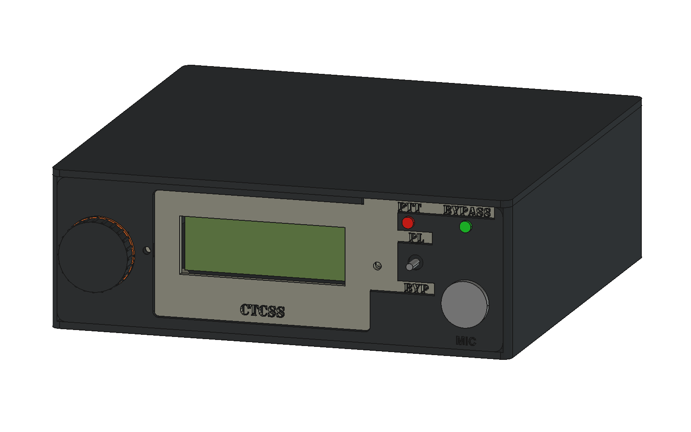

# P1 enclosure print build

The [PCB jig workflow](../../docs/implementation/pcb-jig-and-freecad-cam.md) adds separate registration holes while preserving the board outline and all four enclosure mounts. This print project retains its recorded P1 revision; it is not PCB machining evidence.

The primary output is **[p1-enclosure.3mf](p1-enclosure.3mf)**: one project containing all three prepared plates, shared settings and sliced toolpaths.



```text
enclosure/
├── README.md
├── p1-enclosure.3mf
└── supporting/
    ├── stl/
    └── step/
```

## Print workflow

Open the 3MF **as a project in Bambu Studio**. Keep its placements, millimeter scale and orientations. The profile is Bambu X1 Carbon, 0.4 mm nozzle, Generic PETG, Textured PEI Plate; all objects use filament slot 1 and share global process settings.

| Plate | Contents | Slicer estimate |
| --- | --- | --- |
| [1 — 01-fascia-and-fit-coupons](../../docs/verification/enclosure-p1/print-plate-1.png) | Fascia, LCD surround, knob/band, LED keeper; four coupons; fit washer and harness bridge | 2 h 38 min; 71.9 g |
| [2 — 02-base-and-retainers](../../docs/verification/enclosure-p1/print-plate-2.png) | Base, two harness bridges and four PCB washers | 5 h 52 min; 255.7 g |
| [3 — 03-cover](../../docs/verification/enclosure-p1/print-plate-3.png) | Cover, exterior face down | 3 h 59 min; 133.8 g |

The complete project estimate is **12 h 29 min, 461.5 g**. Plate 1 includes the reusable front assembly, so those parts are used in the enclosure; its extra washer and bridge are fit copies.

1. Choose filament and adjust settings **globally**, then re-slice all plates.
2. Print plate 1 and use its shaft, GX16, control and mounting coupons plus the full fascia/surround/keeper to establish the fits. The shaft coupon bores are 6.0, 6.2 and 6.4 mm, left to right.
3. Print plates 2 and 3 with the same global settings. A material/fit-sensitive setting change starts again with plate 1 inside this same project.

Three plates are the minimum practical arrangement for these orientations and brim reservations: base and cover each occupy 210 × 205 mm, so each needs its own plate. The fascia's 204 × 72 mm brim footprint cannot occupy their remaining strips. It shares plate 1 with the other front parts and fit pieces. A 5 mm brim reservation, 10 mm planning margins and the X1's front-left excluded region are checked in the saved arrangement.

For the illustrated colors, print the shell/knob dark, surround warm grey and band amber. These are separate objects. Use “print selected objects” for a contrasting piece with the desired PETG loaded; keep process settings global and use the plate-1 fits for that filament. A single-color build uses the prepared plates directly. Multicolor hardware is not required.

## Settings and orientation

PETG; 0.2 mm layers; 0.45 mm line widths; five walls; six top/bottom layers; 20% gyroid; 5 mm outer brims; supports disabled. Keep the exported bed face at Z=0. Remove brim and strings from mating edges, nut entries and bores. Tighten metal hardware snugly without crushing plastic or the PCB.

Base: exterior floor down. Cover: exterior top down, columns upward. Fascia/LCD surround/knob/band: front faces down. LED keeper: rear bridge face down, stems upward. Washers, harness bridges and coupons: flat. The base's rear bore has a sloped roof/gusset, the display ears grow on ramps, and small captive-nut ceilings bridge 5.2–5.7 mm. The knob's clamp loads lie in its printed face plane. Load-direction detail is in the [design notes](../../docs/implementation/enclosure-p1.md).

[Slice evidence and saved-layout checks](../../docs/verification/enclosure-p1/multi-plate-checks.json) accompany layer sheets for [plate 1](../../docs/verification/enclosure-p1/slice-01-fascia-and-fit-coupons.png), [plate 2](../../docs/verification/enclosure-p1/slice-02-base-and-retainers.png) and [plate 3](../../docs/verification/enclosure-p1/slice-03-cover.png).

## Supporting assets

The [FreeCAD model](../../mechanical/enclosure/icom-ctcss-enclosure.FCStd) is the editable assembly source. [STEP](supporting/step/p1-enclosure-assembly.step) supports CAD interchange. Individual [STLs](supporting/stl/) support other slicers and part reuse; every file is a closed print-oriented part in millimeters. The 3MF embeds its meshes and settings.

| Mesh | Assembly quantity | Print dimensions, mm |
| --- | ---: | --- |
| [p1-base.stl](supporting/stl/p1-base.stl) | 1 | 200 × 195 × 65 |
| [p1-cover.stl](supporting/stl/p1-cover.stl) | 1 | 200 × 195 × 65 |
| [p1-fascia.stl](supporting/stl/p1-fascia.stl) | 1 | 194 × 62 × 13 |
| [p1-displayinsert.stl](supporting/stl/p1-displayinsert.stl) | 1 | 155 × 56.8 × 11.8 |
| [p1-ledkeeper.stl](supporting/stl/p1-ledkeeper.stl) | 1 | 44 × 12 × 7.7 |
| [p1-pcbwasher.stl](supporting/stl/p1-pcbwasher.stl) | 4 | 7.8 × 7.8 × 1 |
| [p1-wirekeeper.stl](supporting/stl/p1-wirekeeper.stl) | 2 | 30 × 8 × 3 |
| [p1-encoderknob.stl](supporting/stl/p1-encoderknob.stl) | 1 | 30.9 × 30.9 × 15.5 |
| [p1-knobaccentring.stl](supporting/stl/p1-knobaccentring.stl) | 1 | 31.19 × 31.18 × 1.6 |
| [p1-mountcoupon.stl](supporting/stl/p1-mountcoupon.stl) | Coupon | 30 × 22 × 9.35 |
| [p1-controlcoupon.stl](supporting/stl/p1-controlcoupon.stl) | Coupon | 72 × 30 × 4 |
| [p1-gxcoupon.stl](supporting/stl/p1-gxcoupon.stl) | Coupon | 34 × 34 × 7 |
| [p1-shaftcoupon.stl](supporting/stl/p1-shaftcoupon.stl) | Coupon | 44 × 20 × 6 |

## Mechanical bill of materials

Printed supports, washers, harness bridges, knob and retention parts are included above. Electronic UI parts and the two owned GX16-8 adapters follow the [component selections](../../docs/implementation/component-sourcing-review.md). Retain the supplied bushing nuts/washers for the GX16, encoder and toggle. Every purchased mechanical item's print-versus-buy justification is recorded in the [decision register](../../docs/requirements/enclosure-decision-register.md).

| Purchased item | Quantity | Use |
| --- | ---: | --- |
| M3 × 8 socket-head screw, nominal head 5.5 diameter × 3 high | 13 | PCB4, fascia2, front cover2, LED keeper1, harness bridges4 |
| M3 × 10 socket-head screw | 2 | Rear cover tabs |
| M3 × 12 socket-head screw | 2 | LCD surround to fascia |
| M3 × 16 socket-head screw, nominal head 5.5 diameter × 3 high | 1 | Split knob clamp |
| M3 hex nut, nominal 5.5 across flats × 2.4 thick | 18 | Captive joints above |
| M2.5 × 6 screw | 4 | LCD to printed surround posts |
| M2.5 hex nut, nominal 5 across flats × 2 thick | 4 | LCD posts |
| Compliant nonslip foot, 12 diameter × 3 high | 4 | Underside at (15,24), (185,24), (15,180), (185,180) |
| Heat-shrink insulation | As needed | LED, switch and connector terminations |

## Assembly and service

1. Clear brim/strings and load captive nuts before electronics obstruct access. Base post nuts enter from the sides. The cover's long-column nuts load from the inward side; its rear-tab nuts load from the front. Keep nut and screw seats free of debris.
2. Fit the four feet clear of underside screw access. Insert the rear RADIO GX16, seat its nut in the internal cradle, and tighten without twisting terminations. Insulate and connect its 200 mm harness.
3. Place the PCB on the four integrated supports and retain with the four printed washers and M3 × 8 screws. Keep leads/solder clear of the floor. Fit the two printed harness bridges using four M3 × 8 screws, leaving a route for the wiring.
4. Load the fascia's display, bottom-ear and LED-key nuts. Fit the encoder between its side guides and the toggle to its thin land, using their bushing nuts. Align the actual switch contacts with PL/BYP. Insert the front MIC GX16, seat its nut and attach the insulated 260 mm microphone harness.
5. Install the two LEDs from inside into their flange seats, red PTT and green BYPASS. Feed insulated leads through the keeper stems. Fit the bridge over its keyed boss and secure with one M3 × 8 screw.
6. Load the LCD-post nuts from the sides. Fit the LCD/backpack to the surround with four M2.5 × 6 screws. Fit the surround into the fascia recess and fasten its two ramp-supported ears from behind using M3 × 12 screws. Keep the display glass clear of the opening.
7. Fit the accent C-band into the knob groove. Place the M3 nut in the clamp's underside seat, insert the knob over the shaft and tighten its tangential M3 × 16 screw. Leave the knob clear of the panel throughout encoder push travel.
8. Seat the fascia between the side walls and secure it from underneath with two M3 × 8 screws. Connect J3–J6 according to the electrical instructions. Use 200 mm UI harnesses with service loops, 15 mm bends and 5 mm seam/screw clearance. Route audio/shield conductors together and separately from switching wiring; restrain them with the printed bridges.
9. Set RV1 with the top removed and required test connections attached. Fit the cover's locating rails, lower its columns clear of wiring, then install two underside M3 × 8 and two rear M3 × 10 screws.

For service, disconnect radio power and remove the four cover screws; lift the cover vertically. The UI stays on the fascia. To remove that panel, disconnect its headers, release harness clamps as needed, then remove its two underside screws. Flash the Pro Micro before assembly; for reflashing use internal USB with the cover removed, or extract the socketed module. Disconnect RAW/radio power before USB and disconnect USB before restoring radio power. Keep prototype results in the decision register.
