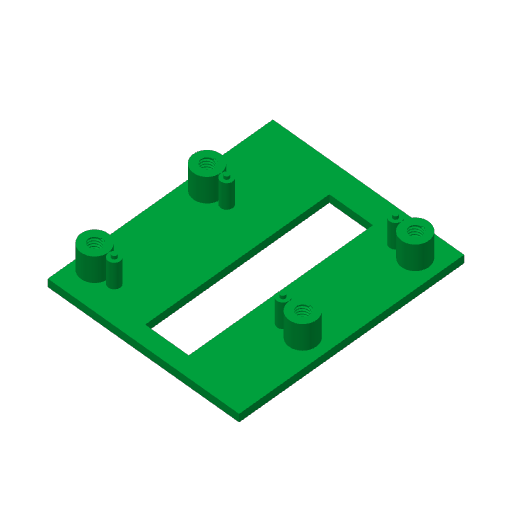
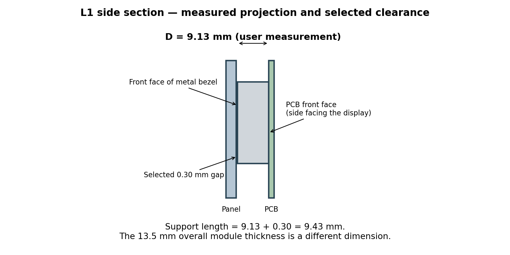

# L1 screen-only retest — reuse the B2 thumb screws

Open **[lcd-fit-l1.3mf](lcd-fit-l1.3mf)** as a Bambu Studio project. Print its
single plate, **01 - RETEST - L1 LCD - reuse four B2 thumb screws**. This avoids
reprinting unrelated fit pieces or a full panel after the original coupon failed.
Estimated **1 h 20 min / 14.7 g PLA**. L1 has not yet been physically accepted.

*Native Bambu preview: front face on the bed, four corrected seats/pins and
coarse-thread bosses pointing up. The supplied file contains this coupon only.*

| Sequence | File / setup | Holding | Acceptance before proceeding |
| --- | --- | --- | --- |
| 1. Print | Linked one-object 3MF | Front face down; posts up; saved 3 mm brim | Cool flat and inspect the four seats/pins/bosses |
| 2. Fit | Grove V4 display, four existing B2 printed screws | Coupon front down on clean soft support | All four ears lie flat on their seats without forcing pins |
| 3. View | Same fitted coupon | Turn over while supporting the module | Complete characters visible, window centered and bezel free of panel pressure |
| 4. Connect | Grove plug and cable | Support the socket while plugging in | Plug and cable clear supports and can be removed |
| 5. Record | Physical result in `docs/` | Retain accepted coupon | Only then print a full panel or qualify C1's M3 clamp coupon |

Use the existing PLA/X1 Carbon 0.4 mm setup: **0.12 mm layers, 0.20 mm first
layer, 0.42 mm nominal line width, four walls, five top/bottom layers, 30%
gyroid, supports off, 3 mm outer brim, textured PEI**. Generic PLA profile
temperatures are 220 °C nozzle / 55 °C bed. These are selected process settings,
not a physical L1 result. This project matches B2's process; C1 retains its
own matching 0.20 mm LCD test coupon in its primary project.

Have the Grove V4 module, four undamaged B2 custom thumb screws, PLA, flush
cutters/plastic deburring tool and a soft support. No purchased fasteners or
inserts are needed for this B2 retest. If the thumb screws have not already been
accepted in their trial sockets, use the full [B2 first plate](../bench-panel-b2/README.md)
to qualify them first. They are custom 5 mm × 1 mm printed threads, not M5.

1. Let the coupon cool fully, release it without levering on the supports and
   remove brim/strings. Do not drill the pins or the display's mounting holes.
2. Lay it **front down, posts up**. Lower the display glass toward the window.
   The Grove socket is at lower left when viewed from the front; a rear view
   mirrors X once. Use the [front/rear diagram](../../docs/images/lcd-fit/corrected-front-and-rear.png).
3. Four selected ear holes sit over 1.8 mm pins. Their centers are 40 mm apart
   in both row spacing and same-row pitch. The unused two side ears remain free.
   All four ears must contact their seats simultaneously, with the PCB flat.
   **Stop if any pin misses or an ear must be bent.**
4. Turn the four existing printed thumb screws into the adjacent bosses by
   fingers. Their head rims overlap the ears, with screw axes outside the PCB.
   Tighten only until the module is retained; keep pressure off the glass,
   bezel, components and Grove socket. Clean strings before retrying a binding
   screw; do not force it with tools.
5. Turn over while supporting the assembly. The corrected **65.5 × 15.5 mm**
   opening is **2.45 mm higher** than the failed design relative to the board.
   The supports are **9.43 mm**, based on the user's **9.13 mm** PCB-front-to-bezel
   measurement plus a selected **0.30 mm gap**. Check centering, character-area
   visibility at the intended viewing angle, no rocking and no bezel contact.
6. Support the Grove socket, fit the plug and check cable access. Unplug before
   removing the display. Clean the coupon and record fit/view/retention results.
   If any check fails, retain the part and report the specific mismatch; do not
   use screw torque or filing the LCD to make it fit.

The [L1 correction record](../../docs/lcd-fit-correction.md) explains the failed
radius interpretation and window datum. Editable sources and full print projects
remain in [B2](../bench-panel-b2/README.md) and [C1](../enclosure-c1/README.md).
The [quick-project checks](../../docs/verification/lcd-fit/quick-slicer-checks.json)
record source mesh identity and native project/slice readback. Rebuild with
`python tools/prepare-lcd-fit.py` after B2's native builder and primary project.
